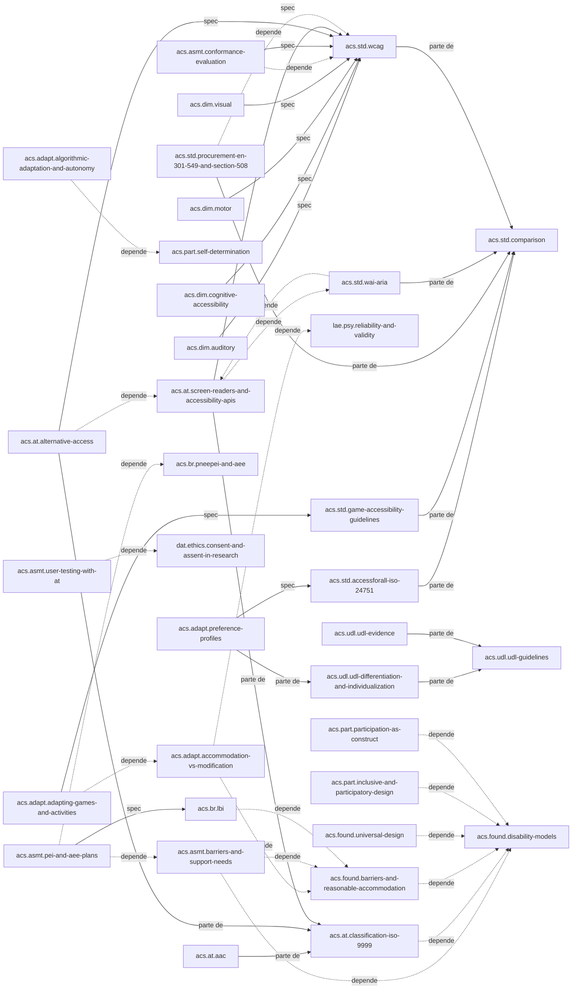

# Mapa de conceitos: acessibilidade, educação especial e DUA

## Visão geral das dependências

O domínio tem um centro conceitual. `acs.found.disability-models` é o alvo de `depende-de` mais frequente: barreira e adaptação razoável, desenho universal, tecnologia assistiva, desenho inclusivo, participação e avaliação de barreiras dependem dele para a ideia de deficiência como interação entre pessoa e ambiente. `acs.found.barriers-and-reasonable-accommodation` é o segundo apoio: a LBI, a acomodação x modificação e a avaliação de barreiras dependem dele.

Três cadeias saem desse centro. A primeira é a **técnica**: `acs.std.wcag` é o piso de que dependem a EN 301 549 e a Section 508 e a avaliação de conformidade; ele especifica as dimensões visual, auditiva, cognitiva e motora e os requisitos de tempo e rótulo do acesso alternativo. As cinco normas são partes de `acs.std.comparison`.

A segunda é a da **tecnologia assistiva**: leitores de tela, acesso alternativo e CAA são partes de `acs.at.classification-iso-9999`. O acesso alternativo depende da mesma árvore de acessibilidade que os leitores de tela.

A terceira é a da **adaptação**: `acs.adapt.adapting-games-and-activities` é especificada pelas diretrizes de jogos e depende de `acs.adapt.accommodation-vs-modification`, que dá o critério do construto; os perfis de preferência são especificados pela ISO/IEC 24751; a adaptação algorítmica depende de `acs.part.self-determination`.

No **DUA**, `acs.udl.udl-guidelines` é o todo; a evidência e a comparação com diferenciação são partes. No **marco brasileiro**, a LBI depende do conceito de barreira e complementa eMAG, AEE e Libras; o PEI e o plano de AEE dependem de `acs.br.pneepei-and-aee` e de `acs.asmt.barriers-and-support-needs`, e são especificados pela LBI.

As relações para outros domínios marcam fronteiras, não lacunas: `ped.*` para o uso em sala e a evidência pedagógica; `iop.health.cif` para a CIF como código; `adp.*` e `gam.*` para modelos de aluno, sistemas adaptativos e dificuldade dinâmica; `lae.psy.*` para validade e equidade de medidas; `psg.*` para dado sensível, assentimento e transparência; `dat.*` para ética de pesquisa e lei de Fitts.

## Como ler o mapa

A seção "Gerado" abaixo é a saída de `python conhecimento/_modelo/gerar_mapa.py acessibilidade-educacao-especial-e-dua`, colada sem edição. Ela tem três partes: a tabela de documentos do domínio; a contagem e a lista completa das relações tipadas declaradas nos frontmatters; e um diagrama Mermaid só com as relações estruturais (`depende-de`, `parte-de`, `alternativa-a`, `especificado-por`). As relações `complementa`, `relacionado-a` e `avaliado-por`, a maioria, ficam fora do diagrama para mantê-lo legível. Alvos marcados "(outro domínio)" existem em outros domínios; a validação da base inteira, via `_modelo/validar.py` sem argumento, confirma que todos resolvem. A tabela de documentos inclui os próprios arquivos de índice, porque a geração foi feita depois deles.

No diagrama, seta tracejada (`-.->`) é `depende-de`; seta cheia rotulada "parte de" é `parte-de`; "spec" é `especificado-por`. Há um ciclo de `depende-de` entre `acs.std.wai-aria` e `acs.at.screen-readers-and-accessibility-apis`, registrado como inconsistência no relatório.

## Gerado

### Documentos

| Id | Tipo | Arquivo | Título |
|---|---|---|---|
| `acs.adapt.accommodation-vs-modification` | conceito | [adaptation/accommodation-vs-modification.md](adaptation/accommodation-vs-modification.md) | Acomodação x modificação |
| `acs.adapt.adapting-games-and-activities` | tecnica | [adaptation/adapting-games-and-activities.md](adaptation/adapting-games-and-activities.md) | Adaptação de jogos e atividades lúdicas |
| `acs.adapt.algorithmic-adaptation-and-autonomy` | conceito | [adaptation/algorithmic-adaptation-and-autonomy.md](adaptation/algorithmic-adaptation-and-autonomy.md) | Adaptação algorítmica e autonomia |
| `acs.adapt.preference-profiles` | conceito | [adaptation/preference-profiles.md](adaptation/preference-profiles.md) | Perfis de preferência e personalização por preferência declarada |
| `acs.asmt.barriers-and-support-needs` | conceito | [assessment/barriers-and-support-needs.md](assessment/barriers-and-support-needs.md) | Avaliação de barreiras e de necessidades de suporte |
| `acs.asmt.conformance-evaluation` | tecnica | [assessment/conformance-evaluation.md](assessment/conformance-evaluation.md) | Avaliação de conformidade de acessibilidade |
| `acs.asmt.pei-and-aee-plans` | conceito | [assessment/pei-and-aee-plans.md](assessment/pei-and-aee-plans.md) | Plano educacional individualizado e plano de AEE |
| `acs.asmt.user-testing-with-at` | tecnica | [assessment/user-testing-with-at.md](assessment/user-testing-with-at.md) | Testes com usuários de tecnologia assistiva e com crianças com deficiência |
| `acs.at.aac` | conceito | [assistive-tech/aac.md](assistive-tech/aac.md) | Comunicação aumentativa e alternativa (CAA) |
| `acs.at.alternative-access` | conceito | [assistive-tech/alternative-access.md](assistive-tech/alternative-access.md) | Acesso alternativo - acionadores, varredura, rastreamento ocular e controle por voz |
| `acs.at.classification-iso-9999` | conceito | [assistive-tech/classification-iso-9999.md](assistive-tech/classification-iso-9999.md) | Tecnologia assistiva e a classificação ISO 9999 |
| `acs.at.screen-readers-and-accessibility-apis` | conceito | [assistive-tech/screen-readers-and-accessibility-apis.md](assistive-tech/screen-readers-and-accessibility-apis.md) | Leitores de tela e APIs de acessibilidade das plataformas |
| `acs.br.emag-and-nbr-17225` | padrao | [brazil/emag-and-nbr-17225.md](brazil/emag-and-nbr-17225.md) | eMAG 3.1 e ABNT NBR 17225 — requisitos brasileiros de acessibilidade digital |
| `acs.br.lbi` | conceito | [brazil/lbi.md](brazil/lbi.md) | Lei Brasileira de Inclusão (Lei 13.146/2015) e o quadro de obrigatoriedade para plataformas educacionais |
| `acs.br.libras` | conceito | [brazil/libras.md](brazil/libras.md) | Libras no marco legal brasileiro e implicações para conteúdo digital |
| `acs.br.pneepei-and-aee` | conceito | [brazil/pneepei-and-aee.md](brazil/pneepei-and-aee.md) | Política de educação especial na perspectiva inclusiva e atendimento educacional especializado (AEE) |
| `acs.brief` | relatorio | [00-brief.md](00-brief.md) | Brief do domínio acessibilidade, educação especial e Desenho Universal para a Aprendizagem |
| `acs.dim.auditory` | conceito | [access-dimensions/auditory.md](access-dimensions/auditory.md) | Acessibilidade auditiva (surdez e baixa audição) |
| `acs.dim.cognitive-accessibility` | conceito | [access-dimensions/cognitive-accessibility.md](access-dimensions/cognitive-accessibility.md) | Acessibilidade cognitiva e de aprendizagem |
| `acs.dim.motor` | conceito | [access-dimensions/motor.md](access-dimensions/motor.md) | Acessibilidade motora (alvos, tempo, gestos e tremor) |
| `acs.dim.visual` | conceito | [access-dimensions/visual.md](access-dimensions/visual.md) | Acessibilidade visual (baixa visão, cegueira e deficiência de visão de cores) |
| `acs.found.barriers-and-reasonable-accommodation` | conceito | [foundations/barriers-and-reasonable-accommodation.md](foundations/barriers-and-reasonable-accommodation.md) | Barreira, acessibilidade e adaptação razoável |
| `acs.found.disability-models` | conceito | [foundations/disability-models.md](foundations/disability-models.md) | Modelos de deficiência |
| `acs.found.universal-design` | conceito | [foundations/universal-design.md](foundations/universal-design.md) | Desenho universal e desenho inclusivo |
| `acs.glossario` | glossario | [glossario.md](glossario.md) | Glossário de acessibilidade, educação especial e Desenho Universal para a Aprendizagem |
| `acs.index` | mapa | [README.md](README.md) | Acessibilidade, educação especial e Desenho Universal para a Aprendizagem |
| `acs.mapa` | mapa | [mapa-conceitos.md](mapa-conceitos.md) | Mapa de conceitos de acessibilidade, educação especial e DUA |
| `acs.matriz` | comparacao | [matriz-comparativa.md](matriz-comparativa.md) | Matriz comparativa de modelos, normas, meios de acesso, adaptações e instrumentos do domínio |
| `acs.part.inclusive-and-participatory-design` | conceito | [participation/inclusive-and-participatory-design.md](participation/inclusive-and-participatory-design.md) | Desenho inclusivo e design participativo com pessoas com deficiência |
| `acs.part.participation-as-construct` | conceito | [participation/participation-as-construct.md](participation/participation-as-construct.md) | Participação como construto |
| `acs.part.self-determination` | conceito | [participation/self-determination.md](participation/self-determination.md) | Autodeterminação |
| `acs.plano-ids` | mapa | [_plano-ids.md](_plano-ids.md) | Plano de identificadores do domínio |
| `acs.relatorio` | relatorio | [relatorio.md](relatorio.md) | Relatório da primeira versão do domínio acessibilidade, educação especial e DUA |
| `acs.std.accessforall-iso-24751` | padrao | [standards/accessforall-iso-24751.md](standards/accessforall-iso-24751.md) | ISO/IEC 24751 e 1EdTech AccessForAll |
| `acs.std.comparison` | comparacao | [standards/comparison.md](standards/comparison.md) | Comparação das normas e diretrizes de acessibilidade digital |
| `acs.std.game-accessibility-guidelines` | padrao | [standards/game-accessibility-guidelines.md](standards/game-accessibility-guidelines.md) | Diretrizes de acessibilidade em jogos (GAG, XAG, APX) |
| `acs.std.procurement-en-301-549-and-section-508` | padrao | [standards/procurement-en-301-549-and-section-508.md](standards/procurement-en-301-549-and-section-508.md) | EN 301 549 e Section 508 |
| `acs.std.wai-aria` | padrao | [standards/wai-aria.md](standards/wai-aria.md) | WAI-ARIA 1.2 e ARIA Authoring Practices Guide |
| `acs.std.wcag` | padrao | [standards/wcag.md](standards/wcag.md) | WCAG 2.2 e o estado do WCAG 3 |
| `acs.udl.udl-differentiation-and-individualization` | comparacao | [udl/udl-differentiation-and-individualization.md](udl/udl-differentiation-and-individualization.md) | DUA, diferenciação pedagógica e adaptação individual |
| `acs.udl.udl-evidence` | comparacao | [udl/udl-evidence.md](udl/udl-evidence.md) | Evidência empírica do Desenho Universal para a Aprendizagem |
| `acs.udl.udl-guidelines` | framework | [udl/udl-guidelines.md](udl/udl-guidelines.md) | Desenho Universal para a Aprendizagem (DUA/UDL) e as diretrizes do CAST |

### Relações tipadas

| Tipo | Quantidade |
|---|---|
| `relacionado-a` | 127 |
| `complementa` | 74 |
| `depende-de` | 20 |
| `avaliado-por` | 12 |
| `parte-de` | 11 |
| `especificado-por` | 10 |

| Origem | Tipo | Alvo |
|---|---|---|
| `acs.adapt.accommodation-vs-modification` | complementa | `acs.adapt.adapting-games-and-activities` |
| `acs.adapt.accommodation-vs-modification` | complementa | `acs.adapt.preference-profiles` |
| `acs.adapt.accommodation-vs-modification` | complementa | `lae.psy.fairness-in-measurement` (outro domínio) |
| `acs.adapt.accommodation-vs-modification` | depende-de | `acs.found.barriers-and-reasonable-accommodation` |
| `acs.adapt.accommodation-vs-modification` | depende-de | `lae.psy.reliability-and-validity` (outro domínio) |
| `acs.adapt.accommodation-vs-modification` | relacionado-a | `acs.asmt.pei-and-aee-plans` |
| `acs.adapt.accommodation-vs-modification` | relacionado-a | `dat.qual.granularity-and-constructs` (outro domínio) |
| `acs.adapt.accommodation-vs-modification` | relacionado-a | `lae.asmt.formative-and-summative` (outro domínio) |
| `acs.adapt.adapting-games-and-activities` | complementa | `acs.at.alternative-access` |
| `acs.adapt.adapting-games-and-activities` | complementa | `acs.dim.cognitive-accessibility` |
| `acs.adapt.adapting-games-and-activities` | complementa | `acs.dim.motor` |
| `acs.adapt.adapting-games-and-activities` | depende-de | `acs.adapt.accommodation-vs-modification` |
| `acs.adapt.adapting-games-and-activities` | especificado-por | `acs.std.game-accessibility-guidelines` |
| `acs.adapt.adapting-games-and-activities` | relacionado-a | `acs.adapt.algorithmic-adaptation-and-autonomy` |
| `acs.adapt.adapting-games-and-activities` | relacionado-a | `gam.diff.dynamic-difficulty-adjustment` (outro domínio) |
| `acs.adapt.adapting-games-and-activities` | relacionado-a | `gam.evid.special-education-and-neurodivergence` (outro domínio) |
| `acs.adapt.algorithmic-adaptation-and-autonomy` | complementa | `acs.adapt.preference-profiles` |
| `acs.adapt.algorithmic-adaptation-and-autonomy` | complementa | `adp.lm.open-learner-model` (outro domínio) |
| `acs.adapt.algorithmic-adaptation-and-autonomy` | complementa | `psg.ai.transparency-and-human-oversight` (outro domínio) |
| `acs.adapt.algorithmic-adaptation-and-autonomy` | depende-de | `acs.part.self-determination` |
| `acs.adapt.algorithmic-adaptation-and-autonomy` | relacionado-a | `acs.adapt.adapting-games-and-activities` |
| `acs.adapt.algorithmic-adaptation-and-autonomy` | relacionado-a | `adp.adapt.adaptive-learning-systems` (outro domínio) |
| `acs.adapt.algorithmic-adaptation-and-autonomy` | relacionado-a | `gam.diff.dynamic-difficulty-adjustment` (outro domínio) |
| `acs.adapt.algorithmic-adaptation-and-autonomy` | relacionado-a | `psg.consent.child-assent` (outro domínio) |
| `acs.adapt.preference-profiles` | complementa | `acs.adapt.accommodation-vs-modification` |
| `acs.adapt.preference-profiles` | complementa | `acs.adapt.algorithmic-adaptation-and-autonomy` |
| `acs.adapt.preference-profiles` | especificado-por | `acs.std.accessforall-iso-24751` |
| `acs.adapt.preference-profiles` | parte-de | `acs.udl.udl-differentiation-and-individualization` |
| `acs.adapt.preference-profiles` | relacionado-a | `acs.found.disability-models` |
| `acs.adapt.preference-profiles` | relacionado-a | `iop.fund.identidade-e-contexto` (outro domínio) |
| `acs.adapt.preference-profiles` | relacionado-a | `psg.access.minimization-and-privacy-by-design` (outro domínio) |
| `acs.asmt.barriers-and-support-needs` | avaliado-por | `lae.psy.reliability-and-validity` (outro domínio) |
| `acs.asmt.barriers-and-support-needs` | complementa | `acs.asmt.pei-and-aee-plans` |
| `acs.asmt.barriers-and-support-needs` | depende-de | `acs.found.barriers-and-reasonable-accommodation` |
| `acs.asmt.barriers-and-support-needs` | depende-de | `acs.found.disability-models` |
| `acs.asmt.barriers-and-support-needs` | relacionado-a | `acs.part.participation-as-construct` |
| `acs.asmt.barriers-and-support-needs` | relacionado-a | `adp.lm.learner-model` (outro domínio) |
| `acs.asmt.barriers-and-support-needs` | relacionado-a | `iop.health.cif` (outro domínio) |
| `acs.asmt.barriers-and-support-needs` | relacionado-a | `lae.psy.fairness-in-measurement` (outro domínio) |
| `acs.asmt.conformance-evaluation` | complementa | `acs.asmt.user-testing-with-at` |
| `acs.asmt.conformance-evaluation` | depende-de | `acs.std.wcag` |
| `acs.asmt.conformance-evaluation` | especificado-por | `acs.std.wcag` |
| `acs.asmt.conformance-evaluation` | relacionado-a | `acs.br.emag-and-nbr-17225` |
| `acs.asmt.conformance-evaluation` | relacionado-a | `acs.dim.cognitive-accessibility` |
| `acs.asmt.conformance-evaluation` | relacionado-a | `acs.std.procurement-en-301-549-and-section-508` |
| `acs.asmt.pei-and-aee-plans` | complementa | `acs.adapt.accommodation-vs-modification` |
| `acs.asmt.pei-and-aee-plans` | depende-de | `acs.asmt.barriers-and-support-needs` |
| `acs.asmt.pei-and-aee-plans` | depende-de | `acs.br.pneepei-and-aee` |
| `acs.asmt.pei-and-aee-plans` | especificado-por | `acs.br.lbi` |
| `acs.asmt.pei-and-aee-plans` | relacionado-a | `lae.asmt.formative-and-summative` (outro domínio) |
| `acs.asmt.pei-and-aee-plans` | relacionado-a | `ped.incl.evidence-based-practices-by-population` (inexistente) |
| `acs.asmt.pei-and-aee-plans` | relacionado-a | `psg.access.school-roles` (outro domínio) |
| `acs.asmt.pei-and-aee-plans` | relacionado-a | `psg.legal.lgpd-children` (outro domínio) |
| `acs.asmt.user-testing-with-at` | complementa | `acs.asmt.conformance-evaluation` |
| `acs.asmt.user-testing-with-at` | depende-de | `dat.ethics.consent-and-assent-in-research` (outro domínio) |
| `acs.asmt.user-testing-with-at` | relacionado-a | `acs.at.aac` |
| `acs.asmt.user-testing-with-at` | relacionado-a | `acs.at.alternative-access` |
| `acs.asmt.user-testing-with-at` | relacionado-a | `acs.at.screen-readers-and-accessibility-apis` |
| `acs.asmt.user-testing-with-at` | relacionado-a | `acs.part.inclusive-and-participatory-design` |
| `acs.asmt.user-testing-with-at` | relacionado-a | `ped.std.single-case-designs` (inexistente) |
| `acs.asmt.user-testing-with-at` | relacionado-a | `psg.consent.child-assent` (outro domínio) |
| `acs.at.aac` | avaliado-por | `ped.std.single-case-designs` (inexistente) |
| `acs.at.aac` | complementa | `acs.at.alternative-access` |
| `acs.at.aac` | parte-de | `acs.at.classification-iso-9999` |
| `acs.at.aac` | relacionado-a | `acs.dim.cognitive-accessibility` |
| `acs.at.aac` | relacionado-a | `acs.part.self-determination` |
| `acs.at.aac` | relacionado-a | `ped.incl.evidence-based-practices-by-population` (inexistente) |
| `acs.at.aac` | relacionado-a | `psg.consent.child-assent` (outro domínio) |
| `acs.at.alternative-access` | complementa | `acs.adapt.adapting-games-and-activities` |
| `acs.at.alternative-access` | complementa | `acs.at.aac` |
| `acs.at.alternative-access` | complementa | `acs.dim.motor` |
| `acs.at.alternative-access` | depende-de | `acs.at.screen-readers-and-accessibility-apis` |
| `acs.at.alternative-access` | especificado-por | `acs.std.wcag` |
| `acs.at.alternative-access` | parte-de | `acs.at.classification-iso-9999` |
| `acs.at.alternative-access` | relacionado-a | `acs.std.game-accessibility-guidelines` |
| `acs.at.alternative-access` | relacionado-a | `gam.diff.dynamic-difficulty-adjustment` (outro domínio) |
| `acs.at.classification-iso-9999` | complementa | `acs.at.aac` |
| `acs.at.classification-iso-9999` | complementa | `acs.at.alternative-access` |
| `acs.at.classification-iso-9999` | complementa | `acs.at.screen-readers-and-accessibility-apis` |
| `acs.at.classification-iso-9999` | complementa | `acs.br.lbi` |
| `acs.at.classification-iso-9999` | depende-de | `acs.found.disability-models` |
| `acs.at.classification-iso-9999` | relacionado-a | `acs.found.barriers-and-reasonable-accommodation` |
| `acs.at.classification-iso-9999` | relacionado-a | `iop.health.cif` (outro domínio) |
| `acs.at.classification-iso-9999` | relacionado-a | `ped.incl.assistive-technology-in-teaching` (inexistente) |
| `acs.at.screen-readers-and-accessibility-apis` | avaliado-por | `acs.asmt.user-testing-with-at` |
| `acs.at.screen-readers-and-accessibility-apis` | complementa | `acs.at.alternative-access` |
| `acs.at.screen-readers-and-accessibility-apis` | complementa | `acs.dim.visual` |
| `acs.at.screen-readers-and-accessibility-apis` | depende-de | `acs.std.wai-aria` |
| `acs.at.screen-readers-and-accessibility-apis` | especificado-por | `acs.std.wcag` |
| `acs.at.screen-readers-and-accessibility-apis` | parte-de | `acs.at.classification-iso-9999` |
| `acs.at.screen-readers-and-accessibility-apis` | relacionado-a | `acs.std.game-accessibility-guidelines` |
| `acs.br.emag-and-nbr-17225` | avaliado-por | `acs.asmt.conformance-evaluation` |
| `acs.br.emag-and-nbr-17225` | complementa | `acs.br.lbi` |
| `acs.br.emag-and-nbr-17225` | relacionado-a | `acs.br.libras` |
| `acs.br.emag-and-nbr-17225` | relacionado-a | `acs.std.comparison` |
| `acs.br.emag-and-nbr-17225` | relacionado-a | `acs.std.procurement-en-301-549-and-section-508` |
| `acs.br.emag-and-nbr-17225` | relacionado-a | `acs.std.wcag` |
| `acs.br.lbi` | complementa | `acs.br.emag-and-nbr-17225` |
| `acs.br.lbi` | complementa | `acs.br.libras` |
| `acs.br.lbi` | complementa | `acs.br.pneepei-and-aee` |
| `acs.br.lbi` | depende-de | `acs.found.barriers-and-reasonable-accommodation` |
| `acs.br.lbi` | relacionado-a | `acs.at.classification-iso-9999` |
| `acs.br.lbi` | relacionado-a | `acs.found.disability-models` |
| `acs.br.lbi` | relacionado-a | `acs.std.wcag` |
| `acs.br.lbi` | relacionado-a | `psg.legal.lgpd-children` (outro domínio) |
| `acs.br.libras` | complementa | `acs.br.lbi` |
| `acs.br.libras` | complementa | `acs.br.pneepei-and-aee` |
| `acs.br.libras` | relacionado-a | `acs.br.emag-and-nbr-17225` |
| `acs.br.libras` | relacionado-a | `acs.dim.auditory` |
| `acs.br.libras` | relacionado-a | `acs.found.disability-models` |
| `acs.br.pneepei-and-aee` | complementa | `acs.br.lbi` |
| `acs.br.pneepei-and-aee` | complementa | `acs.br.libras` |
| `acs.br.pneepei-and-aee` | relacionado-a | `acs.asmt.barriers-and-support-needs` |
| `acs.br.pneepei-and-aee` | relacionado-a | `acs.asmt.pei-and-aee-plans` |
| `acs.br.pneepei-and-aee` | relacionado-a | `ped.incl.assistive-technology-in-teaching` (inexistente) |
| `acs.br.pneepei-and-aee` | relacionado-a | `psg.legal.lgpd-children` (outro domínio) |
| `acs.dim.auditory` | complementa | `acs.adapt.preference-profiles` |
| `acs.dim.auditory` | complementa | `acs.br.libras` |
| `acs.dim.auditory` | complementa | `acs.dim.cognitive-accessibility` |
| `acs.dim.auditory` | complementa | `acs.dim.visual` |
| `acs.dim.auditory` | especificado-por | `acs.std.wcag` |
| `acs.dim.auditory` | relacionado-a | `acs.adapt.adapting-games-and-activities` |
| `acs.dim.auditory` | relacionado-a | `acs.std.game-accessibility-guidelines` |
| `acs.dim.cognitive-accessibility` | avaliado-por | `acs.asmt.user-testing-with-at` |
| `acs.dim.cognitive-accessibility` | complementa | `acs.adapt.preference-profiles` |
| `acs.dim.cognitive-accessibility` | complementa | `acs.at.aac` |
| `acs.dim.cognitive-accessibility` | complementa | `acs.dim.visual` |
| `acs.dim.cognitive-accessibility` | especificado-por | `acs.std.wcag` |
| `acs.dim.cognitive-accessibility` | relacionado-a | `acs.adapt.accommodation-vs-modification` |
| `acs.dim.cognitive-accessibility` | relacionado-a | `acs.br.lbi` |
| `acs.dim.cognitive-accessibility` | relacionado-a | `acs.std.game-accessibility-guidelines` |
| `acs.dim.cognitive-accessibility` | relacionado-a | `ped.incl.evidence-based-practices-by-population` (inexistente) |
| `acs.dim.cognitive-accessibility` | relacionado-a | `psg.consent.child-assent` (outro domínio) |
| `acs.dim.motor` | complementa | `acs.adapt.adapting-games-and-activities` |
| `acs.dim.motor` | complementa | `acs.adapt.preference-profiles` |
| `acs.dim.motor` | complementa | `acs.at.alternative-access` |
| `acs.dim.motor` | especificado-por | `acs.std.wcag` |
| `acs.dim.motor` | relacionado-a | `acs.std.game-accessibility-guidelines` |
| `acs.dim.motor` | relacionado-a | `dat.qual.granularity-and-constructs` (outro domínio) |
| `acs.dim.motor` | relacionado-a | `gam.diff.dynamic-difficulty-adjustment` (outro domínio) |
| `acs.dim.visual` | avaliado-por | `acs.asmt.conformance-evaluation` |
| `acs.dim.visual` | complementa | `acs.adapt.preference-profiles` |
| `acs.dim.visual` | complementa | `acs.at.screen-readers-and-accessibility-apis` |
| `acs.dim.visual` | complementa | `acs.dim.auditory` |
| `acs.dim.visual` | complementa | `acs.dim.cognitive-accessibility` |
| `acs.dim.visual` | especificado-por | `acs.std.wcag` |
| `acs.dim.visual` | relacionado-a | `acs.std.game-accessibility-guidelines` |
| `acs.found.barriers-and-reasonable-accommodation` | complementa | `acs.found.universal-design` |
| `acs.found.barriers-and-reasonable-accommodation` | depende-de | `acs.found.disability-models` |
| `acs.found.barriers-and-reasonable-accommodation` | relacionado-a | `acs.adapt.accommodation-vs-modification` |
| `acs.found.barriers-and-reasonable-accommodation` | relacionado-a | `acs.asmt.barriers-and-support-needs` |
| `acs.found.barriers-and-reasonable-accommodation` | relacionado-a | `acs.asmt.pei-and-aee-plans` |
| `acs.found.barriers-and-reasonable-accommodation` | relacionado-a | `acs.at.classification-iso-9999` |
| `acs.found.barriers-and-reasonable-accommodation` | relacionado-a | `acs.br.lbi` |
| `acs.found.disability-models` | complementa | `acs.found.barriers-and-reasonable-accommodation` |
| `acs.found.disability-models` | complementa | `acs.found.universal-design` |
| `acs.found.disability-models` | relacionado-a | `acs.asmt.barriers-and-support-needs` |
| `acs.found.disability-models` | relacionado-a | `acs.br.lbi` |
| `acs.found.disability-models` | relacionado-a | `acs.part.inclusive-and-participatory-design` |
| `acs.found.disability-models` | relacionado-a | `iop.health.cif` (outro domínio) |
| `acs.found.universal-design` | complementa | `acs.found.barriers-and-reasonable-accommodation` |
| `acs.found.universal-design` | complementa | `acs.part.inclusive-and-participatory-design` |
| `acs.found.universal-design` | complementa | `acs.udl.udl-guidelines` |
| `acs.found.universal-design` | depende-de | `acs.found.disability-models` |
| `acs.found.universal-design` | relacionado-a | `acs.adapt.preference-profiles` |
| `acs.found.universal-design` | relacionado-a | `acs.std.wcag` |
| `acs.found.universal-design` | relacionado-a | `ped.incl.udl-in-practice` (inexistente) |
| `acs.part.inclusive-and-participatory-design` | complementa | `acs.asmt.user-testing-with-at` |
| `acs.part.inclusive-and-participatory-design` | complementa | `acs.found.universal-design` |
| `acs.part.inclusive-and-participatory-design` | complementa | `acs.part.self-determination` |
| `acs.part.inclusive-and-participatory-design` | depende-de | `acs.found.disability-models` |
| `acs.part.inclusive-and-participatory-design` | relacionado-a | `acs.at.aac` |
| `acs.part.inclusive-and-participatory-design` | relacionado-a | `dat.ethics.consent-and-assent-in-research` (outro domínio) |
| `acs.part.inclusive-and-participatory-design` | relacionado-a | `psg.consent.child-assent` (outro domínio) |
| `acs.part.participation-as-construct` | avaliado-por | `lae.psy.reliability-and-validity` (outro domínio) |
| `acs.part.participation-as-construct` | complementa | `acs.asmt.barriers-and-support-needs` |
| `acs.part.participation-as-construct` | complementa | `acs.part.self-determination` |
| `acs.part.participation-as-construct` | depende-de | `acs.found.disability-models` |
| `acs.part.participation-as-construct` | relacionado-a | `acs.part.inclusive-and-participatory-design` |
| `acs.part.participation-as-construct` | relacionado-a | `dat.qual.granularity-and-constructs` (outro domínio) |
| `acs.part.participation-as-construct` | relacionado-a | `iop.health.cif` (outro domínio) |
| `acs.part.participation-as-construct` | relacionado-a | `lae.psy.fairness-in-measurement` (outro domínio) |
| `acs.part.self-determination` | avaliado-por | `lae.psy.reliability-and-validity` (outro domínio) |
| `acs.part.self-determination` | complementa | `acs.part.inclusive-and-participatory-design` |
| `acs.part.self-determination` | complementa | `acs.part.participation-as-construct` |
| `acs.part.self-determination` | relacionado-a | `acs.adapt.algorithmic-adaptation-and-autonomy` |
| `acs.part.self-determination` | relacionado-a | `acs.adapt.preference-profiles` |
| `acs.part.self-determination` | relacionado-a | `acs.asmt.pei-and-aee-plans` |
| `acs.part.self-determination` | relacionado-a | `adp.lm.open-learner-model` (outro domínio) |
| `acs.part.self-determination` | relacionado-a | `ped.incl.evidence-based-practices-by-population` (inexistente) |
| `acs.std.accessforall-iso-24751` | complementa | `acs.adapt.preference-profiles` |
| `acs.std.accessforall-iso-24751` | complementa | `acs.std.wcag` |
| `acs.std.accessforall-iso-24751` | parte-de | `acs.std.comparison` |
| `acs.std.accessforall-iso-24751` | relacionado-a | `acs.found.disability-models` |
| `acs.std.accessforall-iso-24751` | relacionado-a | `adp.lm.learner-model` (outro domínio) |
| `acs.std.accessforall-iso-24751` | relacionado-a | `iop.fund.conformidade-e-certificacao` (outro domínio) |
| `acs.std.accessforall-iso-24751` | relacionado-a | `psg.access.minimization-and-privacy-by-design` (outro domínio) |
| `acs.std.comparison` | relacionado-a | `acs.br.emag-and-nbr-17225` |
| `acs.std.comparison` | relacionado-a | `acs.std.accessforall-iso-24751` |
| `acs.std.comparison` | relacionado-a | `acs.std.game-accessibility-guidelines` |
| `acs.std.comparison` | relacionado-a | `acs.std.procurement-en-301-549-and-section-508` |
| `acs.std.comparison` | relacionado-a | `acs.std.wai-aria` |
| `acs.std.comparison` | relacionado-a | `acs.std.wcag` |
| `acs.std.comparison` | relacionado-a | `iop.fund.conformidade-e-certificacao` (outro domínio) |
| `acs.std.game-accessibility-guidelines` | complementa | `acs.adapt.adapting-games-and-activities` |
| `acs.std.game-accessibility-guidelines` | complementa | `acs.std.wcag` |
| `acs.std.game-accessibility-guidelines` | parte-de | `acs.std.comparison` |
| `acs.std.game-accessibility-guidelines` | relacionado-a | `acs.at.alternative-access` |
| `acs.std.game-accessibility-guidelines` | relacionado-a | `acs.dim.cognitive-accessibility` |
| `acs.std.game-accessibility-guidelines` | relacionado-a | `acs.dim.motor` |
| `acs.std.game-accessibility-guidelines` | relacionado-a | `gam.diff.dynamic-difficulty-adjustment` (outro domínio) |
| `acs.std.game-accessibility-guidelines` | relacionado-a | `gam.evid.special-education-and-neurodivergence` (outro domínio) |
| `acs.std.procurement-en-301-549-and-section-508` | avaliado-por | `acs.asmt.conformance-evaluation` |
| `acs.std.procurement-en-301-549-and-section-508` | depende-de | `acs.std.wcag` |
| `acs.std.procurement-en-301-549-and-section-508` | parte-de | `acs.std.comparison` |
| `acs.std.procurement-en-301-549-and-section-508` | relacionado-a | `acs.br.emag-and-nbr-17225` |
| `acs.std.procurement-en-301-549-and-section-508` | relacionado-a | `iop.fund.conformidade-e-certificacao` (outro domínio) |
| `acs.std.wai-aria` | avaliado-por | `acs.asmt.user-testing-with-at` |
| `acs.std.wai-aria` | complementa | `acs.std.wcag` |
| `acs.std.wai-aria` | depende-de | `acs.at.screen-readers-and-accessibility-apis` |
| `acs.std.wai-aria` | parte-de | `acs.std.comparison` |
| `acs.std.wai-aria` | relacionado-a | `acs.at.alternative-access` |
| `acs.std.wcag` | avaliado-por | `acs.asmt.conformance-evaluation` |
| `acs.std.wcag` | complementa | `acs.dim.cognitive-accessibility` |
| `acs.std.wcag` | complementa | `acs.std.wai-aria` |
| `acs.std.wcag` | parte-de | `acs.std.comparison` |
| `acs.std.wcag` | relacionado-a | `acs.at.alternative-access` |
| `acs.std.wcag` | relacionado-a | `acs.dim.motor` |
| `acs.std.wcag` | relacionado-a | `iop.fund.conformidade-e-certificacao` (outro domínio) |
| `acs.udl.udl-differentiation-and-individualization` | complementa | `acs.adapt.accommodation-vs-modification` |
| `acs.udl.udl-differentiation-and-individualization` | complementa | `acs.asmt.pei-and-aee-plans` |
| `acs.udl.udl-differentiation-and-individualization` | complementa | `ped.incl.udl-in-practice` (inexistente) |
| `acs.udl.udl-differentiation-and-individualization` | parte-de | `acs.udl.udl-guidelines` |
| `acs.udl.udl-differentiation-and-individualization` | relacionado-a | `acs.adapt.algorithmic-adaptation-and-autonomy` |
| `acs.udl.udl-differentiation-and-individualization` | relacionado-a | `acs.adapt.preference-profiles` |
| `acs.udl.udl-differentiation-and-individualization` | relacionado-a | `acs.std.wcag` |
| `acs.udl.udl-differentiation-and-individualization` | relacionado-a | `acs.udl.udl-evidence` |
| `acs.udl.udl-differentiation-and-individualization` | relacionado-a | `adp.adapt.adaptive-learning-systems` (outro domínio) |
| `acs.udl.udl-differentiation-and-individualization` | relacionado-a | `lae.asmt.formative-and-summative` (outro domínio) |
| `acs.udl.udl-evidence` | parte-de | `acs.udl.udl-guidelines` |
| `acs.udl.udl-evidence` | relacionado-a | `acs.udl.udl-differentiation-and-individualization` |
| `acs.udl.udl-evidence` | relacionado-a | `adp.eval.heterogeneous-populations` (outro domínio) |
| `acs.udl.udl-evidence` | relacionado-a | `lae.psy.reliability-and-validity` (outro domínio) |
| `acs.udl.udl-evidence` | relacionado-a | `ped.incl.evidence-based-practices-by-population` (inexistente) |
| `acs.udl.udl-evidence` | relacionado-a | `ped.incl.udl-in-practice` (inexistente) |
| `acs.udl.udl-evidence` | relacionado-a | `ped.std.single-case-designs` (inexistente) |
| `acs.udl.udl-guidelines` | avaliado-por | `acs.udl.udl-evidence` |
| `acs.udl.udl-guidelines` | complementa | `acs.dim.cognitive-accessibility` |
| `acs.udl.udl-guidelines` | complementa | `acs.std.wcag` |
| `acs.udl.udl-guidelines` | complementa | `acs.udl.udl-differentiation-and-individualization` |
| `acs.udl.udl-guidelines` | complementa | `ped.incl.udl-in-practice` (inexistente) |
| `acs.udl.udl-guidelines` | relacionado-a | `acs.at.classification-iso-9999` |
| `acs.udl.udl-guidelines` | relacionado-a | `acs.found.universal-design` |
| `acs.udl.udl-guidelines` | relacionado-a | `acs.part.self-determination` |

### Diagrama (relações estruturais)

