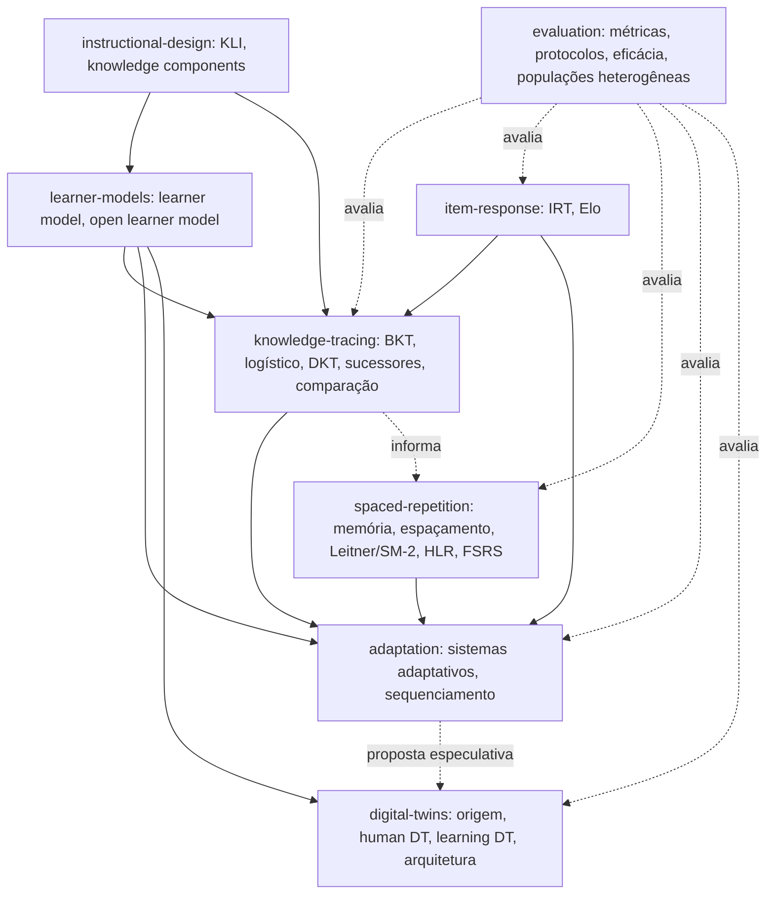
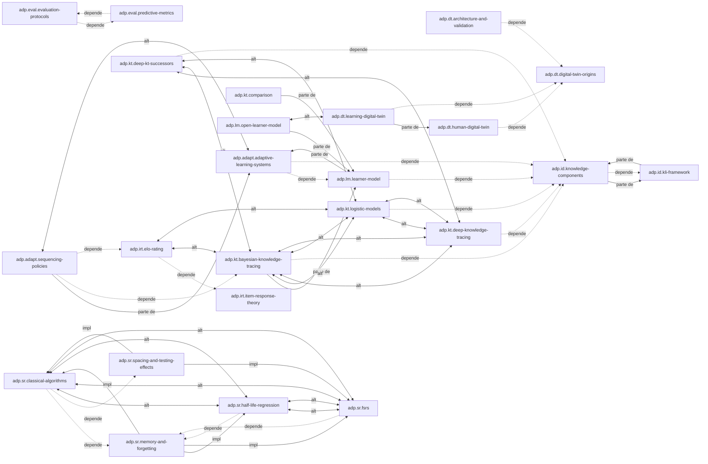

# Mapa de conceitos: aprendizagem adaptativa e gêmeos digitais para aprendizagem

A primeira parte é escrita à mão e descreve as dependências entre áreas. A segunda é gerada a partir dos frontmatters com `python conhecimento/_modelo/gerar_mapa.py aprendizagem-adaptativa` e lista todos os documentos e relações. Regenere a segunda parte ao adicionar documentos.

## Visão geral das dependências

## Como ler o mapa

**Um vocabulário comum antes de qualquer modelo.** [I] `adp.id.kli-framework` e `adp.id.knowledge-components` vêm primeiro porque BKT, modelos logísticos, DKT, IRT e Elo compartilham a mesma unidade de análise — o knowledge component — mesmo discordando de como estimar o domínio dele. `adp.lm.learner-model` é o lugar onde esse conhecimento é guardado; `adp.lm.open-learner-model` trata de expor essa estrutura a quem decide (aluno, professor).

**Quatro famílias respondem à mesma pergunta — "o aluno domina este KC agora?"** [I] `adp.kt.bayesian-knowledge-tracing` (estado discreto, probabilístico, interpretável, mas com problema de identifiability), `adp.kt.logistic-models` (AFM/PFA, contínuo, bom para KCs com muita prática), `adp.kt.deep-knowledge-tracing` e `adp.kt.deep-kt-successors` (redes neurais, maior capacidade nominal, mas re-benchmarks independentes — Gervet et al. 2020, pyKT — mostram que boa parte da vantagem relatada nos artigos originais não se sustenta sob protocolo padronizado e sem vazamento de dados), e `adp.irt.item-response-theory`/`adp.irt.elo-rating` (tradição psicométrica, estática por padrão, mas com extensões dinâmicas via Elo). `adp.kt.comparison` resume sem declarar vencedor único.

**Esquecimento é a lacuna que une knowledge tracing e repetição espaçada.** [I] O BKT clássico assume que o domínio nunca regride; a literatura de `spaced-repetition/` (curva de Ebbinghaus, storage/retrieval strength de Bjork, DSR do FSRS) modela exatamente o que falta. Khajah et al. 2016 mostram que adicionar esquecimento ao BKT fecha boa parte da diferença de AUC que antes parecia vir só da arquitetura profunda do DKT — por isso `adp.sr.memory-and-forgetting` tem relação `relacionado-a` direta com `adp.kt.bayesian-knowledge-tracing`.

**Adaptação consome os modelos, não os substitui.** [I] `adp.adapt.adaptive-learning-systems` e `adp.adapt.sequencing-policies` dependem de uma estimativa de domínio (de `knowledge-tracing/` ou `item-response/`) e de um critério de parada (mastery threshold, taxa de sucesso alvo). A crítica de Doroudi et al. 2019 sobre a formulação de sequenciamento como MDP/POMDP — a recompensa raramente é bem especificada — é a principal lacuna aberta desta área.

**Gêmeos digitais de aprendizagem: proposta, não prática estabelecida.** `adp.dt.digital-twin-origins` traz o conceito de manufatura (Grieves, NASA); `adp.dt.human-digital-twin` mostra sua extensão a pessoas; `adp.dt.learning-digital-twin` investiga criticamente se existe, de fato, um "gêmeo digital do aluno" na literatura — e conclui que a maior parte do que se chama assim em educação é gêmeo de laboratório ou de campus, e que a minoria que propõe um gêmeo do aprendiz o faz como visão de pesquisa futura, nunca implementada e avaliada. Por isso a relação com `adp.lm.learner-model` é `relacionado-a`, não `especificado-por`: não há, nas fontes abertas, um critério operacional que separe de forma nítida um "digital twin" de um learner model tradicional, além de ambição retórica.

**Avaliação fecha o ciclo, em duas camadas.** `adp.eval.predictive-metrics` e `adp.eval.evaluation-protocols` avaliam o MODELO (AUC, calibração, vazamento de dados, validação por aluno); `adp.eval.educational-effectiveness` avalia a POLÍTICA ou o sistema (meta-análises de ITS, RCTs como o de Pane et al.) — precisão preditiva alta não implica eficácia educacional, e a literatura trata as duas coisas com instrumentos distintos. `adp.eval.heterogeneous-populations` cruza as duas camadas: mostra que desempenho agregado bom pode esconder disparidade entre subgrupos (ABROCA), e que a pesquisa sobre estudantes com necessidades educacionais específicas em sistemas adaptativos é escassa — uma lacuna, não um resultado.

## Lacunas no grafo

- Todos os alvos de relação existem (verificado por `_modelo/validar.py` em 2026-10-29). Não há ids pendentes.
- `adp.dt.learning-digital-twin` tem relação `parte-de` com `adp.dt.human-digital-twin`: reflete que a literatura aberta trata gêmeos de aprendiz como um caso (ainda majoritariamente conceitual) de human digital twin, não como categoria própria consolidada.
- A área `assessment/` (ECD, stealth assessment) do brief original não foi coberta nesta primeira versão; ver `relatorio.md`, seção "o que ficou de fora".

### Documentos

| Id | Tipo | Arquivo | Título |
|---|---|---|---|
| `adp.adapt.adaptive-learning-systems` | conceito | [adaptation/adaptive-learning-systems.md](adaptation/adaptive-learning-systems.md) | Aprendizagem adaptativa (adaptive learning systems) |
| `adp.adapt.sequencing-policies` | tecnica | [adaptation/sequencing-policies.md](adaptation/sequencing-policies.md) | Políticas de seleção e sequenciamento de atividades |
| `adp.brief` | relatorio | [00-brief.md](00-brief.md) | Brief do domínio aprendizagem adaptativa e gêmeos digitais para aprendizagem |
| `adp.dt.architecture-and-validation` | tecnica | [digital-twins/architecture-and-validation.md](digital-twins/architecture-and-validation.md) | Arquiteturas, sincronização e validação de digital twins |
| `adp.dt.digital-twin-origins` | conceito | [digital-twins/digital-twin-origins.md](digital-twins/digital-twin-origins.md) | Origens e definições do conceito de digital twin |
| `adp.dt.human-digital-twin` | conceito | [digital-twins/human-digital-twin.md](digital-twins/human-digital-twin.md) | Human digital twin |
| `adp.dt.learning-digital-twin` | conceito | [digital-twins/learning-digital-twin.md](digital-twins/learning-digital-twin.md) | Learning digital twin (gêmeo digital do aprendiz) |
| `adp.eval.educational-effectiveness` | conceito | [evaluation/educational-effectiveness.md](evaluation/educational-effectiveness.md) | Eficácia educacional versus precisão preditiva |
| `adp.eval.evaluation-protocols` | tecnica | [evaluation/evaluation-protocols.md](evaluation/evaluation-protocols.md) | Protocolos de validação para modelos de aluno |
| `adp.eval.heterogeneous-populations` | conceito | [evaluation/heterogeneous-populations.md](evaluation/heterogeneous-populations.md) | Limitações para populações heterogêneas e necessidades educacionais específicas |
| `adp.eval.predictive-metrics` | tecnica | [evaluation/predictive-metrics.md](evaluation/predictive-metrics.md) | Métricas preditivas para modelos de aluno |
| `adp.id.kli-framework` | framework | [instructional-design/kli-framework.md](instructional-design/kli-framework.md) | Knowledge-Learning-Instruction (KLI) framework |
| `adp.id.knowledge-components` | conceito | [instructional-design/knowledge-components.md](instructional-design/knowledge-components.md) | Knowledge component |
| `adp.irt.elo-rating` | tecnica | [item-response/elo-rating.md](item-response/elo-rating.md) | Elo rating aplicado a sistemas educacionais adaptativos |
| `adp.irt.item-response-theory` | conceito | [item-response/item-response-theory.md](item-response/item-response-theory.md) | Item response theory (IRT) |
| `adp.kt.bayesian-knowledge-tracing` | tecnica | [knowledge-tracing/bayesian-knowledge-tracing.md](knowledge-tracing/bayesian-knowledge-tracing.md) | Bayesian Knowledge Tracing (BKT) |
| `adp.kt.comparison` | comparacao | [knowledge-tracing/comparison.md](knowledge-tracing/comparison.md) | Comparação entre famílias de knowledge tracing (BKT, logísticos, DKT, sucessores profundos) |
| `adp.kt.deep-knowledge-tracing` | tecnica | [knowledge-tracing/deep-knowledge-tracing.md](knowledge-tracing/deep-knowledge-tracing.md) | Deep Knowledge Tracing (DKT) |
| `adp.kt.deep-kt-successors` | tecnica | [knowledge-tracing/deep-kt-successors.md](knowledge-tracing/deep-kt-successors.md) | Sucessores do DKT baseados em memória e atenção (DKVMN, SAKT, AKT) |
| `adp.kt.logistic-models` | tecnica | [knowledge-tracing/logistic-models.md](knowledge-tracing/logistic-models.md) | Modelos logísticos de knowledge tracing (AFM, PFA) |
| `adp.lm.learner-model` | conceito | [learner-models/learner-model.md](learner-models/learner-model.md) | Learner model |
| `adp.lm.open-learner-model` | conceito | [learner-models/open-learner-model.md](learner-models/open-learner-model.md) | Open learner model |
| `adp.plano-ids` | mapa | [_plano-ids.md](_plano-ids.md) | Plano de identificadores do domínio |
| `adp.sr.classical-algorithms` | tecnica | [spaced-repetition/classical-algorithms.md](spaced-repetition/classical-algorithms.md) | Algoritmos clássicos de repetição espaçada (Leitner e SM-2) |
| `adp.sr.comparison` | comparacao | [spaced-repetition/comparison.md](spaced-repetition/comparison.md) | Comparação de algoritmos de repetição espaçada |
| `adp.sr.fsrs` | tecnica | [spaced-repetition/fsrs.md](spaced-repetition/fsrs.md) | FSRS (Free Spaced Repetition Scheduler) |
| `adp.sr.half-life-regression` | tecnica | [spaced-repetition/half-life-regression.md](spaced-repetition/half-life-regression.md) | Half-life regression (HLR) |
| `adp.sr.memory-and-forgetting` | conceito | [spaced-repetition/memory-and-forgetting.md](spaced-repetition/memory-and-forgetting.md) | Memória e esquecimento |
| `adp.sr.spacing-and-testing-effects` | conceito | [spaced-repetition/spacing-and-testing-effects.md](spaced-repetition/spacing-and-testing-effects.md) | Efeitos de espaçamento e de teste |

### Relações tipadas

| Tipo | Quantidade |
|---|---|
| `relacionado-a` | 65 |
| `avaliado-por` | 29 |
| `depende-de` | 20 |
| `complementa` | 20 |
| `alternativa-a` | 19 |
| `parte-de` | 8 |
| `implementado-por` | 5 |

| Origem | Tipo | Alvo |
|---|---|---|
| `adp.adapt.adaptive-learning-systems` | avaliado-por | `adp.eval.educational-effectiveness` |
| `adp.adapt.adaptive-learning-systems` | complementa | `adp.adapt.sequencing-policies` |
| `adp.adapt.adaptive-learning-systems` | depende-de | `adp.id.knowledge-components` |
| `adp.adapt.adaptive-learning-systems` | depende-de | `adp.lm.learner-model` |
| `adp.adapt.adaptive-learning-systems` | relacionado-a | `adp.dt.learning-digital-twin` |
| `adp.adapt.adaptive-learning-systems` | relacionado-a | `adp.irt.item-response-theory` |
| `adp.adapt.adaptive-learning-systems` | relacionado-a | `adp.kt.bayesian-knowledge-tracing` |
| `adp.adapt.adaptive-learning-systems` | relacionado-a | `adp.lm.open-learner-model` |
| `adp.adapt.sequencing-policies` | alternativa-a | `adp.adapt.adaptive-learning-systems` |
| `adp.adapt.sequencing-policies` | avaliado-por | `adp.eval.evaluation-protocols` |
| `adp.adapt.sequencing-policies` | avaliado-por | `adp.eval.predictive-metrics` |
| `adp.adapt.sequencing-policies` | depende-de | `adp.irt.elo-rating` |
| `adp.adapt.sequencing-policies` | depende-de | `adp.kt.bayesian-knowledge-tracing` |
| `adp.adapt.sequencing-policies` | parte-de | `adp.adapt.adaptive-learning-systems` |
| `adp.adapt.sequencing-policies` | relacionado-a | `adp.kt.logistic-models` |
| `adp.dt.architecture-and-validation` | avaliado-por | `adp.eval.evaluation-protocols` |
| `adp.dt.architecture-and-validation` | complementa | `adp.dt.human-digital-twin` |
| `adp.dt.architecture-and-validation` | complementa | `adp.dt.learning-digital-twin` |
| `adp.dt.architecture-and-validation` | depende-de | `adp.dt.digital-twin-origins` |
| `adp.dt.architecture-and-validation` | relacionado-a | `adp.eval.predictive-metrics` |
| `adp.dt.digital-twin-origins` | complementa | `adp.dt.architecture-and-validation` |
| `adp.dt.digital-twin-origins` | relacionado-a | `adp.dt.human-digital-twin` |
| `adp.dt.digital-twin-origins` | relacionado-a | `adp.dt.learning-digital-twin` |
| `adp.dt.digital-twin-origins` | relacionado-a | `adp.lm.learner-model` |
| `adp.dt.human-digital-twin` | complementa | `adp.dt.architecture-and-validation` |
| `adp.dt.human-digital-twin` | depende-de | `adp.dt.digital-twin-origins` |
| `adp.dt.human-digital-twin` | relacionado-a | `adp.dt.learning-digital-twin` |
| `adp.dt.human-digital-twin` | relacionado-a | `adp.lm.learner-model` |
| `adp.dt.learning-digital-twin` | avaliado-por | `adp.eval.evaluation-protocols` |
| `adp.dt.learning-digital-twin` | complementa | `adp.dt.architecture-and-validation` |
| `adp.dt.learning-digital-twin` | complementa | `adp.lm.open-learner-model` |
| `adp.dt.learning-digital-twin` | depende-de | `adp.dt.digital-twin-origins` |
| `adp.dt.learning-digital-twin` | parte-de | `adp.dt.human-digital-twin` |
| `adp.dt.learning-digital-twin` | relacionado-a | `adp.adapt.adaptive-learning-systems` |
| `adp.dt.learning-digital-twin` | relacionado-a | `adp.lm.learner-model` |
| `adp.eval.educational-effectiveness` | avaliado-por | `adp.adapt.adaptive-learning-systems` |
| `adp.eval.educational-effectiveness` | complementa | `adp.eval.evaluation-protocols` |
| `adp.eval.educational-effectiveness` | complementa | `adp.eval.predictive-metrics` |
| `adp.eval.educational-effectiveness` | relacionado-a | `adp.eval.heterogeneous-populations` |
| `adp.eval.educational-effectiveness` | relacionado-a | `adp.id.kli-framework` |
| `adp.eval.evaluation-protocols` | avaliado-por | `adp.kt.bayesian-knowledge-tracing` |
| `adp.eval.evaluation-protocols` | avaliado-por | `adp.kt.deep-knowledge-tracing` |
| `adp.eval.evaluation-protocols` | complementa | `adp.eval.predictive-metrics` |
| `adp.eval.evaluation-protocols` | depende-de | `adp.eval.predictive-metrics` |
| `adp.eval.evaluation-protocols` | relacionado-a | `adp.adapt.sequencing-policies` |
| `adp.eval.evaluation-protocols` | relacionado-a | `adp.eval.educational-effectiveness` |
| `adp.eval.heterogeneous-populations` | complementa | `adp.eval.evaluation-protocols` |
| `adp.eval.heterogeneous-populations` | complementa | `adp.eval.predictive-metrics` |
| `adp.eval.heterogeneous-populations` | relacionado-a | `adp.eval.educational-effectiveness` |
| `adp.eval.heterogeneous-populations` | relacionado-a | `adp.lm.learner-model` |
| `adp.eval.heterogeneous-populations` | relacionado-a | `adp.lm.open-learner-model` |
| `adp.eval.predictive-metrics` | avaliado-por | `adp.kt.bayesian-knowledge-tracing` |
| `adp.eval.predictive-metrics` | avaliado-por | `adp.kt.deep-knowledge-tracing` |
| `adp.eval.predictive-metrics` | avaliado-por | `adp.kt.logistic-models` |
| `adp.eval.predictive-metrics` | complementa | `adp.eval.evaluation-protocols` |
| `adp.eval.predictive-metrics` | depende-de | `adp.eval.evaluation-protocols` |
| `adp.eval.predictive-metrics` | relacionado-a | `adp.eval.educational-effectiveness` |
| `adp.id.kli-framework` | avaliado-por | `adp.eval.educational-effectiveness` |
| `adp.id.kli-framework` | complementa | `adp.lm.learner-model` |
| `adp.id.kli-framework` | parte-de | `adp.id.knowledge-components` |
| `adp.id.kli-framework` | relacionado-a | `adp.adapt.sequencing-policies` |
| `adp.id.kli-framework` | relacionado-a | `adp.sr.spacing-and-testing-effects` |
| `adp.id.knowledge-components` | avaliado-por | `adp.eval.predictive-metrics` |
| `adp.id.knowledge-components` | complementa | `adp.lm.learner-model` |
| `adp.id.knowledge-components` | depende-de | `adp.id.kli-framework` |
| `adp.id.knowledge-components` | parte-de | `adp.id.kli-framework` |
| `adp.id.knowledge-components` | relacionado-a | `adp.adapt.sequencing-policies` |
| `adp.id.knowledge-components` | relacionado-a | `adp.irt.item-response-theory` |
| `adp.id.knowledge-components` | relacionado-a | `adp.kt.bayesian-knowledge-tracing` |
| `adp.irt.elo-rating` | alternativa-a | `adp.kt.bayesian-knowledge-tracing` |
| `adp.irt.elo-rating` | alternativa-a | `adp.kt.logistic-models` |
| `adp.irt.elo-rating` | avaliado-por | `adp.eval.predictive-metrics` |
| `adp.irt.elo-rating` | complementa | `adp.adapt.sequencing-policies` |
| `adp.irt.elo-rating` | depende-de | `adp.irt.item-response-theory` |
| `adp.irt.elo-rating` | relacionado-a | `adp.adapt.adaptive-learning-systems` |
| `adp.irt.elo-rating` | relacionado-a | `adp.sr.memory-and-forgetting` |
| `adp.irt.item-response-theory` | avaliado-por | `adp.eval.predictive-metrics` |
| `adp.irt.item-response-theory` | relacionado-a | `adp.adapt.sequencing-policies` |
| `adp.irt.item-response-theory` | relacionado-a | `adp.irt.elo-rating` |
| `adp.irt.item-response-theory` | relacionado-a | `adp.kt.bayesian-knowledge-tracing` |
| `adp.irt.item-response-theory` | relacionado-a | `adp.kt.logistic-models` |
| `adp.irt.item-response-theory` | relacionado-a | `adp.lm.learner-model` |
| `adp.kt.bayesian-knowledge-tracing` | alternativa-a | `adp.kt.deep-knowledge-tracing` |
| `adp.kt.bayesian-knowledge-tracing` | alternativa-a | `adp.kt.logistic-models` |
| `adp.kt.bayesian-knowledge-tracing` | avaliado-por | `adp.eval.evaluation-protocols` |
| `adp.kt.bayesian-knowledge-tracing` | avaliado-por | `adp.eval.predictive-metrics` |
| `adp.kt.bayesian-knowledge-tracing` | depende-de | `adp.id.knowledge-components` |
| `adp.kt.bayesian-knowledge-tracing` | parte-de | `adp.lm.learner-model` |
| `adp.kt.bayesian-knowledge-tracing` | relacionado-a | `adp.adapt.sequencing-policies` |
| `adp.kt.bayesian-knowledge-tracing` | relacionado-a | `adp.kt.comparison` |
| `adp.kt.comparison` | avaliado-por | `adp.eval.evaluation-protocols` |
| `adp.kt.comparison` | avaliado-por | `adp.eval.predictive-metrics` |
| `adp.kt.comparison` | parte-de | `adp.lm.learner-model` |
| `adp.kt.comparison` | relacionado-a | `adp.kt.bayesian-knowledge-tracing` |
| `adp.kt.comparison` | relacionado-a | `adp.kt.deep-knowledge-tracing` |
| `adp.kt.comparison` | relacionado-a | `adp.kt.deep-kt-successors` |
| `adp.kt.comparison` | relacionado-a | `adp.kt.logistic-models` |
| `adp.kt.comparison` | relacionado-a | `adp.lm.open-learner-model` |
| `adp.kt.deep-knowledge-tracing` | alternativa-a | `adp.kt.bayesian-knowledge-tracing` |
| `adp.kt.deep-knowledge-tracing` | alternativa-a | `adp.kt.logistic-models` |
| `adp.kt.deep-knowledge-tracing` | avaliado-por | `adp.eval.evaluation-protocols` |
| `adp.kt.deep-knowledge-tracing` | avaliado-por | `adp.eval.predictive-metrics` |
| `adp.kt.deep-knowledge-tracing` | depende-de | `adp.id.knowledge-components` |
| `adp.kt.deep-knowledge-tracing` | relacionado-a | `adp.kt.comparison` |
| `adp.kt.deep-knowledge-tracing` | relacionado-a | `adp.kt.deep-kt-successors` |
| `adp.kt.deep-kt-successors` | alternativa-a | `adp.kt.bayesian-knowledge-tracing` |
| `adp.kt.deep-kt-successors` | alternativa-a | `adp.kt.deep-knowledge-tracing` |
| `adp.kt.deep-kt-successors` | alternativa-a | `adp.kt.logistic-models` |
| `adp.kt.deep-kt-successors` | avaliado-por | `adp.eval.evaluation-protocols` |
| `adp.kt.deep-kt-successors` | avaliado-por | `adp.eval.predictive-metrics` |
| `adp.kt.deep-kt-successors` | depende-de | `adp.id.knowledge-components` |
| `adp.kt.deep-kt-successors` | relacionado-a | `adp.irt.item-response-theory` |
| `adp.kt.deep-kt-successors` | relacionado-a | `adp.kt.comparison` |
| `adp.kt.logistic-models` | alternativa-a | `adp.kt.bayesian-knowledge-tracing` |
| `adp.kt.logistic-models` | alternativa-a | `adp.kt.deep-knowledge-tracing` |
| `adp.kt.logistic-models` | avaliado-por | `adp.eval.predictive-metrics` |
| `adp.kt.logistic-models` | depende-de | `adp.id.knowledge-components` |
| `adp.kt.logistic-models` | relacionado-a | `adp.id.kli-framework` |
| `adp.kt.logistic-models` | relacionado-a | `adp.irt.elo-rating` |
| `adp.kt.logistic-models` | relacionado-a | `adp.irt.item-response-theory` |
| `adp.kt.logistic-models` | relacionado-a | `adp.kt.comparison` |
| `adp.lm.learner-model` | avaliado-por | `adp.eval.predictive-metrics` |
| `adp.lm.learner-model` | complementa | `adp.lm.open-learner-model` |
| `adp.lm.learner-model` | depende-de | `adp.id.knowledge-components` |
| `adp.lm.learner-model` | parte-de | `adp.adapt.adaptive-learning-systems` |
| `adp.lm.learner-model` | relacionado-a | `adp.dt.learning-digital-twin` |
| `adp.lm.learner-model` | relacionado-a | `adp.kt.bayesian-knowledge-tracing` |
| `adp.lm.open-learner-model` | alternativa-a | `adp.dt.learning-digital-twin` |
| `adp.lm.open-learner-model` | avaliado-por | `adp.eval.educational-effectiveness` |
| `adp.lm.open-learner-model` | complementa | `adp.lm.learner-model` |
| `adp.lm.open-learner-model` | parte-de | `adp.lm.learner-model` |
| `adp.lm.open-learner-model` | relacionado-a | `adp.adapt.adaptive-learning-systems` |
| `adp.sr.classical-algorithms` | alternativa-a | `adp.sr.fsrs` |
| `adp.sr.classical-algorithms` | alternativa-a | `adp.sr.half-life-regression` |
| `adp.sr.classical-algorithms` | depende-de | `adp.sr.memory-and-forgetting` |
| `adp.sr.classical-algorithms` | depende-de | `adp.sr.spacing-and-testing-effects` |
| `adp.sr.classical-algorithms` | relacionado-a | `adp.adapt.sequencing-policies` |
| `adp.sr.comparison` | avaliado-por | `adp.eval.predictive-metrics` |
| `adp.sr.comparison` | relacionado-a | `adp.kt.comparison` |
| `adp.sr.comparison` | relacionado-a | `adp.kt.logistic-models` |
| `adp.sr.comparison` | relacionado-a | `adp.sr.classical-algorithms` |
| `adp.sr.comparison` | relacionado-a | `adp.sr.fsrs` |
| `adp.sr.comparison` | relacionado-a | `adp.sr.half-life-regression` |
| `adp.sr.comparison` | relacionado-a | `adp.sr.memory-and-forgetting` |
| `adp.sr.fsrs` | alternativa-a | `adp.sr.classical-algorithms` |
| `adp.sr.fsrs` | alternativa-a | `adp.sr.half-life-regression` |
| `adp.sr.fsrs` | avaliado-por | `adp.eval.predictive-metrics` |
| `adp.sr.fsrs` | depende-de | `adp.sr.memory-and-forgetting` |
| `adp.sr.fsrs` | relacionado-a | `adp.adapt.sequencing-policies` |
| `adp.sr.half-life-regression` | alternativa-a | `adp.sr.classical-algorithms` |
| `adp.sr.half-life-regression` | alternativa-a | `adp.sr.fsrs` |
| `adp.sr.half-life-regression` | avaliado-por | `adp.eval.predictive-metrics` |
| `adp.sr.half-life-regression` | depende-de | `adp.sr.memory-and-forgetting` |
| `adp.sr.half-life-regression` | relacionado-a | `adp.irt.item-response-theory` |
| `adp.sr.half-life-regression` | relacionado-a | `adp.kt.logistic-models` |
| `adp.sr.memory-and-forgetting` | complementa | `adp.sr.spacing-and-testing-effects` |
| `adp.sr.memory-and-forgetting` | implementado-por | `adp.sr.classical-algorithms` |
| `adp.sr.memory-and-forgetting` | implementado-por | `adp.sr.fsrs` |
| `adp.sr.memory-and-forgetting` | implementado-por | `adp.sr.half-life-regression` |
| `adp.sr.memory-and-forgetting` | relacionado-a | `adp.kt.bayesian-knowledge-tracing` |
| `adp.sr.memory-and-forgetting` | relacionado-a | `adp.lm.learner-model` |
| `adp.sr.spacing-and-testing-effects` | complementa | `adp.sr.memory-and-forgetting` |
| `adp.sr.spacing-and-testing-effects` | implementado-por | `adp.sr.classical-algorithms` |
| `adp.sr.spacing-and-testing-effects` | implementado-por | `adp.sr.fsrs` |
| `adp.sr.spacing-and-testing-effects` | relacionado-a | `adp.adapt.sequencing-policies` |
| `adp.sr.spacing-and-testing-effects` | relacionado-a | `adp.id.kli-framework` |

### Diagrama (relações estruturais)

