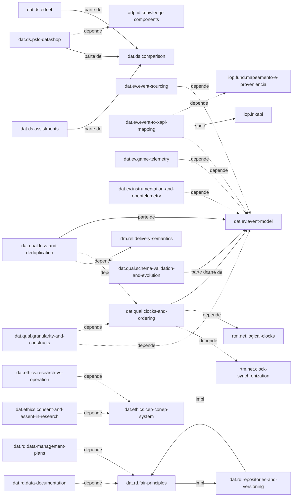

# Mapa de conceitos: dados de pesquisa e eventos

## Visão geral

O domínio tem cinco áreas, ligadas numa cadeia que vai do evento ao dataset publicado.

- **events** é a base. `dat.ev.event-model` define o envelope, a identidade e os dois relógios. Telemetria de jogos, instrumentação, event sourcing e o mapeamento para xAPI dependem dele (`depende-de`).
- **quality** detalha o envelope. Relógios, perda e deduplicação, e esquema são `parte-de` `dat.ev.event-model`. A granularidade depende do modelo de evento e dos relógios. A perda depende da sequência por sessão definida em relógios.
- **research-data** transforma o log em dataset. `dat.rd.fair-principles` é o ponto de partida: o plano de gestão de dados e a documentação dependem dele, e os repositórios o implementam.
- **research-ethics** tem `dat.ethics.cep-conep-system` como raiz. Consentimento e assentimento, e a fronteira entre pesquisa e operação, dependem dele.
- **datasets** é uma comparação com três estudos de caso como partes (`parte-de` `dat.ds.comparison`).

As áreas se cruzam por `complementa` e `relacionado-a`: o esquema versionado vai com o dataset (`quality` → `research-data`); o log append-only vira fatia publicável (`events` → `research-data`); o plano de gestão de dados precisa ser coerente com o protocolo ético (`research-data` ↔ `research-ethics`); a granularidade dos datasets públicos é medida contra a de `dat.qual.granularity-and-constructs` (`datasets` → `quality`).

## Como ler o mapa

A seção "Gerado" é a saída de `_modelo/gerar_mapa.py dados-pesquisa-e-eventos`, colada sem edição. A tabela "Documentos" lista os ids do domínio. A tabela de relações lista todas as relações tipadas dos frontmatters. O diagrama mostra só as relações estruturais (`depende-de`, `parte-de`, `especificado-por`, `implementado-por`, `alternativa-a`). Alvos marcados "(outro domínio)" existem em `psg`, `lae`, `adp`, `rtm`, `iop` ou `kg`; o validador `_modelo/validar.py`, rodado sem argumento, confirma que todos existem.

Duas relações merecem atenção na leitura. `dat.rd.fair-principles` e `dat.rd.repositories-and-versioning` declaram `implementado-por` uma para a outra; pela semântica do modelo, só a primeira direção (FAIR implementado por repositórios) é a esperada. E `dat.ev.event-model` declara `complementa` para relógios, perda e esquema, enquanto esses três declaram `parte-de` para ele.

## Gerado

### Documentos

| Id | Tipo | Arquivo | Título |
|---|---|---|---|
| `dat.brief` | relatorio | [00-brief.md](00-brief.md) | Brief do domínio dados de pesquisa e eventos |
| `dat.ds.assistments` | estudo-de-caso | [datasets/assistments.md](datasets/assistments.md) | Datasets públicos do ASSISTments |
| `dat.ds.comparison` | comparacao | [datasets/comparison.md](datasets/comparison.md) | Comparação de datasets públicos de referência em educação |
| `dat.ds.ednet` | estudo-de-caso | [datasets/ednet.md](datasets/ednet.md) | EdNet |
| `dat.ds.pslc-datashop` | estudo-de-caso | [datasets/pslc-datashop.md](datasets/pslc-datashop.md) | PSLC DataShop |
| `dat.ethics.cep-conep-system` | framework | [research-ethics/cep-conep-system.md](research-ethics/cep-conep-system.md) | Sistema CEP/Conep e o novo Sistema Nacional de Ética em Pesquisa |
| `dat.ethics.consent-and-assent-in-research` | conceito | [research-ethics/consent-and-assent-in-research.md](research-ethics/consent-and-assent-in-research.md) | Consentimento e assentimento como exigência de protocolo de pesquisa |
| `dat.ethics.research-vs-operation` | conceito | [research-ethics/research-vs-operation.md](research-ethics/research-vs-operation.md) | Pesquisa versus operação - base de pesquisa, base operacional e experimentos em serviço |
| `dat.ev.event-model` | conceito | [events/event-model.md](events/event-model.md) | Modelo de evento (envelope, identidade, tipo, versão e contexto) |
| `dat.ev.event-sourcing` | tecnica | [events/event-sourcing.md](events/event-sourcing.md) | Event sourcing e log append-only |
| `dat.ev.event-to-xapi-mapping` | tecnica | [events/event-to-xapi-mapping.md](events/event-to-xapi-mapping.md) | Mapeamento de evento interno para xAPI sem perda |
| `dat.ev.game-telemetry` | conceito | [events/game-telemetry.md](events/game-telemetry.md) | Telemetria de jogos |
| `dat.ev.instrumentation-and-opentelemetry` | framework | [events/instrumentation-and-opentelemetry.md](events/instrumentation-and-opentelemetry.md) | Instrumentação e OpenTelemetry como referência |
| `dat.plano-ids` | mapa | [_plano-ids.md](_plano-ids.md) | Plano de identificadores do domínio |
| `dat.qual.clocks-and-ordering` | conceito | [quality/clocks-and-ordering.md](quality/clocks-and-ordering.md) | Relógios de dispositivo, carimbos de evento e ordenação em dados de pesquisa |
| `dat.qual.granularity-and-constructs` | conceito | [quality/granularity-and-constructs.md](quality/granularity-and-constructs.md) | Granularidade de evento e preservação de construtos cognitivo-motores |
| `dat.qual.loss-and-deduplication` | conceito | [quality/loss-and-deduplication.md](quality/loss-and-deduplication.md) | Perda, duplicação e reconciliação de eventos coletados no cliente |
| `dat.qual.schema-validation-and-evolution` | conceito | [quality/schema-validation-and-evolution.md](quality/schema-validation-and-evolution.md) | Validação de esquema e evolução compatível de eventos |
| `dat.rd.data-documentation` | comparacao | [research-data/data-documentation.md](research-data/data-documentation.md) | Documentação de dataset (datasheets, dicionário de dados, codebook, README) |
| `dat.rd.data-management-plans` | conceito | [research-data/data-management-plans.md](research-data/data-management-plans.md) | Plano de gestão de dados (PGD/DMP) |
| `dat.rd.fair-principles` | conceito | [research-data/fair-principles.md](research-data/fair-principles.md) | Princípios FAIR para dados de pesquisa |
| `dat.rd.repositories-and-versioning` | comparacao | [research-data/repositories-and-versioning.md](research-data/repositories-and-versioning.md) | Repositórios de dados, DOI de dataset e versionamento |

### Relações tipadas

| Tipo | Quantidade |
|---|---|
| `complementa` | 79 |
| `relacionado-a` | 70 |
| `depende-de` | 16 |
| `parte-de` | 6 |
| `avaliado-por` | 4 |
| `implementado-por` | 2 |
| `especificado-por` | 1 |

| Origem | Tipo | Alvo |
|---|---|---|
| `dat.ds.assistments` | avaliado-por | `adp.eval.predictive-metrics` (outro domínio) |
| `dat.ds.assistments` | complementa | `adp.kt.bayesian-knowledge-tracing` (outro domínio) |
| `dat.ds.assistments` | complementa | `adp.kt.deep-knowledge-tracing` (outro domínio) |
| `dat.ds.assistments` | parte-de | `dat.ds.comparison` |
| `dat.ds.assistments` | relacionado-a | `adp.kt.comparison` (outro domínio) |
| `dat.ds.assistments` | relacionado-a | `dat.ethics.research-vs-operation` |
| `dat.ds.assistments` | relacionado-a | `dat.qual.loss-and-deduplication` |
| `dat.ds.assistments` | relacionado-a | `dat.rd.data-documentation` |
| `dat.ds.assistments` | relacionado-a | `lae.dq.bias-and-validity` (outro domínio) |
| `dat.ds.assistments` | relacionado-a | `psg.deid.reidentification-risk` (outro domínio) |
| `dat.ds.comparison` | complementa | `adp.kt.comparison` (outro domínio) |
| `dat.ds.comparison` | complementa | `dat.qual.granularity-and-constructs` |
| `dat.ds.comparison` | complementa | `dat.rd.data-documentation` |
| `dat.ds.comparison` | relacionado-a | `dat.ds.assistments` |
| `dat.ds.comparison` | relacionado-a | `dat.ds.ednet` |
| `dat.ds.comparison` | relacionado-a | `dat.ds.pslc-datashop` |
| `dat.ds.comparison` | relacionado-a | `dat.rd.fair-principles` |
| `dat.ds.comparison` | relacionado-a | `lae.dq.bias-and-validity` (outro domínio) |
| `dat.ds.comparison` | relacionado-a | `psg.deid.anonymization-and-pseudonymization` (outro domínio) |
| `dat.ds.comparison` | relacionado-a | `psg.deid.reidentification-risk` (outro domínio) |
| `dat.ds.ednet` | avaliado-por | `adp.eval.predictive-metrics` (outro domínio) |
| `dat.ds.ednet` | complementa | `adp.kt.deep-knowledge-tracing` (outro domínio) |
| `dat.ds.ednet` | complementa | `dat.qual.granularity-and-constructs` |
| `dat.ds.ednet` | parte-de | `dat.ds.comparison` |
| `dat.ds.ednet` | relacionado-a | `adp.kt.comparison` (outro domínio) |
| `dat.ds.ednet` | relacionado-a | `dat.ev.event-model` |
| `dat.ds.ednet` | relacionado-a | `dat.rd.data-documentation` |
| `dat.ds.ednet` | relacionado-a | `lae.dq.bias-and-validity` (outro domínio) |
| `dat.ds.ednet` | relacionado-a | `psg.deid.anonymization-and-pseudonymization` (outro domínio) |
| `dat.ds.pslc-datashop` | avaliado-por | `adp.eval.predictive-metrics` (outro domínio) |
| `dat.ds.pslc-datashop` | complementa | `adp.id.kli-framework` (outro domínio) |
| `dat.ds.pslc-datashop` | complementa | `dat.ev.event-model` |
| `dat.ds.pslc-datashop` | complementa | `dat.qual.granularity-and-constructs` |
| `dat.ds.pslc-datashop` | complementa | `dat.rd.data-documentation` |
| `dat.ds.pslc-datashop` | complementa | `dat.rd.repositories-and-versioning` |
| `dat.ds.pslc-datashop` | depende-de | `adp.id.knowledge-components` (outro domínio) |
| `dat.ds.pslc-datashop` | parte-de | `dat.ds.comparison` |
| `dat.ds.pslc-datashop` | relacionado-a | `dat.ethics.cep-conep-system` |
| `dat.ds.pslc-datashop` | relacionado-a | `psg.deid.reidentification-risk` (outro domínio) |
| `dat.ethics.cep-conep-system` | complementa | `dat.ethics.consent-and-assent-in-research` |
| `dat.ethics.cep-conep-system` | complementa | `dat.ethics.research-vs-operation` |
| `dat.ethics.cep-conep-system` | relacionado-a | `adp.eval.evaluation-protocols` (outro domínio) |
| `dat.ethics.cep-conep-system` | relacionado-a | `dat.rd.data-management-plans` |
| `dat.ethics.cep-conep-system` | relacionado-a | `psg.audit.ripd-dpia` (outro domínio) |
| `dat.ethics.consent-and-assent-in-research` | complementa | `dat.ethics.research-vs-operation` |
| `dat.ethics.consent-and-assent-in-research` | complementa | `psg.consent.child-assent` (outro domínio) |
| `dat.ethics.consent-and-assent-in-research` | complementa | `psg.consent.parental-consent` (outro domínio) |
| `dat.ethics.consent-and-assent-in-research` | depende-de | `dat.ethics.cep-conep-system` |
| `dat.ethics.consent-and-assent-in-research` | relacionado-a | `psg.consent.permission-lifecycle` (outro domínio) |
| `dat.ethics.consent-and-assent-in-research` | relacionado-a | `psg.legal.lgpd-children` (outro domínio) |
| `dat.ethics.research-vs-operation` | complementa | `dat.ethics.consent-and-assent-in-research` |
| `dat.ethics.research-vs-operation` | complementa | `psg.access.minimization-and-privacy-by-design` (outro domínio) |
| `dat.ethics.research-vs-operation` | complementa | `psg.deid.anonymization-and-pseudonymization` (outro domínio) |
| `dat.ethics.research-vs-operation` | depende-de | `dat.ethics.cep-conep-system` |
| `dat.ethics.research-vs-operation` | relacionado-a | `adp.eval.evaluation-protocols` (outro domínio) |
| `dat.ethics.research-vs-operation` | relacionado-a | `dat.rd.data-management-plans` |
| `dat.ethics.research-vs-operation` | relacionado-a | `dat.rd.fair-principles` |
| `dat.ethics.research-vs-operation` | relacionado-a | `lae.dq.bias-and-validity` (outro domínio) |
| `dat.ethics.research-vs-operation` | relacionado-a | `lae.evalm.experimental-design` (outro domínio) |
| `dat.ethics.research-vs-operation` | relacionado-a | `lae.found.analytics-cycle` (outro domínio) |
| `dat.ethics.research-vs-operation` | relacionado-a | `psg.audit.ripd-dpia` (outro domínio) |
| `dat.ethics.research-vs-operation` | relacionado-a | `psg.legal.lgpd-children` (outro domínio) |
| `dat.ev.event-model` | complementa | `dat.ev.event-sourcing` |
| `dat.ev.event-model` | complementa | `dat.ev.event-to-xapi-mapping` |
| `dat.ev.event-model` | complementa | `dat.ev.game-telemetry` |
| `dat.ev.event-model` | complementa | `dat.ev.instrumentation-and-opentelemetry` |
| `dat.ev.event-model` | complementa | `dat.qual.clocks-and-ordering` |
| `dat.ev.event-model` | complementa | `dat.qual.loss-and-deduplication` |
| `dat.ev.event-model` | complementa | `dat.qual.schema-validation-and-evolution` |
| `dat.ev.event-model` | complementa | `lae.dq.provenance-and-lineage` (outro domínio) |
| `dat.ev.event-model` | complementa | `psg.access.minimization-and-privacy-by-design` (outro domínio) |
| `dat.ev.event-model` | relacionado-a | `dat.qual.granularity-and-constructs` |
| `dat.ev.event-model` | relacionado-a | `iop.fund.dados-vs-protocolo` (outro domínio) |
| `dat.ev.event-model` | relacionado-a | `rtm.net.clock-synchronization` (outro domínio) |
| `dat.ev.event-sourcing` | complementa | `dat.ev.event-to-xapi-mapping` |
| `dat.ev.event-sourcing` | complementa | `dat.qual.loss-and-deduplication` |
| `dat.ev.event-sourcing` | complementa | `dat.qual.schema-validation-and-evolution` |
| `dat.ev.event-sourcing` | complementa | `dat.rd.repositories-and-versioning` |
| `dat.ev.event-sourcing` | complementa | `lae.dq.provenance-and-lineage` (outro domínio) |
| `dat.ev.event-sourcing` | complementa | `psg.audit.audit-trails` (outro domínio) |
| `dat.ev.event-sourcing` | depende-de | `dat.ev.event-model` |
| `dat.ev.event-sourcing` | relacionado-a | `dat.ethics.research-vs-operation` |
| `dat.ev.event-sourcing` | relacionado-a | `psg.deid.anonymization-and-pseudonymization` (outro domínio) |
| `dat.ev.event-sourcing` | relacionado-a | `rtm.rel.delivery-semantics` (outro domínio) |
| `dat.ev.event-to-xapi-mapping` | complementa | `dat.ev.event-sourcing` |
| `dat.ev.event-to-xapi-mapping` | complementa | `dat.ev.game-telemetry` |
| `dat.ev.event-to-xapi-mapping` | complementa | `dat.qual.clocks-and-ordering` |
| `dat.ev.event-to-xapi-mapping` | complementa | `dat.qual.schema-validation-and-evolution` |
| `dat.ev.event-to-xapi-mapping` | complementa | `iop.lr.cmi5` (outro domínio) |
| `dat.ev.event-to-xapi-mapping` | complementa | `kg.std.prov-o` (outro domínio) |
| `dat.ev.event-to-xapi-mapping` | depende-de | `dat.ev.event-model` |
| `dat.ev.event-to-xapi-mapping` | depende-de | `iop.fund.mapeamento-e-proveniencia` (outro domínio) |
| `dat.ev.event-to-xapi-mapping` | especificado-por | `iop.lr.xapi` (outro domínio) |
| `dat.ev.event-to-xapi-mapping` | relacionado-a | `iop.lr.caliper` (outro domínio) |
| `dat.ev.event-to-xapi-mapping` | relacionado-a | `iop.lr.comparison` (outro domínio) |
| `dat.ev.event-to-xapi-mapping` | relacionado-a | `psg.deid.anonymization-and-pseudonymization` (outro domínio) |
| `dat.ev.game-telemetry` | complementa | `dat.ev.event-to-xapi-mapping` |
| `dat.ev.game-telemetry` | complementa | `dat.ev.instrumentation-and-opentelemetry` |
| `dat.ev.game-telemetry` | complementa | `dat.qual.granularity-and-constructs` |
| `dat.ev.game-telemetry` | complementa | `dat.qual.loss-and-deduplication` |
| `dat.ev.game-telemetry` | complementa | `lae.found.analytics-cycle` (outro domínio) |
| `dat.ev.game-telemetry` | complementa | `psg.access.minimization-and-privacy-by-design` (outro domínio) |
| `dat.ev.game-telemetry` | depende-de | `dat.ev.event-model` |
| `dat.ev.game-telemetry` | relacionado-a | `dat.ethics.research-vs-operation` |
| `dat.ev.game-telemetry` | relacionado-a | `psg.deid.anonymization-and-pseudonymization` (outro domínio) |
| `dat.ev.instrumentation-and-opentelemetry` | complementa | `dat.ev.game-telemetry` |
| `dat.ev.instrumentation-and-opentelemetry` | complementa | `dat.qual.clocks-and-ordering` |
| `dat.ev.instrumentation-and-opentelemetry` | complementa | `dat.qual.loss-and-deduplication` |
| `dat.ev.instrumentation-and-opentelemetry` | complementa | `dat.qual.schema-validation-and-evolution` |
| `dat.ev.instrumentation-and-opentelemetry` | complementa | `psg.access.minimization-and-privacy-by-design` (outro domínio) |
| `dat.ev.instrumentation-and-opentelemetry` | depende-de | `dat.ev.event-model` |
| `dat.ev.instrumentation-and-opentelemetry` | relacionado-a | `psg.audit.audit-trails` (outro domínio) |
| `dat.ev.instrumentation-and-opentelemetry` | relacionado-a | `rtm.net.clock-synchronization` (outro domínio) |
| `dat.qual.clocks-and-ordering` | complementa | `dat.qual.granularity-and-constructs` |
| `dat.qual.clocks-and-ordering` | complementa | `dat.qual.loss-and-deduplication` |
| `dat.qual.clocks-and-ordering` | complementa | `rtm.net.ordering-and-reliability` (outro domínio) |
| `dat.qual.clocks-and-ordering` | depende-de | `rtm.net.clock-synchronization` (outro domínio) |
| `dat.qual.clocks-and-ordering` | depende-de | `rtm.net.logical-clocks` (outro domínio) |
| `dat.qual.clocks-and-ordering` | parte-de | `dat.ev.event-model` |
| `dat.qual.clocks-and-ordering` | relacionado-a | `dat.ev.event-sourcing` |
| `dat.qual.clocks-and-ordering` | relacionado-a | `lae.dq.provenance-and-lineage` (outro domínio) |
| `dat.qual.clocks-and-ordering` | relacionado-a | `rtm.net.jitter` (outro domínio) |
| `dat.qual.granularity-and-constructs` | avaliado-por | `lae.psy.reliability-and-validity` (outro domínio) |
| `dat.qual.granularity-and-constructs` | complementa | `dat.ev.game-telemetry` |
| `dat.qual.granularity-and-constructs` | complementa | `dat.qual.schema-validation-and-evolution` |
| `dat.qual.granularity-and-constructs` | depende-de | `dat.ev.event-model` |
| `dat.qual.granularity-and-constructs` | depende-de | `dat.qual.clocks-and-ordering` |
| `dat.qual.granularity-and-constructs` | relacionado-a | `dat.ds.comparison` |
| `dat.qual.granularity-and-constructs` | relacionado-a | `lae.dq.bias-and-validity` (outro domínio) |
| `dat.qual.loss-and-deduplication` | complementa | `dat.ev.event-sourcing` |
| `dat.qual.loss-and-deduplication` | complementa | `rtm.rel.reconnection` (outro domínio) |
| `dat.qual.loss-and-deduplication` | depende-de | `dat.qual.clocks-and-ordering` |
| `dat.qual.loss-and-deduplication` | depende-de | `rtm.rel.delivery-semantics` (outro domínio) |
| `dat.qual.loss-and-deduplication` | parte-de | `dat.ev.event-model` |
| `dat.qual.loss-and-deduplication` | relacionado-a | `lae.dq.bias-and-validity` (outro domínio) |
| `dat.qual.loss-and-deduplication` | relacionado-a | `lae.dq.provenance-and-lineage` (outro domínio) |
| `dat.qual.loss-and-deduplication` | relacionado-a | `rtm.net.ordering-and-reliability` (outro domínio) |
| `dat.qual.schema-validation-and-evolution` | complementa | `dat.ev.event-to-xapi-mapping` |
| `dat.qual.schema-validation-and-evolution` | complementa | `dat.rd.data-documentation` |
| `dat.qual.schema-validation-and-evolution` | complementa | `dat.rd.repositories-and-versioning` |
| `dat.qual.schema-validation-and-evolution` | parte-de | `dat.ev.event-model` |
| `dat.qual.schema-validation-and-evolution` | relacionado-a | `dat.ev.event-sourcing` |
| `dat.qual.schema-validation-and-evolution` | relacionado-a | `dat.qual.granularity-and-constructs` |
| `dat.qual.schema-validation-and-evolution` | relacionado-a | `lae.dq.provenance-and-lineage` (outro domínio) |
| `dat.rd.data-documentation` | complementa | `dat.ds.comparison` |
| `dat.rd.data-documentation` | complementa | `dat.rd.data-management-plans` |
| `dat.rd.data-documentation` | complementa | `dat.rd.repositories-and-versioning` |
| `dat.rd.data-documentation` | complementa | `kg.std.prov-o` (outro domínio) |
| `dat.rd.data-documentation` | complementa | `lae.dq.provenance-and-lineage` (outro domínio) |
| `dat.rd.data-documentation` | depende-de | `dat.rd.fair-principles` |
| `dat.rd.data-documentation` | relacionado-a | `dat.ethics.consent-and-assent-in-research` |
| `dat.rd.data-documentation` | relacionado-a | `psg.deid.reidentification-risk` (outro domínio) |
| `dat.rd.data-management-plans` | complementa | `dat.ethics.cep-conep-system` |
| `dat.rd.data-management-plans` | complementa | `dat.ethics.consent-and-assent-in-research` |
| `dat.rd.data-management-plans` | complementa | `dat.rd.data-documentation` |
| `dat.rd.data-management-plans` | complementa | `dat.rd.repositories-and-versioning` |
| `dat.rd.data-management-plans` | depende-de | `dat.rd.fair-principles` |
| `dat.rd.data-management-plans` | relacionado-a | `psg.access.minimization-and-privacy-by-design` (outro domínio) |
| `dat.rd.data-management-plans` | relacionado-a | `psg.deid.anonymization-and-pseudonymization` (outro domínio) |
| `dat.rd.data-management-plans` | relacionado-a | `psg.legal.lgpd-children` (outro domínio) |
| `dat.rd.fair-principles` | complementa | `dat.rd.data-documentation` |
| `dat.rd.fair-principles` | complementa | `dat.rd.data-management-plans` |
| `dat.rd.fair-principles` | complementa | `kg.std.prov-o` (outro domínio) |
| `dat.rd.fair-principles` | complementa | `lae.dq.provenance-and-lineage` (outro domínio) |
| `dat.rd.fair-principles` | implementado-por | `dat.rd.repositories-and-versioning` |
| `dat.rd.fair-principles` | relacionado-a | `dat.ethics.research-vs-operation` |
| `dat.rd.fair-principles` | relacionado-a | `psg.access.minimization-and-privacy-by-design` (outro domínio) |
| `dat.rd.fair-principles` | relacionado-a | `psg.deid.anonymization-and-pseudonymization` (outro domínio) |
| `dat.rd.fair-principles` | relacionado-a | `psg.deid.reidentification-risk` (outro domínio) |
| `dat.rd.fair-principles` | relacionado-a | `psg.legal.lgpd-children` (outro domínio) |
| `dat.rd.repositories-and-versioning` | complementa | `dat.rd.data-documentation` |
| `dat.rd.repositories-and-versioning` | complementa | `dat.rd.data-management-plans` |
| `dat.rd.repositories-and-versioning` | complementa | `kg.eng.versioning-and-provenance` (outro domínio) |
| `dat.rd.repositories-and-versioning` | complementa | `lae.dq.provenance-and-lineage` (outro domínio) |
| `dat.rd.repositories-and-versioning` | implementado-por | `dat.rd.fair-principles` |
| `dat.rd.repositories-and-versioning` | relacionado-a | `iop.fund.mapeamento-e-proveniencia` (outro domínio) |
| `dat.rd.repositories-and-versioning` | relacionado-a | `psg.access.minimization-and-privacy-by-design` (outro domínio) |
| `dat.rd.repositories-and-versioning` | relacionado-a | `psg.deid.reidentification-risk` (outro domínio) |

### Diagrama (relações estruturais)

