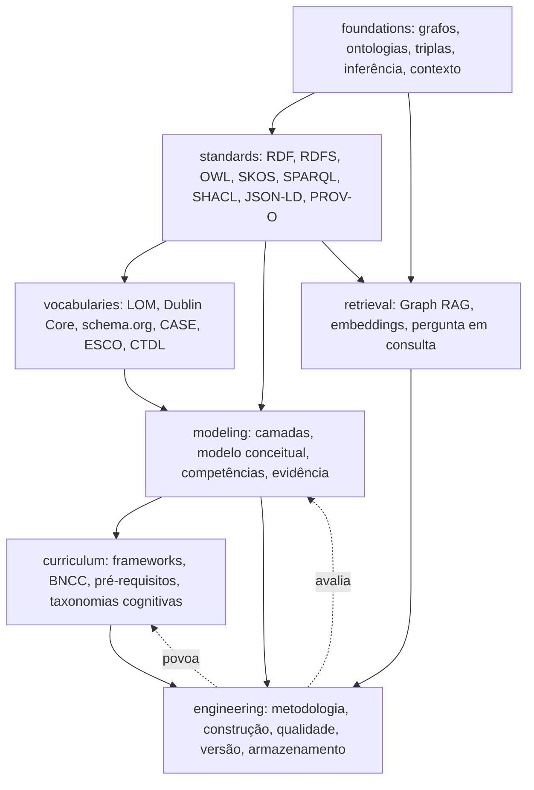
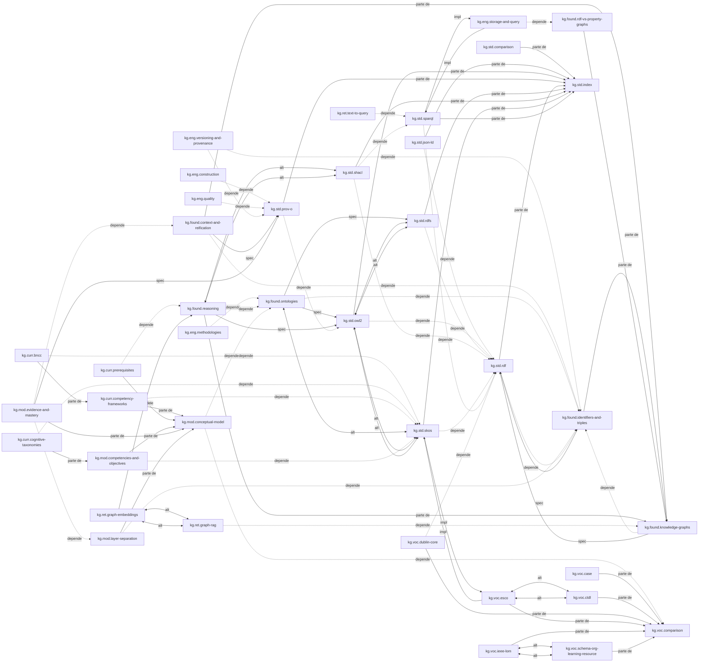

# Mapa de conceitos: grafo de conhecimento educacional

A primeira parte é escrita à mão e descreve as dependências entre áreas. A segunda é gerada a partir dos frontmatters com `python conhecimento/_modelo/gerar_mapa.py grafo-conhecimento-educacional` e lista todos os documentos e relações. Regenere a segunda parte ao adicionar documentos.

## Visão geral das dependências

## Como ler o mapa

**Quatro decisões em cadeia.** [I] Os documentos se organizam em torno de quatro perguntas, nesta ordem. Cada uma só faz sentido depois da anterior.

1. **Que modelo de grafo?** RDF ou grafo de propriedades. A resposta decide quase tudo o que vem depois, e é reversível com custo de engenharia, não de modelagem. Ver `kg.found.rdf-vs-property-graphs`.
2. **Que camadas da pilha?** SKOS basta, ou é preciso OWL? Onde entra validação? Ver `kg.std.comparison`.
3. **O que reusar e o que criar?** A tabela de cobertura por vocabulário responde, e a conclusão é que o que precisa ser criado é pequeno: pré-requisito, evidência, estado de domínio. Ver `kg.voc.comparison`.
4. **Como separar o que não deve ser misturado?** Grafo conceitual, modelo do aluno e dados observados. Ver `kg.mod.layer-separation`.

**A recomendação central do domínio** está em `kg.mod.layer-separation` e se repete em `kg.mod.conceptual-model`, `kg.mod.evidence-and-mastery` e `kg.eng.storage-and-query`: três camadas, uma chave de ligação (o IRI do conceito), políticas distintas de versão, acesso e retenção.

**Três armadilhas recorrentes**, tratadas em `kg.std.comparison`: usar OWL como validador, usar `owl:sameAs` como mapeamento entre currículos e usar `skos:broader` ou `skos:related` como pré-requisito.

**Onde o domínio é mais fraco**: `kg.ret.text-to-query` é quase todo recomendação de engenharia, sem literatura consultada; `kg.curr.bncc` descreve uma proposta de modelagem, porque a BNCC não é publicada como grafo; e `kg.curr.cognitive-taxonomies` não enumera os níveis da taxonomia de Bloom porque o texto de Krathwohl não pôde ser consultado.

## Gerado a partir dos frontmatters

### Documentos

| Id | Tipo | Arquivo | Título |
|---|---|---|---|
| `kg.brief` | relatorio | [00-brief.md](00-brief.md) | Brief do domínio grafo de conhecimento educacional |
| `kg.curr.bncc` | estudo-de-caso | [curriculum/bncc.md](curriculum/bncc.md) | BNCC como grafo |
| `kg.curr.cognitive-taxonomies` | conceito | [curriculum/cognitive-taxonomies.md](curriculum/cognitive-taxonomies.md) | Taxonomias cognitivas no grafo |
| `kg.curr.competency-frameworks` | conceito | [curriculum/competency-frameworks.md](curriculum/competency-frameworks.md) | Frameworks de competência como grafo |
| `kg.curr.prerequisites` | conceito | [curriculum/prerequisites.md](curriculum/prerequisites.md) | Pré-requisitos e progressões de aprendizagem |
| `kg.eng.construction` | tecnica | [engineering/construction.md](engineering/construction.md) | Construção e povoamento do grafo |
| `kg.eng.methodologies` | tecnica | [engineering/methodologies.md](engineering/methodologies.md) | Metodologias de construção de ontologia |
| `kg.eng.quality` | tecnica | [engineering/quality.md](engineering/quality.md) | Qualidade e avaliação do grafo |
| `kg.eng.storage-and-query` | comparacao | [engineering/storage-and-query.md](engineering/storage-and-query.md) | Armazenamento e consulta |
| `kg.eng.versioning-and-provenance` | tecnica | [engineering/versioning-and-provenance.md](engineering/versioning-and-provenance.md) | Versionamento e proveniência do grafo |
| `kg.found.context-and-reification` | tecnica | [foundations/context-and-reification.md](foundations/context-and-reification.md) | Contexto, reificação e anotação de arestas |
| `kg.found.identifiers-and-triples` | conceito | [foundations/identifiers-and-triples.md](foundations/identifiers-and-triples.md) | Triplas, IRIs e identidade |
| `kg.found.knowledge-graphs` | conceito | [foundations/knowledge-graphs.md](foundations/knowledge-graphs.md) | Grafo de conhecimento |
| `kg.found.ontologies` | conceito | [foundations/ontologies.md](foundations/ontologies.md) | Ontologia |
| `kg.found.rdf-vs-property-graphs` | comparacao | [foundations/rdf-vs-property-graphs.md](foundations/rdf-vs-property-graphs.md) | RDF e grafos de propriedades, comparação |
| `kg.found.reasoning` | conceito | [foundations/reasoning.md](foundations/reasoning.md) | Inferência e raciocínio sobre grafos |
| `kg.mod.competencies-and-objectives` | conceito | [modeling/competencies-and-objectives.md](modeling/competencies-and-objectives.md) | Competências, habilidades e objetivos de aprendizagem |
| `kg.mod.conceptual-model` | conceito | [modeling/conceptual-model.md](modeling/conceptual-model.md) | Modelo conceitual do grafo educacional |
| `kg.mod.evidence-and-mastery` | conceito | [modeling/evidence-and-mastery.md](modeling/evidence-and-mastery.md) | Evidência e estado de domínio no grafo |
| `kg.mod.layer-separation` | conceito | [modeling/layer-separation.md](modeling/layer-separation.md) | Separação entre grafo conceitual, modelo do aluno e dados observados |
| `kg.ret.graph-embeddings` | tecnica | [retrieval/graph-embeddings.md](retrieval/graph-embeddings.md) | Embeddings de grafo |
| `kg.ret.graph-rag` | tecnica | [retrieval/graph-rag.md](retrieval/graph-rag.md) | Graph RAG |
| `kg.ret.text-to-query` | tecnica | [retrieval/text-to-query.md](retrieval/text-to-query.md) | Tradução de pergunta em consulta ao grafo |
| `kg.std.comparison` | comparacao | [standards/comparison.md](standards/comparison.md) | Quando usar cada padrão da pilha |
| `kg.std.index` | padrao | [standards/index.md](standards/index.md) | Índice de normas e especificações do domínio |
| `kg.std.json-ld` | padrao | [standards/json-ld.md](standards/json-ld.md) | JSON-LD 1.1 |
| `kg.std.owl2` | padrao | [standards/owl2.md](standards/owl2.md) | OWL 2 e seus perfis |
| `kg.std.prov-o` | padrao | [standards/prov-o.md](standards/prov-o.md) | PROV-O |
| `kg.std.rdf` | padrao | [standards/rdf.md](standards/rdf.md) | RDF 1.1 e RDF 1.2 |
| `kg.std.rdfs` | padrao | [standards/rdfs.md](standards/rdfs.md) | RDF Schema 1.1 |
| `kg.std.shacl` | padrao | [standards/shacl.md](standards/shacl.md) | SHACL |
| `kg.std.skos` | padrao | [standards/skos.md](standards/skos.md) | SKOS |
| `kg.std.sparql` | padrao | [standards/sparql.md](standards/sparql.md) | SPARQL 1.1 |
| `kg.voc.case` | padrao | [vocabularies/case.md](vocabularies/case.md) | 1EdTech CASE |
| `kg.voc.comparison` | comparacao | [vocabularies/comparison.md](vocabularies/comparison.md) | Vocabulários educacionais, comparação |
| `kg.voc.ctdl` | padrao | [vocabularies/ctdl.md](vocabularies/ctdl.md) | CTDL (Credential Transparency Description Language) |
| `kg.voc.dublin-core` | padrao | [vocabularies/dublin-core.md](vocabularies/dublin-core.md) | Dublin Core e DCMI Metadata Terms |
| `kg.voc.esco` | padrao | [vocabularies/esco.md](vocabularies/esco.md) | ESCO |
| `kg.voc.ieee-lom` | padrao | [vocabularies/ieee-lom.md](vocabularies/ieee-lom.md) | IEEE LOM (1484.12.1) |
| `kg.voc.schema-org-learning-resource` | padrao | [vocabularies/schema-org-learning-resource.md](vocabularies/schema-org-learning-resource.md) | schema.org LearningResource |

### Relações tipadas

| Tipo | Quantidade |
|---|---|
| `relacionado-a` | 88 |
| `complementa` | 49 |
| `depende-de` | 32 |
| `parte-de` | 27 |
| `alternativa-a` | 13 |
| `especificado-por` | 7 |
| `avaliado-por` | 6 |
| `implementado-por` | 4 |

| Origem | Tipo | Alvo |
|---|---|---|
| `kg.curr.bncc` | complementa | `kg.mod.competencies-and-objectives` |
| `kg.curr.bncc` | depende-de | `kg.std.skos` |
| `kg.curr.bncc` | parte-de | `kg.curr.competency-frameworks` |
| `kg.curr.bncc` | relacionado-a | `kg.eng.construction` |
| `kg.curr.bncc` | relacionado-a | `kg.voc.case` |
| `kg.curr.cognitive-taxonomies` | depende-de | `kg.std.skos` |
| `kg.curr.cognitive-taxonomies` | parte-de | `kg.mod.competencies-and-objectives` |
| `kg.curr.cognitive-taxonomies` | relacionado-a | `adp.id.knowledge-components` (inexistente) |
| `kg.curr.cognitive-taxonomies` | relacionado-a | `kg.mod.conceptual-model` |
| `kg.curr.cognitive-taxonomies` | relacionado-a | `kg.voc.case` |
| `kg.curr.competency-frameworks` | complementa | `kg.curr.bncc` |
| `kg.curr.competency-frameworks` | complementa | `kg.curr.prerequisites` |
| `kg.curr.competency-frameworks` | depende-de | `kg.std.skos` |
| `kg.curr.competency-frameworks` | parte-de | `kg.mod.conceptual-model` |
| `kg.curr.competency-frameworks` | relacionado-a | `kg.eng.versioning-and-provenance` |
| `kg.curr.competency-frameworks` | relacionado-a | `kg.voc.case` |
| `kg.curr.competency-frameworks` | relacionado-a | `kg.voc.esco` |
| `kg.curr.prerequisites` | avaliado-por | `kg.std.shacl` |
| `kg.curr.prerequisites` | complementa | `kg.curr.competency-frameworks` |
| `kg.curr.prerequisites` | depende-de | `kg.found.reasoning` |
| `kg.curr.prerequisites` | parte-de | `kg.mod.conceptual-model` |
| `kg.curr.prerequisites` | relacionado-a | `adp.adapt.sequencing-policies` (inexistente) |
| `kg.curr.prerequisites` | relacionado-a | `kg.eng.construction` |
| `kg.curr.prerequisites` | relacionado-a | `kg.voc.case` |
| `kg.eng.construction` | avaliado-por | `kg.eng.quality` |
| `kg.eng.construction` | complementa | `kg.eng.methodologies` |
| `kg.eng.construction` | depende-de | `kg.std.prov-o` |
| `kg.eng.construction` | relacionado-a | `kg.curr.bncc` |
| `kg.eng.construction` | relacionado-a | `kg.curr.prerequisites` |
| `kg.eng.construction` | relacionado-a | `kg.ret.graph-rag` |
| `kg.eng.methodologies` | complementa | `kg.eng.construction` |
| `kg.eng.methodologies` | complementa | `kg.eng.quality` |
| `kg.eng.methodologies` | depende-de | `kg.found.ontologies` |
| `kg.eng.methodologies` | relacionado-a | `kg.mod.conceptual-model` |
| `kg.eng.methodologies` | relacionado-a | `kg.voc.comparison` |
| `kg.eng.quality` | avaliado-por | `kg.std.shacl` |
| `kg.eng.quality` | complementa | `kg.eng.construction` |
| `kg.eng.quality` | complementa | `kg.eng.methodologies` |
| `kg.eng.quality` | depende-de | `kg.std.prov-o` |
| `kg.eng.quality` | relacionado-a | `kg.eng.versioning-and-provenance` |
| `kg.eng.storage-and-query` | complementa | `kg.mod.layer-separation` |
| `kg.eng.storage-and-query` | depende-de | `kg.found.rdf-vs-property-graphs` |
| `kg.eng.storage-and-query` | implementado-por | `kg.std.sparql` |
| `kg.eng.storage-and-query` | relacionado-a | `kg.eng.quality` |
| `kg.eng.storage-and-query` | relacionado-a | `kg.found.reasoning` |
| `kg.eng.versioning-and-provenance` | complementa | `kg.eng.quality` |
| `kg.eng.versioning-and-provenance` | complementa | `kg.found.context-and-reification` |
| `kg.eng.versioning-and-provenance` | depende-de | `kg.found.identifiers-and-triples` |
| `kg.eng.versioning-and-provenance` | depende-de | `kg.std.prov-o` |
| `kg.eng.versioning-and-provenance` | relacionado-a | `kg.curr.competency-frameworks` |
| `kg.eng.versioning-and-provenance` | relacionado-a | `kg.mod.layer-separation` |
| `kg.found.context-and-reification` | complementa | `kg.eng.versioning-and-provenance` |
| `kg.found.context-and-reification` | depende-de | `kg.found.identifiers-and-triples` |
| `kg.found.context-and-reification` | especificado-por | `kg.std.prov-o` |
| `kg.found.context-and-reification` | parte-de | `kg.found.knowledge-graphs` |
| `kg.found.context-and-reification` | relacionado-a | `kg.found.rdf-vs-property-graphs` |
| `kg.found.context-and-reification` | relacionado-a | `kg.mod.evidence-and-mastery` |
| `kg.found.identifiers-and-triples` | complementa | `kg.eng.versioning-and-provenance` |
| `kg.found.identifiers-and-triples` | especificado-por | `kg.std.rdf` |
| `kg.found.identifiers-and-triples` | parte-de | `kg.found.knowledge-graphs` |
| `kg.found.identifiers-and-triples` | relacionado-a | `kg.found.context-and-reification` |
| `kg.found.knowledge-graphs` | complementa | `kg.found.context-and-reification` |
| `kg.found.knowledge-graphs` | complementa | `kg.found.ontologies` |
| `kg.found.knowledge-graphs` | depende-de | `kg.found.identifiers-and-triples` |
| `kg.found.knowledge-graphs` | especificado-por | `kg.std.rdf` |
| `kg.found.knowledge-graphs` | relacionado-a | `kg.found.rdf-vs-property-graphs` |
| `kg.found.knowledge-graphs` | relacionado-a | `kg.found.reasoning` |
| `kg.found.knowledge-graphs` | relacionado-a | `kg.mod.conceptual-model` |
| `kg.found.ontologies` | alternativa-a | `kg.std.skos` |
| `kg.found.ontologies` | complementa | `kg.found.knowledge-graphs` |
| `kg.found.ontologies` | depende-de | `kg.found.identifiers-and-triples` |
| `kg.found.ontologies` | especificado-por | `kg.std.owl2` |
| `kg.found.ontologies` | especificado-por | `kg.std.rdfs` |
| `kg.found.ontologies` | relacionado-a | `kg.eng.methodologies` |
| `kg.found.ontologies` | relacionado-a | `kg.found.reasoning` |
| `kg.found.rdf-vs-property-graphs` | parte-de | `kg.found.knowledge-graphs` |
| `kg.found.rdf-vs-property-graphs` | relacionado-a | `kg.eng.storage-and-query` |
| `kg.found.rdf-vs-property-graphs` | relacionado-a | `kg.found.context-and-reification` |
| `kg.found.rdf-vs-property-graphs` | relacionado-a | `kg.std.comparison` |
| `kg.found.reasoning` | alternativa-a | `kg.std.shacl` |
| `kg.found.reasoning` | depende-de | `kg.found.ontologies` |
| `kg.found.reasoning` | especificado-por | `kg.std.owl2` |
| `kg.found.reasoning` | parte-de | `kg.found.knowledge-graphs` |
| `kg.found.reasoning` | relacionado-a | `kg.curr.prerequisites` |
| `kg.found.reasoning` | relacionado-a | `kg.eng.storage-and-query` |
| `kg.mod.competencies-and-objectives` | complementa | `kg.curr.cognitive-taxonomies` |
| `kg.mod.competencies-and-objectives` | complementa | `kg.curr.competency-frameworks` |
| `kg.mod.competencies-and-objectives` | depende-de | `kg.std.skos` |
| `kg.mod.competencies-and-objectives` | parte-de | `kg.mod.conceptual-model` |
| `kg.mod.competencies-and-objectives` | relacionado-a | `adp.id.knowledge-components` (inexistente) |
| `kg.mod.competencies-and-objectives` | relacionado-a | `kg.voc.case` |
| `kg.mod.conceptual-model` | complementa | `kg.mod.competencies-and-objectives` |
| `kg.mod.conceptual-model` | complementa | `kg.mod.evidence-and-mastery` |
| `kg.mod.conceptual-model` | complementa | `kg.mod.layer-separation` |
| `kg.mod.conceptual-model` | depende-de | `kg.found.ontologies` |
| `kg.mod.conceptual-model` | depende-de | `kg.voc.comparison` |
| `kg.mod.conceptual-model` | relacionado-a | `adp.id.knowledge-components` (inexistente) |
| `kg.mod.conceptual-model` | relacionado-a | `kg.curr.prerequisites` |
| `kg.mod.conceptual-model` | relacionado-a | `kg.std.comparison` |
| `kg.mod.evidence-and-mastery` | complementa | `adp.lm.learner-model` (inexistente) |
| `kg.mod.evidence-and-mastery` | depende-de | `kg.found.context-and-reification` |
| `kg.mod.evidence-and-mastery` | depende-de | `kg.mod.layer-separation` |
| `kg.mod.evidence-and-mastery` | especificado-por | `kg.std.prov-o` |
| `kg.mod.evidence-and-mastery` | parte-de | `kg.mod.conceptual-model` |
| `kg.mod.evidence-and-mastery` | relacionado-a | `adp.kt.bayesian-knowledge-tracing` (inexistente) |
| `kg.mod.evidence-and-mastery` | relacionado-a | `kg.found.reasoning` |
| `kg.mod.layer-separation` | complementa | `adp.id.knowledge-components` (inexistente) |
| `kg.mod.layer-separation` | complementa | `adp.lm.learner-model` (inexistente) |
| `kg.mod.layer-separation` | complementa | `kg.found.context-and-reification` |
| `kg.mod.layer-separation` | complementa | `kg.mod.evidence-and-mastery` |
| `kg.mod.layer-separation` | depende-de | `kg.found.identifiers-and-triples` |
| `kg.mod.layer-separation` | parte-de | `kg.mod.conceptual-model` |
| `kg.mod.layer-separation` | relacionado-a | `kg.eng.versioning-and-provenance` |
| `kg.mod.layer-separation` | relacionado-a | `kg.ret.graph-rag` |
| `kg.ret.graph-embeddings` | alternativa-a | `kg.ret.graph-rag` |
| `kg.ret.graph-embeddings` | complementa | `kg.eng.construction` |
| `kg.ret.graph-embeddings` | parte-de | `kg.found.reasoning` |
| `kg.ret.graph-embeddings` | relacionado-a | `kg.curr.prerequisites` |
| `kg.ret.graph-embeddings` | relacionado-a | `kg.eng.quality` |
| `kg.ret.graph-rag` | alternativa-a | `kg.ret.graph-embeddings` |
| `kg.ret.graph-rag` | complementa | `kg.ret.text-to-query` |
| `kg.ret.graph-rag` | depende-de | `kg.found.knowledge-graphs` |
| `kg.ret.graph-rag` | relacionado-a | `kg.eng.construction` |
| `kg.ret.graph-rag` | relacionado-a | `kg.mod.layer-separation` |
| `kg.ret.text-to-query` | avaliado-por | `kg.eng.quality` |
| `kg.ret.text-to-query` | complementa | `kg.ret.graph-rag` |
| `kg.ret.text-to-query` | depende-de | `kg.std.sparql` |
| `kg.ret.text-to-query` | relacionado-a | `kg.found.ontologies` |
| `kg.std.comparison` | parte-de | `kg.std.index` |
| `kg.std.comparison` | relacionado-a | `kg.found.rdf-vs-property-graphs` |
| `kg.std.comparison` | relacionado-a | `kg.std.owl2` |
| `kg.std.comparison` | relacionado-a | `kg.std.rdf` |
| `kg.std.comparison` | relacionado-a | `kg.std.rdfs` |
| `kg.std.comparison` | relacionado-a | `kg.std.shacl` |
| `kg.std.comparison` | relacionado-a | `kg.std.skos` |
| `kg.std.comparison` | relacionado-a | `kg.std.sparql` |
| `kg.std.index` | relacionado-a | `kg.std.comparison` |
| `kg.std.index` | relacionado-a | `kg.std.json-ld` |
| `kg.std.index` | relacionado-a | `kg.std.owl2` |
| `kg.std.index` | relacionado-a | `kg.std.prov-o` |
| `kg.std.index` | relacionado-a | `kg.std.rdf` |
| `kg.std.index` | relacionado-a | `kg.std.rdfs` |
| `kg.std.index` | relacionado-a | `kg.std.shacl` |
| `kg.std.index` | relacionado-a | `kg.std.skos` |
| `kg.std.index` | relacionado-a | `kg.std.sparql` |
| `kg.std.index` | relacionado-a | `kg.voc.comparison` |
| `kg.std.json-ld` | complementa | `kg.voc.schema-org-learning-resource` |
| `kg.std.json-ld` | depende-de | `kg.std.rdf` |
| `kg.std.json-ld` | parte-de | `kg.std.index` |
| `kg.std.json-ld` | relacionado-a | `kg.voc.case` |
| `kg.std.owl2` | alternativa-a | `kg.std.rdfs` |
| `kg.std.owl2` | alternativa-a | `kg.std.skos` |
| `kg.std.owl2` | avaliado-por | `kg.found.reasoning` |
| `kg.std.owl2` | complementa | `kg.found.ontologies` |
| `kg.std.owl2` | depende-de | `kg.std.rdf` |
| `kg.std.owl2` | parte-de | `kg.std.index` |
| `kg.std.owl2` | relacionado-a | `kg.eng.versioning-and-provenance` |
| `kg.std.prov-o` | complementa | `kg.eng.versioning-and-provenance` |
| `kg.std.prov-o` | complementa | `kg.found.context-and-reification` |
| `kg.std.prov-o` | depende-de | `kg.std.owl2` |
| `kg.std.prov-o` | parte-de | `kg.std.index` |
| `kg.std.prov-o` | relacionado-a | `kg.mod.evidence-and-mastery` |
| `kg.std.rdf` | complementa | `kg.std.json-ld` |
| `kg.std.rdf` | complementa | `kg.std.rdfs` |
| `kg.std.rdf` | depende-de | `kg.found.identifiers-and-triples` |
| `kg.std.rdf` | parte-de | `kg.std.index` |
| `kg.std.rdf` | relacionado-a | `kg.found.context-and-reification` |
| `kg.std.rdfs` | alternativa-a | `kg.std.owl2` |
| `kg.std.rdfs` | complementa | `kg.found.ontologies` |
| `kg.std.rdfs` | depende-de | `kg.std.rdf` |
| `kg.std.rdfs` | parte-de | `kg.std.index` |
| `kg.std.rdfs` | relacionado-a | `kg.found.reasoning` |
| `kg.std.shacl` | alternativa-a | `kg.found.reasoning` |
| `kg.std.shacl` | avaliado-por | `kg.eng.quality` |
| `kg.std.shacl` | depende-de | `kg.std.rdf` |
| `kg.std.shacl` | depende-de | `kg.std.sparql` |
| `kg.std.shacl` | parte-de | `kg.std.index` |
| `kg.std.shacl` | relacionado-a | `kg.std.owl2` |
| `kg.std.skos` | alternativa-a | `kg.std.owl2` |
| `kg.std.skos` | complementa | `kg.curr.competency-frameworks` |
| `kg.std.skos` | depende-de | `kg.std.rdf` |
| `kg.std.skos` | implementado-por | `kg.voc.esco` |
| `kg.std.skos` | parte-de | `kg.std.index` |
| `kg.std.skos` | relacionado-a | `kg.found.reasoning` |
| `kg.std.sparql` | complementa | `kg.found.reasoning` |
| `kg.std.sparql` | depende-de | `kg.std.rdf` |
| `kg.std.sparql` | implementado-por | `kg.eng.storage-and-query` |
| `kg.std.sparql` | parte-de | `kg.std.index` |
| `kg.std.sparql` | relacionado-a | `kg.ret.text-to-query` |
| `kg.voc.case` | complementa | `kg.curr.competency-frameworks` |
| `kg.voc.case` | complementa | `kg.curr.prerequisites` |
| `kg.voc.case` | parte-de | `kg.voc.comparison` |
| `kg.voc.case` | relacionado-a | `kg.curr.bncc` |
| `kg.voc.case` | relacionado-a | `kg.curr.cognitive-taxonomies` |
| `kg.voc.case` | relacionado-a | `kg.std.skos` |
| `kg.voc.comparison` | complementa | `kg.mod.conceptual-model` |
| `kg.voc.comparison` | relacionado-a | `kg.std.comparison` |
| `kg.voc.comparison` | relacionado-a | `kg.voc.case` |
| `kg.voc.comparison` | relacionado-a | `kg.voc.ctdl` |
| `kg.voc.comparison` | relacionado-a | `kg.voc.dublin-core` |
| `kg.voc.comparison` | relacionado-a | `kg.voc.esco` |
| `kg.voc.comparison` | relacionado-a | `kg.voc.ieee-lom` |
| `kg.voc.comparison` | relacionado-a | `kg.voc.schema-org-learning-resource` |
| `kg.voc.ctdl` | alternativa-a | `kg.voc.esco` |
| `kg.voc.ctdl` | complementa | `kg.curr.competency-frameworks` |
| `kg.voc.ctdl` | parte-de | `kg.voc.comparison` |
| `kg.voc.ctdl` | relacionado-a | `kg.std.rdf` |
| `kg.voc.dublin-core` | complementa | `kg.voc.ieee-lom` |
| `kg.voc.dublin-core` | complementa | `kg.voc.schema-org-learning-resource` |
| `kg.voc.dublin-core` | depende-de | `kg.std.rdf` |
| `kg.voc.dublin-core` | parte-de | `kg.voc.comparison` |
| `kg.voc.dublin-core` | relacionado-a | `kg.std.skos` |
| `kg.voc.esco` | alternativa-a | `kg.voc.ctdl` |
| `kg.voc.esco` | complementa | `kg.curr.competency-frameworks` |
| `kg.voc.esco` | implementado-por | `kg.std.skos` |
| `kg.voc.esco` | parte-de | `kg.voc.comparison` |
| `kg.voc.esco` | relacionado-a | `kg.found.identifiers-and-triples` |
| `kg.voc.ieee-lom` | alternativa-a | `kg.voc.schema-org-learning-resource` |
| `kg.voc.ieee-lom` | complementa | `kg.voc.dublin-core` |
| `kg.voc.ieee-lom` | parte-de | `kg.voc.comparison` |
| `kg.voc.ieee-lom` | relacionado-a | `kg.mod.conceptual-model` |
| `kg.voc.schema-org-learning-resource` | alternativa-a | `kg.voc.ieee-lom` |
| `kg.voc.schema-org-learning-resource` | complementa | `kg.std.json-ld` |
| `kg.voc.schema-org-learning-resource` | complementa | `kg.voc.dublin-core` |
| `kg.voc.schema-org-learning-resource` | parte-de | `kg.voc.comparison` |
| `kg.voc.schema-org-learning-resource` | relacionado-a | `kg.mod.conceptual-model` |

### Diagrama (relações estruturais)

