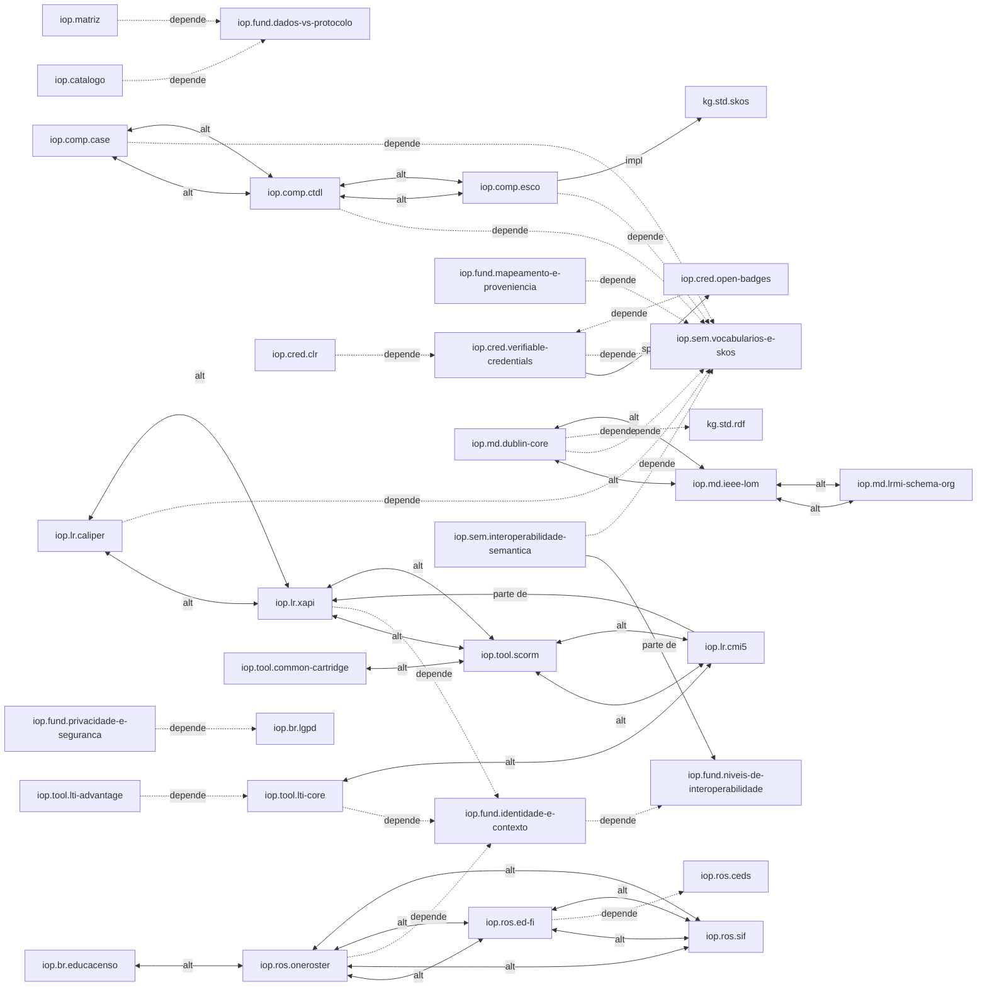

# Mapa de conceitos: interoperabilidade

Relações entre os documentos do domínio. A seção "Gerado" é produzida por `_modelo/gerar_mapa.py` a partir do frontmatter; não edite à mão.

## Leitura do mapa

Três eixos organizam o domínio:

1. **Camadas** (`fundamentos/`): níveis de interoperabilidade, identidade, mapeamento, conformidade e privacidade valem para todos os padrões. Quase todo documento de padrão depende de pelo menos um deles.
2. **Função** (`learning-records/`, `tool-integration/`, `assessment/`, `rostering/`, `metadata/`, `competencies/`, `credentials/`): cada pasta responde a uma pergunta operacional distinta. Dentro de cada uma, as relações são sobretudo `alternativa-a`.
3. **Cola semântica** (`semantics/`): SKOS e interoperabilidade semântica são alvo de `depende-de` a partir de quase todas as outras pastas, porque todas deixam valores em aberto.

Os documentos `comparison.md` de cada pasta e os de raiz (`catalogo-padroes.md`, `matriz-comparativa.md`) agregam, e por isso concentram relações `relacionado-a`.

## Lacunas conhecidas no mapa

- Não há documento sobre perfis xAPI, embora vários documentos apontem para a necessidade dele.
- `health/` conecta-se pouco ao resto: falta o documento que mostre como códigos CIF atravessam um padrão educacional.
- `brazil/` não tem par para `iop.ros.*`: falta o mapeamento entre o leiaute do Censo Escolar e um padrão internacional.

## Gerado

### Documentos

| Id | Tipo | Arquivo | Título |
|---|---|---|---|
| `iop.asmt.qti` | padrao | [assessment/qti.md](assessment/qti.md) | QTI 3.0 (Question and Test Interoperability) |
| `iop.br.educacenso` | padrao | [brazil/educacenso.md](brazil/educacenso.md) | Educacenso e o Censo Escolar |
| `iop.br.lgpd` | conceito | [brazil/lgpd.md](brazil/lgpd.md) | LGPD aplicada à troca de dados educacionais |
| `iop.brief` | relatorio | [00-brief.md](00-brief.md) | Brief do domínio padrões de interoperabilidade |
| `iop.catalogo` | mapa | [catalogo-padroes.md](catalogo-padroes.md) | Catálogo de padrões |
| `iop.comp.case` | padrao | [competencies/case.md](competencies/case.md) | CASE (Competencies and Academic Standards Exchange) |
| `iop.comp.ctdl` | padrao | [competencies/ctdl.md](competencies/ctdl.md) | CTDL e CTDL-ASN (Credential Transparency Description Language) |
| `iop.comp.esco` | padrao | [competencies/esco.md](competencies/esco.md) | ESCO (European Skills, Competences, Qualifications and Occupations) |
| `iop.cred.clr` | padrao | [credentials/clr.md](credentials/clr.md) | Comprehensive Learner Record (CLR) 2.0 |
| `iop.cred.open-badges` | padrao | [credentials/open-badges.md](credentials/open-badges.md) | Open Badges 3.0 |
| `iop.cred.verifiable-credentials` | padrao | [credentials/verifiable-credentials.md](credentials/verifiable-credentials.md) | W3C Verifiable Credentials Data Model 2.0 |
| `iop.exemplos` | comparacao | [exemplos-payloads.md](exemplos-payloads.md) | Exemplos de mensagens e payloads |
| `iop.fund.conformidade-e-certificacao` | conceito | [fundamentos/conformidade-e-certificacao.md](fundamentos/conformidade-e-certificacao.md) | Conformidade, certificação e o que elas garantem |
| `iop.fund.dados-vs-protocolo` | conceito | [fundamentos/dados-vs-protocolo.md](fundamentos/dados-vs-protocolo.md) | Padrões de dados, de protocolo e de empacotamento |
| `iop.fund.identidade-e-contexto` | conceito | [fundamentos/identidade-e-contexto.md](fundamentos/identidade-e-contexto.md) | Identidade, papéis e contexto na troca de dados educacionais |
| `iop.fund.mapeamento-e-proveniencia` | tecnica | [fundamentos/mapeamento-e-proveniencia.md](fundamentos/mapeamento-e-proveniencia.md) | Mapeamento entre padrões e preservação de proveniência |
| `iop.fund.niveis-de-interoperabilidade` | conceito | [fundamentos/niveis-de-interoperabilidade.md](fundamentos/niveis-de-interoperabilidade.md) | Níveis de interoperabilidade (técnica, semântica, organizacional, jurídica) |
| `iop.fund.privacidade-e-seguranca` | conceito | [fundamentos/privacidade-e-seguranca.md](fundamentos/privacidade-e-seguranca.md) | Privacidade, consentimento e segurança na troca de dados educacionais |
| `iop.glossario` | glossario | [glossario.md](glossario.md) | Glossário de interoperabilidade educacional |
| `iop.health.cif` | padrao | [health/cif.md](health/cif.md) | CIF / ICF (Classificação Internacional de Funcionalidade) |
| `iop.health.fhir` | padrao | [health/fhir.md](health/fhir.md) | HL7 FHIR R5 |
| `iop.index` | mapa | [README.md](README.md) | Padrões de interoperabilidade educacional |
| `iop.lr.caliper` | padrao | [learning-records/caliper.md](learning-records/caliper.md) | Caliper Analytics |
| `iop.lr.cmi5` | padrao | [learning-records/cmi5.md](learning-records/cmi5.md) | cmi5 |
| `iop.lr.comparison` | comparacao | [learning-records/comparison.md](learning-records/comparison.md) | Comparação entre xAPI, cmi5, Caliper e SCORM |
| `iop.lr.xapi` | padrao | [learning-records/xapi.md](learning-records/xapi.md) | xAPI (Experience API, IEEE 9274.1.1) |
| `iop.mapa` | mapa | [mapa-conceitos.md](mapa-conceitos.md) | Mapa de conceitos do domínio interoperabilidade |
| `iop.matriz` | comparacao | [matriz-comparativa.md](matriz-comparativa.md) | Matriz comparativa por caso de uso |
| `iop.md.comparison` | comparacao | [metadata/comparison.md](metadata/comparison.md) | Comparação entre IEEE LOM, Dublin Core e LRMI/schema.org |
| `iop.md.dublin-core` | padrao | [metadata/dublin-core.md](metadata/dublin-core.md) | Dublin Core (DCMI Metadata Terms) |
| `iop.md.ieee-lom` | padrao | [metadata/ieee-lom.md](metadata/ieee-lom.md) | IEEE LOM (1484.12.1, Learning Object Metadata) |
| `iop.md.lrmi-schema-org` | padrao | [metadata/lrmi-schema-org.md](metadata/lrmi-schema-org.md) | LRMI e schema.org LearningResource |
| `iop.plano-ids` | mapa | [_plano-ids.md](_plano-ids.md) | Plano de identificadores do domínio |
| `iop.relatorio` | relatorio | [relatorio.md](relatorio.md) | Relatório da primeira versão do domínio |
| `iop.ros.ceds` | padrao | [rostering/ceds.md](rostering/ceds.md) | CEDS (Common Education Data Standards) |
| `iop.ros.comparison` | comparacao | [rostering/comparison.md](rostering/comparison.md) | Comparação entre OneRoster, Ed-Fi, SIF e CEDS |
| `iop.ros.ed-fi` | padrao | [rostering/ed-fi.md](rostering/ed-fi.md) | Ed-Fi Data Standard |
| `iop.ros.oneroster` | padrao | [rostering/oneroster.md](rostering/oneroster.md) | OneRoster 1.2 |
| `iop.ros.sif` | padrao | [rostering/sif.md](rostering/sif.md) | SIF (Systems Interoperability Framework) |
| `iop.sem.interoperabilidade-semantica` | conceito | [semantics/interoperabilidade-semantica.md](semantics/interoperabilidade-semantica.md) | Interoperabilidade semântica em sistemas educacionais |
| `iop.sem.vocabularios-e-skos` | padrao | [semantics/vocabularios-e-skos.md](semantics/vocabularios-e-skos.md) | Vocabulários controlados e SKOS |
| `iop.tool.common-cartridge` | padrao | [tool-integration/common-cartridge.md](tool-integration/common-cartridge.md) | Common Cartridge |
| `iop.tool.lti-advantage` | protocolo | [tool-integration/lti-advantage.md](tool-integration/lti-advantage.md) | LTI Advantage (NRPS, AGS, Deep Linking) |
| `iop.tool.lti-core` | protocolo | [tool-integration/lti-core.md](tool-integration/lti-core.md) | LTI 1.3 (Learning Tools Interoperability Core) |
| `iop.tool.scorm` | padrao | [tool-integration/scorm.md](tool-integration/scorm.md) | SCORM |

### Relações tipadas

| Tipo | Quantidade |
|---|---|
| `relacionado-a` | 60 |
| `complementa` | 53 |
| `alternativa-a` | 23 |
| `depende-de` | 20 |
| `parte-de` | 2 |
| `implementado-por` | 1 |
| `especificado-por` | 1 |

| Origem | Tipo | Alvo |
|---|---|---|
| `iop.asmt.qti` | complementa | `iop.md.ieee-lom` |
| `iop.asmt.qti` | complementa | `iop.tool.common-cartridge` |
| `iop.asmt.qti` | relacionado-a | `iop.comp.case` |
| `iop.asmt.qti` | relacionado-a | `iop.tool.lti-advantage` |
| `iop.br.educacenso` | alternativa-a | `iop.ros.oneroster` |
| `iop.br.educacenso` | complementa | `iop.br.lgpd` |
| `iop.br.educacenso` | relacionado-a | `iop.ros.comparison` |
| `iop.br.lgpd` | complementa | `iop.br.educacenso` |
| `iop.br.lgpd` | complementa | `iop.fund.privacidade-e-seguranca` |
| `iop.br.lgpd` | relacionado-a | `iop.fund.identidade-e-contexto` |
| `iop.catalogo` | complementa | `iop.matriz` |
| `iop.catalogo` | depende-de | `iop.fund.dados-vs-protocolo` |
| `iop.comp.case` | alternativa-a | `iop.comp.ctdl` |
| `iop.comp.case` | complementa | `iop.asmt.qti` |
| `iop.comp.case` | complementa | `iop.md.lrmi-schema-org` |
| `iop.comp.case` | complementa | `kg.curr.competency-frameworks` (outro domínio) |
| `iop.comp.case` | complementa | `kg.curr.prerequisites` (outro domínio) |
| `iop.comp.case` | depende-de | `iop.sem.vocabularios-e-skos` |
| `iop.comp.case` | relacionado-a | `kg.curr.bncc` (outro domínio) |
| `iop.comp.case` | relacionado-a | `kg.curr.cognitive-taxonomies` (outro domínio) |
| `iop.comp.case` | relacionado-a | `kg.std.skos` (outro domínio) |
| `iop.comp.case` | relacionado-a | `kg.voc.comparison` (outro domínio) |
| `iop.comp.ctdl` | alternativa-a | `iop.comp.case` |
| `iop.comp.ctdl` | alternativa-a | `iop.comp.esco` |
| `iop.comp.ctdl` | complementa | `iop.cred.open-badges` |
| `iop.comp.ctdl` | complementa | `kg.curr.competency-frameworks` (outro domínio) |
| `iop.comp.ctdl` | depende-de | `iop.sem.vocabularios-e-skos` |
| `iop.comp.ctdl` | relacionado-a | `kg.std.rdf` (outro domínio) |
| `iop.comp.ctdl` | relacionado-a | `kg.voc.comparison` (outro domínio) |
| `iop.comp.esco` | alternativa-a | `iop.comp.ctdl` |
| `iop.comp.esco` | complementa | `iop.comp.case` |
| `iop.comp.esco` | complementa | `kg.curr.competency-frameworks` (outro domínio) |
| `iop.comp.esco` | depende-de | `iop.sem.vocabularios-e-skos` |
| `iop.comp.esco` | implementado-por | `kg.std.skos` (outro domínio) |
| `iop.comp.esco` | relacionado-a | `kg.found.identifiers-and-triples` (outro domínio) |
| `iop.comp.esco` | relacionado-a | `kg.voc.comparison` (outro domínio) |
| `iop.cred.clr` | complementa | `iop.asmt.qti` |
| `iop.cred.clr` | complementa | `iop.cred.open-badges` |
| `iop.cred.clr` | depende-de | `iop.cred.verifiable-credentials` |
| `iop.cred.clr` | relacionado-a | `iop.comp.case` |
| `iop.cred.open-badges` | complementa | `iop.comp.case` |
| `iop.cred.open-badges` | complementa | `iop.cred.clr` |
| `iop.cred.open-badges` | depende-de | `iop.cred.verifiable-credentials` |
| `iop.cred.open-badges` | relacionado-a | `iop.fund.privacidade-e-seguranca` |
| `iop.cred.verifiable-credentials` | complementa | `iop.cred.clr` |
| `iop.cred.verifiable-credentials` | depende-de | `iop.sem.vocabularios-e-skos` |
| `iop.cred.verifiable-credentials` | especificado-por | `iop.cred.open-badges` |
| `iop.cred.verifiable-credentials` | relacionado-a | `iop.fund.privacidade-e-seguranca` |
| `iop.exemplos` | complementa | `iop.matriz` |
| `iop.exemplos` | relacionado-a | `iop.lr.comparison` |
| `iop.fund.conformidade-e-certificacao` | complementa | `iop.fund.niveis-de-interoperabilidade` |
| `iop.fund.conformidade-e-certificacao` | relacionado-a | `iop.catalogo` |
| `iop.fund.dados-vs-protocolo` | complementa | `iop.fund.niveis-de-interoperabilidade` |
| `iop.fund.dados-vs-protocolo` | relacionado-a | `iop.catalogo` |
| `iop.fund.identidade-e-contexto` | complementa | `iop.fund.privacidade-e-seguranca` |
| `iop.fund.identidade-e-contexto` | depende-de | `iop.fund.niveis-de-interoperabilidade` |
| `iop.fund.identidade-e-contexto` | relacionado-a | `iop.ros.oneroster` |
| `iop.fund.mapeamento-e-proveniencia` | complementa | `iop.sem.interoperabilidade-semantica` |
| `iop.fund.mapeamento-e-proveniencia` | depende-de | `iop.sem.vocabularios-e-skos` |
| `iop.fund.mapeamento-e-proveniencia` | relacionado-a | `iop.lr.comparison` |
| `iop.fund.niveis-de-interoperabilidade` | complementa | `iop.fund.conformidade-e-certificacao` |
| `iop.fund.niveis-de-interoperabilidade` | complementa | `iop.sem.interoperabilidade-semantica` |
| `iop.fund.niveis-de-interoperabilidade` | relacionado-a | `iop.fund.dados-vs-protocolo` |
| `iop.fund.privacidade-e-seguranca` | complementa | `iop.fund.identidade-e-contexto` |
| `iop.fund.privacidade-e-seguranca` | depende-de | `iop.br.lgpd` |
| `iop.fund.privacidade-e-seguranca` | relacionado-a | `iop.cred.verifiable-credentials` |
| `iop.health.cif` | complementa | `iop.health.fhir` |
| `iop.health.cif` | complementa | `iop.sem.interoperabilidade-semantica` |
| `iop.health.cif` | relacionado-a | `iop.fund.privacidade-e-seguranca` |
| `iop.health.fhir` | complementa | `iop.health.cif` |
| `iop.health.fhir` | relacionado-a | `iop.fund.privacidade-e-seguranca` |
| `iop.health.fhir` | relacionado-a | `iop.sem.interoperabilidade-semantica` |
| `iop.lr.caliper` | alternativa-a | `iop.lr.xapi` |
| `iop.lr.caliper` | complementa | `iop.tool.lti-core` |
| `iop.lr.caliper` | depende-de | `iop.sem.vocabularios-e-skos` |
| `iop.lr.caliper` | relacionado-a | `iop.lr.comparison` |
| `iop.lr.cmi5` | alternativa-a | `iop.tool.scorm` |
| `iop.lr.cmi5` | complementa | `iop.tool.lti-core` |
| `iop.lr.cmi5` | parte-de | `iop.lr.xapi` |
| `iop.lr.comparison` | complementa | `iop.fund.mapeamento-e-proveniencia` |
| `iop.lr.comparison` | relacionado-a | `iop.lr.caliper` |
| `iop.lr.comparison` | relacionado-a | `iop.lr.cmi5` |
| `iop.lr.comparison` | relacionado-a | `iop.lr.xapi` |
| `iop.lr.comparison` | relacionado-a | `iop.tool.scorm` |
| `iop.lr.xapi` | alternativa-a | `iop.lr.caliper` |
| `iop.lr.xapi` | alternativa-a | `iop.tool.scorm` |
| `iop.lr.xapi` | complementa | `iop.lr.cmi5` |
| `iop.lr.xapi` | depende-de | `iop.fund.identidade-e-contexto` |
| `iop.lr.xapi` | relacionado-a | `iop.lr.comparison` |
| `iop.matriz` | complementa | `iop.catalogo` |
| `iop.matriz` | depende-de | `iop.fund.dados-vs-protocolo` |
| `iop.matriz` | relacionado-a | `iop.lr.comparison` |
| `iop.matriz` | relacionado-a | `iop.md.comparison` |
| `iop.matriz` | relacionado-a | `iop.ros.comparison` |
| `iop.md.comparison` | complementa | `iop.fund.dados-vs-protocolo` |
| `iop.md.comparison` | relacionado-a | `iop.md.dublin-core` |
| `iop.md.comparison` | relacionado-a | `iop.md.ieee-lom` |
| `iop.md.comparison` | relacionado-a | `iop.md.lrmi-schema-org` |
| `iop.md.dublin-core` | alternativa-a | `iop.md.ieee-lom` |
| `iop.md.dublin-core` | complementa | `iop.md.lrmi-schema-org` |
| `iop.md.dublin-core` | depende-de | `iop.sem.vocabularios-e-skos` |
| `iop.md.dublin-core` | depende-de | `kg.std.rdf` (outro domínio) |
| `iop.md.dublin-core` | relacionado-a | `iop.md.comparison` |
| `iop.md.dublin-core` | relacionado-a | `kg.std.skos` (outro domínio) |
| `iop.md.dublin-core` | relacionado-a | `kg.voc.comparison` (outro domínio) |
| `iop.md.ieee-lom` | alternativa-a | `iop.md.dublin-core` |
| `iop.md.ieee-lom` | alternativa-a | `iop.md.lrmi-schema-org` |
| `iop.md.ieee-lom` | complementa | `iop.tool.common-cartridge` |
| `iop.md.ieee-lom` | relacionado-a | `iop.md.comparison` |
| `iop.md.ieee-lom` | relacionado-a | `kg.mod.conceptual-model` (outro domínio) |
| `iop.md.ieee-lom` | relacionado-a | `kg.voc.comparison` (outro domínio) |
| `iop.md.lrmi-schema-org` | alternativa-a | `iop.md.ieee-lom` |
| `iop.md.lrmi-schema-org` | complementa | `iop.comp.case` |
| `iop.md.lrmi-schema-org` | complementa | `iop.md.dublin-core` |
| `iop.md.lrmi-schema-org` | complementa | `kg.std.json-ld` (outro domínio) |
| `iop.md.lrmi-schema-org` | relacionado-a | `iop.md.comparison` |
| `iop.md.lrmi-schema-org` | relacionado-a | `kg.found.context-and-reification` (outro domínio) |
| `iop.md.lrmi-schema-org` | relacionado-a | `kg.mod.conceptual-model` (outro domínio) |
| `iop.md.lrmi-schema-org` | relacionado-a | `kg.voc.comparison` (outro domínio) |
| `iop.ros.ceds` | complementa | `iop.ros.ed-fi` |
| `iop.ros.ceds` | complementa | `iop.sem.interoperabilidade-semantica` |
| `iop.ros.ceds` | relacionado-a | `iop.ros.comparison` |
| `iop.ros.comparison` | complementa | `iop.fund.dados-vs-protocolo` |
| `iop.ros.comparison` | relacionado-a | `iop.ros.ceds` |
| `iop.ros.comparison` | relacionado-a | `iop.ros.ed-fi` |
| `iop.ros.comparison` | relacionado-a | `iop.ros.oneroster` |
| `iop.ros.comparison` | relacionado-a | `iop.ros.sif` |
| `iop.ros.ed-fi` | alternativa-a | `iop.ros.oneroster` |
| `iop.ros.ed-fi` | alternativa-a | `iop.ros.sif` |
| `iop.ros.ed-fi` | depende-de | `iop.ros.ceds` |
| `iop.ros.ed-fi` | relacionado-a | `iop.ros.comparison` |
| `iop.ros.oneroster` | alternativa-a | `iop.ros.ed-fi` |
| `iop.ros.oneroster` | alternativa-a | `iop.ros.sif` |
| `iop.ros.oneroster` | complementa | `iop.tool.lti-advantage` |
| `iop.ros.oneroster` | depende-de | `iop.fund.identidade-e-contexto` |
| `iop.ros.oneroster` | relacionado-a | `iop.ros.comparison` |
| `iop.ros.sif` | alternativa-a | `iop.ros.ed-fi` |
| `iop.ros.sif` | alternativa-a | `iop.ros.oneroster` |
| `iop.ros.sif` | relacionado-a | `iop.ros.comparison` |
| `iop.sem.interoperabilidade-semantica` | complementa | `iop.fund.mapeamento-e-proveniencia` |
| `iop.sem.interoperabilidade-semantica` | depende-de | `iop.sem.vocabularios-e-skos` |
| `iop.sem.interoperabilidade-semantica` | parte-de | `iop.fund.niveis-de-interoperabilidade` |
| `iop.sem.vocabularios-e-skos` | complementa | `iop.fund.mapeamento-e-proveniencia` |
| `iop.sem.vocabularios-e-skos` | complementa | `iop.sem.interoperabilidade-semantica` |
| `iop.sem.vocabularios-e-skos` | relacionado-a | `iop.comp.case` |
| `iop.sem.vocabularios-e-skos` | relacionado-a | `iop.md.dublin-core` |
| `iop.tool.common-cartridge` | alternativa-a | `iop.tool.scorm` |
| `iop.tool.common-cartridge` | complementa | `iop.asmt.qti` |
| `iop.tool.common-cartridge` | complementa | `iop.tool.lti-core` |
| `iop.tool.common-cartridge` | relacionado-a | `iop.md.ieee-lom` |
| `iop.tool.lti-advantage` | complementa | `iop.ros.oneroster` |
| `iop.tool.lti-advantage` | depende-de | `iop.tool.lti-core` |
| `iop.tool.lti-advantage` | relacionado-a | `iop.fund.privacidade-e-seguranca` |
| `iop.tool.lti-core` | alternativa-a | `iop.lr.cmi5` |
| `iop.tool.lti-core` | complementa | `iop.tool.lti-advantage` |
| `iop.tool.lti-core` | depende-de | `iop.fund.identidade-e-contexto` |
| `iop.tool.lti-core` | relacionado-a | `iop.tool.common-cartridge` |
| `iop.tool.scorm` | alternativa-a | `iop.lr.cmi5` |
| `iop.tool.scorm` | alternativa-a | `iop.lr.xapi` |
| `iop.tool.scorm` | complementa | `iop.tool.common-cartridge` |

### Diagrama (relações estruturais)

