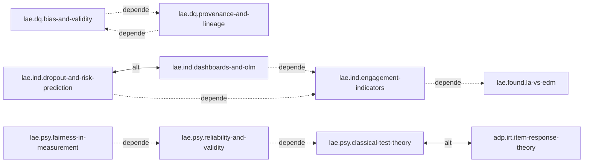

# Mapa de conceitos: learning analytics, mineração de dados e avaliação

A seção abaixo é gerada por `_modelo/gerar_mapa.py learning-analytics-e-avaliacao` e colada sem edição manual (os alvos marcados `(inexistente)` existem em outros domínios — `adp.*` em `aprendizagem-adaptativa`, `iop.*` em `interoperabilidade` — e só aparecem assim porque o script lista ids por domínio; a validação completa da base, via `_modelo/validar.py` sem argumento, confirma que todos existem).

## Gerado

### Documentos

| Id | Tipo | Arquivo | Título |
|---|---|---|---|
| `lae.asmt.constructive-alignment` | conceito | [assessment-design/constructive-alignment.md](assessment-design/constructive-alignment.md) | Alinhamento construtivo (constructive alignment) |
| `lae.asmt.formative-and-summative` | conceito | [assessment-design/formative-and-summative.md](assessment-design/formative-and-summative.md) | Avaliação formativa, somativa e diagnóstica |
| `lae.brief` | relatorio | [00-brief.md](00-brief.md) | Brief do domínio learning analytics, mineração de dados e avaliação |
| `lae.dq.bias-and-validity` | conceito | [data-quality/bias-and-validity.md](data-quality/bias-and-validity.md) | Vieses e validade em dados de interação usados para learning analytics |
| `lae.dq.provenance-and-lineage` | conceito | [data-quality/provenance-and-lineage.md](data-quality/provenance-and-lineage.md) | Proveniência e linhagem de dados em learning analytics |
| `lae.evalm.effect-size-and-replication` | conceito | [evaluation-methods/effect-size-and-replication.md](evaluation-methods/effect-size-and-replication.md) | Tamanho de efeito, meta-análise e crise de replicação na avaliação de resultado educacional |
| `lae.evalm.experimental-design` | conceito | [evaluation-methods/experimental-design.md](evaluation-methods/experimental-design.md) | Desenho experimental e quase-experimental para avaliação de resultado educacional |
| `lae.found.analytics-cycle` | framework | [foundations/analytics-cycle.md](foundations/analytics-cycle.md) | O ciclo de learning analytics |
| `lae.found.la-vs-edm` | conceito | [foundations/la-vs-edm.md](foundations/la-vs-edm.md) | Learning Analytics vs. Educational Data Mining |
| `lae.ind.dashboards-and-olm` | conceito | [indicators/dashboards-and-olm.md](indicators/dashboards-and-olm.md) | Dashboards de learning analytics e sua relação com o open learner model |
| `lae.ind.dropout-and-risk-prediction` | conceito | [indicators/dropout-and-risk-prediction.md](indicators/dropout-and-risk-prediction.md) | Sistemas de alerta precoce e predição de risco de evasão |
| `lae.ind.engagement-indicators` | conceito | [indicators/engagement-indicators.md](indicators/engagement-indicators.md) | Indicadores de engajamento a partir de trace data |
| `lae.plano-ids` | mapa | [_plano-ids.md](_plano-ids.md) | Plano de identificadores do domínio |
| `lae.psy.classical-test-theory` | conceito | [psychometrics/classical-test-theory.md](psychometrics/classical-test-theory.md) | Teoria clássica dos testes (CTT) |
| `lae.psy.fairness-in-measurement` | conceito | [psychometrics/fairness-in-measurement.md](psychometrics/fairness-in-measurement.md) | Equidade e viés de medição em avaliação |
| `lae.psy.reliability-and-validity` | conceito | [psychometrics/reliability-and-validity.md](psychometrics/reliability-and-validity.md) | Confiabilidade e validade de instrumentos de avaliação |

### Relações tipadas

| Tipo | Quantidade |
|---|---|
| `relacionado-a` | 20 |
| `depende-de` | 7 |
| `complementa` | 4 |
| `alternativa-a` | 2 |
| `avaliado-por` | 1 |

| Origem | Tipo | Alvo |
|---|---|---|
| `lae.asmt.constructive-alignment` | relacionado-a | `lae.asmt.formative-and-summative` |
| `lae.asmt.formative-and-summative` | relacionado-a | `lae.asmt.constructive-alignment` |
| `lae.dq.bias-and-validity` | depende-de | `lae.dq.provenance-and-lineage` |
| `lae.dq.bias-and-validity` | relacionado-a | `lae.found.la-vs-edm` |
| `lae.dq.provenance-and-lineage` | depende-de | `lae.dq.bias-and-validity` |
| `lae.dq.provenance-and-lineage` | relacionado-a | `lae.found.la-vs-edm` |
| `lae.evalm.effect-size-and-replication` | relacionado-a | `lae.evalm.experimental-design` |
| `lae.evalm.experimental-design` | relacionado-a | `lae.evalm.effect-size-and-replication` |
| `lae.found.analytics-cycle` | complementa | `iop.lr.caliper` |
| `lae.found.analytics-cycle` | relacionado-a | `adp.lm.open-learner-model` |
| `lae.found.analytics-cycle` | relacionado-a | `lae.found.la-vs-edm` |
| `lae.found.la-vs-edm` | complementa | `adp.irt.item-response-theory` |
| `lae.found.la-vs-edm` | complementa | `adp.kt.bayesian-knowledge-tracing` |
| `lae.found.la-vs-edm` | relacionado-a | `adp.lm.learner-model` |
| `lae.found.la-vs-edm` | relacionado-a | `lae.found.analytics-cycle` |
| `lae.ind.dashboards-and-olm` | complementa | `adp.lm.open-learner-model` |
| `lae.ind.dashboards-and-olm` | depende-de | `lae.ind.engagement-indicators` |
| `lae.ind.dashboards-and-olm` | relacionado-a | `lae.found.analytics-cycle` |
| `lae.ind.dashboards-and-olm` | relacionado-a | `lae.ind.dropout-and-risk-prediction` |
| `lae.ind.dropout-and-risk-prediction` | alternativa-a | `lae.ind.dashboards-and-olm` |
| `lae.ind.dropout-and-risk-prediction` | depende-de | `lae.ind.engagement-indicators` |
| `lae.ind.dropout-and-risk-prediction` | relacionado-a | `lae.dq.bias-and-validity` |
| `lae.ind.dropout-and-risk-prediction` | relacionado-a | `lae.found.analytics-cycle` |
| `lae.ind.engagement-indicators` | depende-de | `lae.found.la-vs-edm` |
| `lae.ind.engagement-indicators` | relacionado-a | `lae.dq.bias-and-validity` |
| `lae.ind.engagement-indicators` | relacionado-a | `lae.found.analytics-cycle` |
| `lae.psy.classical-test-theory` | alternativa-a | `adp.irt.item-response-theory` |
| `lae.psy.classical-test-theory` | relacionado-a | `adp.irt.item-response-theory` |
| `lae.psy.fairness-in-measurement` | depende-de | `lae.psy.reliability-and-validity` |
| `lae.psy.fairness-in-measurement` | relacionado-a | `adp.irt.item-response-theory` |
| `lae.psy.fairness-in-measurement` | relacionado-a | `lae.psy.classical-test-theory` |
| `lae.psy.reliability-and-validity` | avaliado-por | `lae.psy.fairness-in-measurement` |
| `lae.psy.reliability-and-validity` | depende-de | `lae.psy.classical-test-theory` |
| `lae.psy.reliability-and-validity` | relacionado-a | `adp.irt.item-response-theory` |

### Diagrama (relações estruturais)

## Leitura das dependências

Duas cadeias concentram a maior parte das dependências estruturais (`depende-de`):

- **Indicadores**: `lae.ind.engagement-indicators` é o ponto de partida; `lae.ind.dropout-and-risk-prediction` e `lae.ind.dashboards-and-olm` dependem dele, e são tratados como abordagens alternativas (não excludentes) de agir sobre o mesmo indicador de base — uma prediz risco para intervenção direcionada, a outra expõe o indicador para autorregulação.
- **Psicometria**: `lae.psy.classical-test-theory` fundamenta `lae.psy.reliability-and-validity`, que por sua vez é avaliado quanto a equidade por `lae.psy.fairness-in-measurement`. A relação de ciclo entre qualidade de dado (`lae.dq.provenance-and-lineage` ↔ `lae.dq.bias-and-validity`) é proposital: proveniência mal registrada é fonte de viés não detectável, e viés detectado exige melhor proveniência para ser corrigido.

As relações cross-domain (`adp.*`, `iop.*`) marcam onde este domínio se apoia em `aprendizagem-adaptativa` (TRI, knowledge tracing, open learner model) e `interoperabilidade` (Caliper como formato de registro de evento) sem duplicar esse conteúdo.
