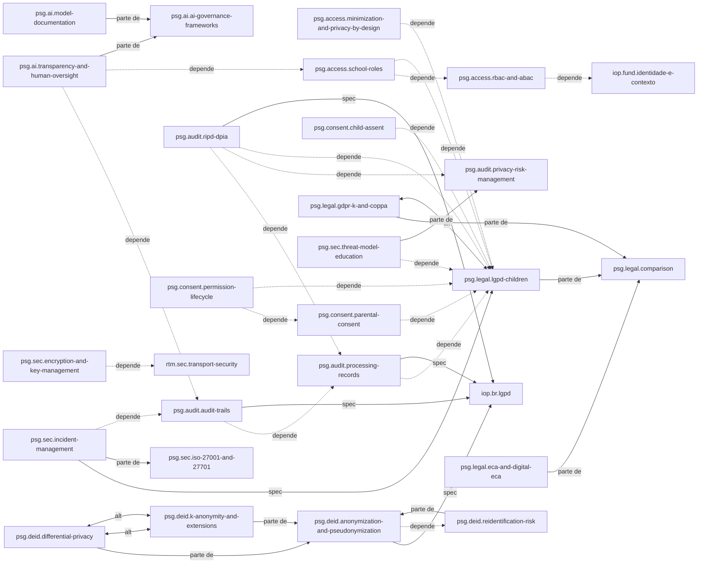

# Mapa de conceitos: privacidade, segurança e governança

## Visão geral das dependências

O domínio tem um centro jurídico. `psg.legal.lgpd-children` é o alvo de `depende-de` mais frequente: consentimento, assentimento, ciclo de permissões, papéis escolares, minimização, modelo de ameaças, registro de operações e RIPD dependem dele para base legal, melhor interesse e dado sensível. Os outros três documentos legais são partes de `psg.legal.comparison`.

Duas cadeias saem desse centro. A primeira é a do **consentimento**: `psg.consent.parental-consent` e `psg.consent.child-assent` dependem do art. 14; `psg.consent.permission-lifecycle` depende do consentimento parental e registra o que ele produz.

A segunda é a da **auditoria**: `psg.audit.ripd-dpia` depende do registro de operações (`psg.audit.processing-records`) e da gestão de riscos (`psg.audit.privacy-risk-management`); a trilha de auditoria (`psg.audit.audit-trails`) depende do registro de operações. A trilha é, por sua vez, insumo de duas outras áreas: `psg.ai.transparency-and-human-oversight` e `psg.sec.incident-management` dependem dela para reconstruir o que aconteceu.

Na **desidentificação**, `psg.deid.anonymization-and-pseudonymization` é o todo; k-anonimato, privacidade diferencial e risco de reidentificação são partes. k-anonimato e privacidade diferencial são alternativas entre si, e o risco de reidentificação é o teste que decide se o art. 12 da LGPD foi atingido.

Na **segurança**, o modelo de ameaças é parte da gestão de riscos de privacidade, e a gestão de incidentes é parte do sistema de gestão ISO/IEC 27001 e 27701. Criptografia, incidentes e modelo de ameaças se complementam entre si.

No **controle de acesso**, `psg.access.school-roles` depende de `psg.access.rbac-and-abac`; a minimização complementa os dois. Na **governança de IA**, transparência e documentação de modelos são partes de `psg.ai.ai-governance-frameworks`; o AI Act e o PL 2338/2023 complementam os frameworks com obrigações legais.

As relações para outros domínios marcam fronteiras, não lacunas: `iop.*` para a LGPD na troca entre sistemas e para papéis vindos de OneRoster e CEDS; `rtm.*` para transporte, autenticação e tolerância a falhas; `kg.*` para PROV-O e versionamento; `lae.*` e `adp.*` para viés, equidade, dashboards e modelo aberto do aprendiz; `dat.rd.data-documentation` para documentação de dados.

## Como ler o mapa

A seção "Gerado" abaixo é a saída de `python conhecimento/_modelo/gerar_mapa.py privacidade-seguranca-e-governanca`, colada sem edição. Ela tem três partes: a tabela de documentos do domínio; a contagem e a lista completa das relações tipadas declaradas nos frontmatters; e um diagrama Mermaid só com as relações estruturais (`depende-de`, `parte-de`, `alternativa-a`, `especificado-por`). As relações `complementa` e `relacionado-a`, a maioria, ficam fora do diagrama para mantê-lo legível. Alvos marcados "(outro domínio)" existem em outros domínios; a validação da base inteira, via `_modelo/validar.py` sem argumento, confirma que todos resolvem. A tabela de documentos inclui os próprios arquivos de índice, porque a geração foi feita depois deles.

No diagrama, seta tracejada (`-.->`) é `depende-de`; seta cheia rotulada "parte de" é `parte-de`; "spec" é `especificado-por`; seta dupla "alt" é `alternativa-a`. A relação `psg.legal.gdpr-k-and-coppa` `alternativa-a` `psg.legal.lgpd-children` significa "mesmo problema, outro ordenamento", não substituição.

## Gerado

### Documentos

| Id | Tipo | Arquivo | Título |
|---|---|---|---|
| `psg.access.minimization-and-privacy-by-design` | conceito | [access-control/minimization-and-privacy-by-design.md](access-control/minimization-and-privacy-by-design.md) | Minimização, limitação de finalidade e privacy by design |
| `psg.access.rbac-and-abac` | conceito | [access-control/rbac-and-abac.md](access-control/rbac-and-abac.md) | Modelos de controle de acesso: RBAC, ABAC e ReBAC |
| `psg.access.school-roles` | conceito | [access-control/school-roles.md](access-control/school-roles.md) | Papéis escolares e separação de visões sobre o aluno |
| `psg.ai.ai-governance-frameworks` | framework | [ai-governance/ai-governance-frameworks.md](ai-governance/ai-governance-frameworks.md) | Frameworks de governança de IA (NIST AI RMF, ISO/IEC 42001, UNICEF e UNESCO) |
| `psg.ai.eu-ai-act-and-brazil` | comparacao | [ai-governance/eu-ai-act-and-brazil.md](ai-governance/eu-ai-act-and-brazil.md) | AI Act europeu (educação como alto risco) e PL 2338/2023 no Brasil |
| `psg.ai.model-documentation` | padrao | [ai-governance/model-documentation.md](ai-governance/model-documentation.md) | Model cards, datasheets e documentação de modelos de aprendizagem |
| `psg.ai.transparency-and-human-oversight` | conceito | [ai-governance/transparency-and-human-oversight.md](ai-governance/transparency-and-human-oversight.md) | Transparência, explicabilidade e supervisão humana em decisões sobre aprendizes |
| `psg.audit.audit-trails` | conceito | [audit-risk/audit-trails.md](audit-risk/audit-trails.md) | Trilhas de auditoria e rastreabilidade de decisões |
| `psg.audit.privacy-risk-management` | framework | [audit-risk/privacy-risk-management.md](audit-risk/privacy-risk-management.md) | Gestão de riscos de privacidade como processo contínuo |
| `psg.audit.processing-records` | conceito | [audit-risk/processing-records.md](audit-risk/processing-records.md) | Registro das operações de tratamento e inventário de dados |
| `psg.audit.ripd-dpia` | protocolo | [audit-risk/ripd-dpia.md](audit-risk/ripd-dpia.md) | Relatório de impacto à proteção de dados (RIPD/DPIA) |
| `psg.brief` | relatorio | [00-brief.md](00-brief.md) | Brief do domínio privacidade, segurança e governança |
| `psg.consent.child-assent` | conceito | [consent/child-assent.md](consent/child-assent.md) | Assentimento da criança |
| `psg.consent.parental-consent` | conceito | [consent/parental-consent.md](consent/parental-consent.md) | Consentimento parental |
| `psg.consent.permission-lifecycle` | conceito | [consent/permission-lifecycle.md](consent/permission-lifecycle.md) | Ciclo de vida das permissões |
| `psg.deid.anonymization-and-pseudonymization` | conceito | [de-identification/anonymization-and-pseudonymization.md](de-identification/anonymization-and-pseudonymization.md) | Anonimização e pseudonimização |
| `psg.deid.differential-privacy` | tecnica | [de-identification/differential-privacy.md](de-identification/differential-privacy.md) | Privacidade diferencial |
| `psg.deid.k-anonymity-and-extensions` | tecnica | [de-identification/k-anonymity-and-extensions.md](de-identification/k-anonymity-and-extensions.md) | k-anonimato, l-diversidade e t-closeness |
| `psg.deid.reidentification-risk` | conceito | [de-identification/reidentification-risk.md](de-identification/reidentification-risk.md) | Risco de reidentificação |
| `psg.glossario` | glossario | [glossario.md](glossario.md) | Glossário de privacidade, segurança e governança |
| `psg.index` | mapa | [README.md](README.md) | Privacidade, segurança e governança |
| `psg.legal.comparison` | comparacao | [legal-framework/comparison.md](legal-framework/comparison.md) | Comparação LGPD, Estatuto Digital, GDPR, AADC e COPPA |
| `psg.legal.eca-and-digital-eca` | conceito | [legal-framework/eca-and-digital-eca.md](legal-framework/eca-and-digital-eca.md) | ECA e Estatuto Digital da Criança e do Adolescente |
| `psg.legal.gdpr-k-and-coppa` | conceito | [legal-framework/gdpr-k-and-coppa.md](legal-framework/gdpr-k-and-coppa.md) | GDPR, Age Appropriate Design Code e COPPA como referências comparativas |
| `psg.legal.lgpd-children` | conceito | [legal-framework/lgpd-children.md](legal-framework/lgpd-children.md) | LGPD aplicada a crianças e adolescentes |
| `psg.mapa` | mapa | [mapa-conceitos.md](mapa-conceitos.md) | Mapa de conceitos de privacidade, segurança e governança |
| `psg.matriz` | comparacao | [matriz-comparativa.md](matriz-comparativa.md) | Matriz comparativa de regimes, modelos e técnicas do domínio |
| `psg.plano-ids` | mapa | [_plano-ids.md](_plano-ids.md) | Plano de identificadores do domínio |
| `psg.relatorio` | relatorio | [relatorio.md](relatorio.md) | Relatório da primeira versão do domínio privacidade, segurança e governança |
| `psg.sec.encryption-and-key-management` | tecnica | [security/encryption-and-key-management.md](security/encryption-and-key-management.md) | Criptografia em trânsito e em repouso e gestão de chaves |
| `psg.sec.incident-management` | protocolo | [security/incident-management.md](security/incident-management.md) | Gestão de incidentes e comunicação à ANPD e aos titulares |
| `psg.sec.iso-27001-and-27701` | padrao | [security/iso-27001-and-27701.md](security/iso-27001-and-27701.md) | ISO/IEC 27001 e 27701 como sistemas de gestão e sua relação com o NIST SP 800-53 |
| `psg.sec.threat-model-education` | tecnica | [security/threat-model-education.md](security/threat-model-education.md) | Modelo de ameaças para dados educacionais de menores |

### Relações tipadas

| Tipo | Quantidade |
|---|---|
| `complementa` | 93 |
| `relacionado-a` | 69 |
| `depende-de` | 19 |
| `parte-de` | 10 |
| `especificado-por` | 5 |
| `avaliado-por` | 4 |
| `alternativa-a` | 3 |

| Origem | Tipo | Alvo |
|---|---|---|
| `psg.access.minimization-and-privacy-by-design` | complementa | `iop.fund.privacidade-e-seguranca` (outro domínio) |
| `psg.access.minimization-and-privacy-by-design` | complementa | `psg.access.rbac-and-abac` |
| `psg.access.minimization-and-privacy-by-design` | complementa | `psg.access.school-roles` |
| `psg.access.minimization-and-privacy-by-design` | complementa | `psg.deid.anonymization-and-pseudonymization` |
| `psg.access.minimization-and-privacy-by-design` | complementa | `psg.sec.encryption-and-key-management` |
| `psg.access.minimization-and-privacy-by-design` | depende-de | `psg.legal.lgpd-children` |
| `psg.access.minimization-and-privacy-by-design` | relacionado-a | `psg.audit.processing-records` |
| `psg.access.minimization-and-privacy-by-design` | relacionado-a | `psg.audit.ripd-dpia` |
| `psg.access.rbac-and-abac` | complementa | `psg.access.minimization-and-privacy-by-design` |
| `psg.access.rbac-and-abac` | complementa | `psg.access.school-roles` |
| `psg.access.rbac-and-abac` | depende-de | `iop.fund.identidade-e-contexto` (outro domínio) |
| `psg.access.rbac-and-abac` | relacionado-a | `psg.audit.audit-trails` |
| `psg.access.rbac-and-abac` | relacionado-a | `rtm.sec.authentication` (outro domínio) |
| `psg.access.school-roles` | complementa | `psg.access.minimization-and-privacy-by-design` |
| `psg.access.school-roles` | depende-de | `psg.access.rbac-and-abac` |
| `psg.access.school-roles` | depende-de | `psg.legal.lgpd-children` |
| `psg.access.school-roles` | relacionado-a | `iop.fund.identidade-e-contexto` (outro domínio) |
| `psg.access.school-roles` | relacionado-a | `iop.ros.ceds` (outro domínio) |
| `psg.access.school-roles` | relacionado-a | `iop.ros.oneroster` (outro domínio) |
| `psg.access.school-roles` | relacionado-a | `psg.audit.audit-trails` |
| `psg.access.school-roles` | relacionado-a | `psg.consent.permission-lifecycle` |
| `psg.ai.ai-governance-frameworks` | complementa | `psg.ai.eu-ai-act-and-brazil` |
| `psg.ai.ai-governance-frameworks` | complementa | `psg.ai.model-documentation` |
| `psg.ai.ai-governance-frameworks` | complementa | `psg.ai.transparency-and-human-oversight` |
| `psg.ai.ai-governance-frameworks` | complementa | `psg.audit.privacy-risk-management` |
| `psg.ai.ai-governance-frameworks` | complementa | `psg.audit.ripd-dpia` |
| `psg.ai.ai-governance-frameworks` | relacionado-a | `adp.eval.evaluation-protocols` (outro domínio) |
| `psg.ai.ai-governance-frameworks` | relacionado-a | `lae.psy.fairness-in-measurement` (outro domínio) |
| `psg.ai.ai-governance-frameworks` | relacionado-a | `psg.legal.lgpd-children` |
| `psg.ai.eu-ai-act-and-brazil` | complementa | `psg.ai.ai-governance-frameworks` |
| `psg.ai.eu-ai-act-and-brazil` | complementa | `psg.ai.model-documentation` |
| `psg.ai.eu-ai-act-and-brazil` | complementa | `psg.ai.transparency-and-human-oversight` |
| `psg.ai.eu-ai-act-and-brazil` | complementa | `psg.audit.ripd-dpia` |
| `psg.ai.eu-ai-act-and-brazil` | relacionado-a | `lae.ind.dropout-and-risk-prediction` (outro domínio) |
| `psg.ai.eu-ai-act-and-brazil` | relacionado-a | `psg.audit.audit-trails` |
| `psg.ai.eu-ai-act-and-brazil` | relacionado-a | `psg.legal.gdpr-k-and-coppa` |
| `psg.ai.eu-ai-act-and-brazil` | relacionado-a | `psg.legal.lgpd-children` |
| `psg.ai.model-documentation` | avaliado-por | `adp.eval.heterogeneous-populations` (outro domínio) |
| `psg.ai.model-documentation` | avaliado-por | `lae.psy.fairness-in-measurement` (outro domínio) |
| `psg.ai.model-documentation` | complementa | `dat.rd.data-documentation` (outro domínio) |
| `psg.ai.model-documentation` | complementa | `lae.dq.provenance-and-lineage` (outro domínio) |
| `psg.ai.model-documentation` | complementa | `psg.ai.transparency-and-human-oversight` |
| `psg.ai.model-documentation` | complementa | `psg.audit.ripd-dpia` |
| `psg.ai.model-documentation` | parte-de | `psg.ai.ai-governance-frameworks` |
| `psg.ai.model-documentation` | relacionado-a | `psg.ai.eu-ai-act-and-brazil` |
| `psg.ai.transparency-and-human-oversight` | complementa | `adp.lm.open-learner-model` (outro domínio) |
| `psg.ai.transparency-and-human-oversight` | complementa | `lae.ind.dashboards-and-olm` (outro domínio) |
| `psg.ai.transparency-and-human-oversight` | complementa | `psg.ai.eu-ai-act-and-brazil` |
| `psg.ai.transparency-and-human-oversight` | complementa | `psg.ai.model-documentation` |
| `psg.ai.transparency-and-human-oversight` | depende-de | `psg.access.school-roles` |
| `psg.ai.transparency-and-human-oversight` | depende-de | `psg.audit.audit-trails` |
| `psg.ai.transparency-and-human-oversight` | parte-de | `psg.ai.ai-governance-frameworks` |
| `psg.ai.transparency-and-human-oversight` | relacionado-a | `lae.ind.dropout-and-risk-prediction` (outro domínio) |
| `psg.ai.transparency-and-human-oversight` | relacionado-a | `psg.legal.eca-and-digital-eca` |
| `psg.ai.transparency-and-human-oversight` | relacionado-a | `psg.legal.lgpd-children` |
| `psg.audit.audit-trails` | complementa | `kg.eng.versioning-and-provenance` (outro domínio) |
| `psg.audit.audit-trails` | complementa | `kg.std.prov-o` (outro domínio) |
| `psg.audit.audit-trails` | complementa | `lae.dq.provenance-and-lineage` (outro domínio) |
| `psg.audit.audit-trails` | complementa | `psg.ai.transparency-and-human-oversight` |
| `psg.audit.audit-trails` | complementa | `psg.audit.privacy-risk-management` |
| `psg.audit.audit-trails` | complementa | `psg.audit.ripd-dpia` |
| `psg.audit.audit-trails` | complementa | `psg.sec.incident-management` |
| `psg.audit.audit-trails` | depende-de | `psg.audit.processing-records` |
| `psg.audit.audit-trails` | especificado-por | `iop.br.lgpd` (outro domínio) |
| `psg.audit.audit-trails` | relacionado-a | `psg.access.rbac-and-abac` |
| `psg.audit.audit-trails` | relacionado-a | `psg.deid.reidentification-risk` |
| `psg.audit.audit-trails` | relacionado-a | `psg.sec.iso-27001-and-27701` |
| `psg.audit.privacy-risk-management` | complementa | `psg.ai.ai-governance-frameworks` |
| `psg.audit.privacy-risk-management` | complementa | `psg.audit.audit-trails` |
| `psg.audit.privacy-risk-management` | complementa | `psg.audit.processing-records` |
| `psg.audit.privacy-risk-management` | complementa | `psg.audit.ripd-dpia` |
| `psg.audit.privacy-risk-management` | complementa | `psg.sec.incident-management` |
| `psg.audit.privacy-risk-management` | complementa | `psg.sec.iso-27001-and-27701` |
| `psg.audit.privacy-risk-management` | relacionado-a | `psg.access.minimization-and-privacy-by-design` |
| `psg.audit.privacy-risk-management` | relacionado-a | `psg.deid.reidentification-risk` |
| `psg.audit.processing-records` | complementa | `psg.access.minimization-and-privacy-by-design` |
| `psg.audit.processing-records` | complementa | `psg.audit.audit-trails` |
| `psg.audit.processing-records` | complementa | `psg.audit.privacy-risk-management` |
| `psg.audit.processing-records` | complementa | `psg.audit.ripd-dpia` |
| `psg.audit.processing-records` | complementa | `psg.consent.permission-lifecycle` |
| `psg.audit.processing-records` | depende-de | `psg.legal.lgpd-children` |
| `psg.audit.processing-records` | especificado-por | `iop.br.lgpd` (outro domínio) |
| `psg.audit.processing-records` | relacionado-a | `psg.sec.incident-management` |
| `psg.audit.ripd-dpia` | complementa | `psg.ai.ai-governance-frameworks` |
| `psg.audit.ripd-dpia` | complementa | `psg.ai.transparency-and-human-oversight` |
| `psg.audit.ripd-dpia` | complementa | `psg.audit.audit-trails` |
| `psg.audit.ripd-dpia` | complementa | `psg.legal.eca-and-digital-eca` |
| `psg.audit.ripd-dpia` | complementa | `psg.legal.gdpr-k-and-coppa` |
| `psg.audit.ripd-dpia` | depende-de | `psg.audit.privacy-risk-management` |
| `psg.audit.ripd-dpia` | depende-de | `psg.audit.processing-records` |
| `psg.audit.ripd-dpia` | depende-de | `psg.legal.lgpd-children` |
| `psg.audit.ripd-dpia` | especificado-por | `iop.br.lgpd` (outro domínio) |
| `psg.audit.ripd-dpia` | relacionado-a | `psg.deid.reidentification-risk` |
| `psg.audit.ripd-dpia` | relacionado-a | `psg.sec.incident-management` |
| `psg.consent.child-assent` | complementa | `psg.consent.parental-consent` |
| `psg.consent.child-assent` | complementa | `psg.consent.permission-lifecycle` |
| `psg.consent.child-assent` | depende-de | `psg.legal.lgpd-children` |
| `psg.consent.child-assent` | relacionado-a | `psg.access.school-roles` |
| `psg.consent.child-assent` | relacionado-a | `psg.legal.eca-and-digital-eca` |
| `psg.consent.parental-consent` | complementa | `iop.br.lgpd` (outro domínio) |
| `psg.consent.parental-consent` | complementa | `psg.consent.child-assent` |
| `psg.consent.parental-consent` | complementa | `psg.consent.permission-lifecycle` |
| `psg.consent.parental-consent` | depende-de | `psg.legal.lgpd-children` |
| `psg.consent.parental-consent` | relacionado-a | `psg.access.school-roles` |
| `psg.consent.parental-consent` | relacionado-a | `psg.legal.eca-and-digital-eca` |
| `psg.consent.parental-consent` | relacionado-a | `psg.legal.gdpr-k-and-coppa` |
| `psg.consent.permission-lifecycle` | complementa | `iop.fund.identidade-e-contexto` (outro domínio) |
| `psg.consent.permission-lifecycle` | complementa | `psg.audit.processing-records` |
| `psg.consent.permission-lifecycle` | complementa | `psg.consent.child-assent` |
| `psg.consent.permission-lifecycle` | depende-de | `psg.consent.parental-consent` |
| `psg.consent.permission-lifecycle` | depende-de | `psg.legal.lgpd-children` |
| `psg.consent.permission-lifecycle` | relacionado-a | `psg.access.school-roles` |
| `psg.consent.permission-lifecycle` | relacionado-a | `psg.legal.gdpr-k-and-coppa` |
| `psg.deid.anonymization-and-pseudonymization` | complementa | `psg.access.minimization-and-privacy-by-design` |
| `psg.deid.anonymization-and-pseudonymization` | complementa | `psg.deid.differential-privacy` |
| `psg.deid.anonymization-and-pseudonymization` | complementa | `psg.deid.k-anonymity-and-extensions` |
| `psg.deid.anonymization-and-pseudonymization` | complementa | `psg.sec.encryption-and-key-management` |
| `psg.deid.anonymization-and-pseudonymization` | depende-de | `psg.deid.reidentification-risk` |
| `psg.deid.anonymization-and-pseudonymization` | especificado-por | `iop.br.lgpd` (outro domínio) |
| `psg.deid.anonymization-and-pseudonymization` | relacionado-a | `psg.audit.ripd-dpia` |
| `psg.deid.anonymization-and-pseudonymization` | relacionado-a | `psg.legal.lgpd-children` |
| `psg.deid.differential-privacy` | alternativa-a | `psg.deid.k-anonymity-and-extensions` |
| `psg.deid.differential-privacy` | avaliado-por | `psg.deid.reidentification-risk` |
| `psg.deid.differential-privacy` | parte-de | `psg.deid.anonymization-and-pseudonymization` |
| `psg.deid.differential-privacy` | relacionado-a | `adp.eval.heterogeneous-populations` (outro domínio) |
| `psg.deid.differential-privacy` | relacionado-a | `lae.dq.bias-and-validity` (outro domínio) |
| `psg.deid.differential-privacy` | relacionado-a | `psg.access.minimization-and-privacy-by-design` |
| `psg.deid.k-anonymity-and-extensions` | alternativa-a | `psg.deid.differential-privacy` |
| `psg.deid.k-anonymity-and-extensions` | avaliado-por | `psg.deid.reidentification-risk` |
| `psg.deid.k-anonymity-and-extensions` | parte-de | `psg.deid.anonymization-and-pseudonymization` |
| `psg.deid.k-anonymity-and-extensions` | relacionado-a | `adp.eval.heterogeneous-populations` (outro domínio) |
| `psg.deid.k-anonymity-and-extensions` | relacionado-a | `lae.dq.bias-and-validity` (outro domínio) |
| `psg.deid.reidentification-risk` | complementa | `psg.audit.ripd-dpia` |
| `psg.deid.reidentification-risk` | complementa | `psg.deid.differential-privacy` |
| `psg.deid.reidentification-risk` | complementa | `psg.deid.k-anonymity-and-extensions` |
| `psg.deid.reidentification-risk` | parte-de | `psg.deid.anonymization-and-pseudonymization` |
| `psg.deid.reidentification-risk` | relacionado-a | `adp.eval.heterogeneous-populations` (outro domínio) |
| `psg.deid.reidentification-risk` | relacionado-a | `iop.br.lgpd` (outro domínio) |
| `psg.deid.reidentification-risk` | relacionado-a | `lae.psy.fairness-in-measurement` (outro domínio) |
| `psg.deid.reidentification-risk` | relacionado-a | `psg.access.minimization-and-privacy-by-design` |
| `psg.deid.reidentification-risk` | relacionado-a | `psg.legal.lgpd-children` |
| `psg.legal.comparison` | complementa | `iop.br.lgpd` (outro domínio) |
| `psg.legal.comparison` | relacionado-a | `psg.audit.ripd-dpia` |
| `psg.legal.comparison` | relacionado-a | `psg.consent.parental-consent` |
| `psg.legal.comparison` | relacionado-a | `psg.legal.eca-and-digital-eca` |
| `psg.legal.comparison` | relacionado-a | `psg.legal.gdpr-k-and-coppa` |
| `psg.legal.comparison` | relacionado-a | `psg.legal.lgpd-children` |
| `psg.legal.eca-and-digital-eca` | complementa | `psg.legal.lgpd-children` |
| `psg.legal.eca-and-digital-eca` | parte-de | `psg.legal.comparison` |
| `psg.legal.eca-and-digital-eca` | relacionado-a | `psg.access.minimization-and-privacy-by-design` |
| `psg.legal.eca-and-digital-eca` | relacionado-a | `psg.audit.ripd-dpia` |
| `psg.legal.eca-and-digital-eca` | relacionado-a | `psg.consent.parental-consent` |
| `psg.legal.gdpr-k-and-coppa` | alternativa-a | `psg.legal.lgpd-children` |
| `psg.legal.gdpr-k-and-coppa` | parte-de | `psg.legal.comparison` |
| `psg.legal.gdpr-k-and-coppa` | relacionado-a | `psg.access.minimization-and-privacy-by-design` |
| `psg.legal.gdpr-k-and-coppa` | relacionado-a | `psg.ai.transparency-and-human-oversight` |
| `psg.legal.gdpr-k-and-coppa` | relacionado-a | `psg.consent.parental-consent` |
| `psg.legal.lgpd-children` | complementa | `iop.br.lgpd` (outro domínio) |
| `psg.legal.lgpd-children` | complementa | `iop.fund.privacidade-e-seguranca` (outro domínio) |
| `psg.legal.lgpd-children` | complementa | `psg.legal.eca-and-digital-eca` |
| `psg.legal.lgpd-children` | parte-de | `psg.legal.comparison` |
| `psg.legal.lgpd-children` | relacionado-a | `psg.ai.transparency-and-human-oversight` |
| `psg.legal.lgpd-children` | relacionado-a | `psg.audit.processing-records` |
| `psg.legal.lgpd-children` | relacionado-a | `psg.audit.ripd-dpia` |
| `psg.legal.lgpd-children` | relacionado-a | `psg.consent.child-assent` |
| `psg.legal.lgpd-children` | relacionado-a | `psg.consent.parental-consent` |
| `psg.legal.lgpd-children` | relacionado-a | `psg.sec.incident-management` |
| `psg.sec.encryption-and-key-management` | complementa | `psg.access.rbac-and-abac` |
| `psg.sec.encryption-and-key-management` | complementa | `psg.audit.audit-trails` |
| `psg.sec.encryption-and-key-management` | complementa | `psg.deid.anonymization-and-pseudonymization` |
| `psg.sec.encryption-and-key-management` | complementa | `psg.sec.incident-management` |
| `psg.sec.encryption-and-key-management` | complementa | `psg.sec.iso-27001-and-27701` |
| `psg.sec.encryption-and-key-management` | complementa | `psg.sec.threat-model-education` |
| `psg.sec.encryption-and-key-management` | complementa | `rtm.sec.authentication` (outro domínio) |
| `psg.sec.encryption-and-key-management` | depende-de | `rtm.sec.transport-security` (outro domínio) |
| `psg.sec.incident-management` | complementa | `psg.audit.processing-records` |
| `psg.sec.incident-management` | complementa | `psg.audit.ripd-dpia` |
| `psg.sec.incident-management` | complementa | `psg.consent.parental-consent` |
| `psg.sec.incident-management` | complementa | `psg.sec.encryption-and-key-management` |
| `psg.sec.incident-management` | complementa | `psg.sec.threat-model-education` |
| `psg.sec.incident-management` | depende-de | `psg.audit.audit-trails` |
| `psg.sec.incident-management` | especificado-por | `psg.legal.lgpd-children` |
| `psg.sec.incident-management` | parte-de | `psg.sec.iso-27001-and-27701` |
| `psg.sec.incident-management` | relacionado-a | `rtm.rel.fault-tolerance` (outro domínio) |
| `psg.sec.iso-27001-and-27701` | complementa | `psg.access.rbac-and-abac` |
| `psg.sec.iso-27001-and-27701` | complementa | `psg.audit.privacy-risk-management` |
| `psg.sec.iso-27001-and-27701` | complementa | `psg.audit.processing-records` |
| `psg.sec.iso-27001-and-27701` | complementa | `psg.audit.ripd-dpia` |
| `psg.sec.iso-27001-and-27701` | complementa | `psg.sec.encryption-and-key-management` |
| `psg.sec.iso-27001-and-27701` | complementa | `psg.sec.incident-management` |
| `psg.sec.iso-27001-and-27701` | complementa | `psg.sec.threat-model-education` |
| `psg.sec.iso-27001-and-27701` | relacionado-a | `psg.legal.lgpd-children` |
| `psg.sec.threat-model-education` | complementa | `psg.access.rbac-and-abac` |
| `psg.sec.threat-model-education` | complementa | `psg.audit.ripd-dpia` |
| `psg.sec.threat-model-education` | complementa | `psg.deid.anonymization-and-pseudonymization` |
| `psg.sec.threat-model-education` | complementa | `psg.sec.encryption-and-key-management` |
| `psg.sec.threat-model-education` | complementa | `psg.sec.incident-management` |
| `psg.sec.threat-model-education` | complementa | `psg.sec.iso-27001-and-27701` |
| `psg.sec.threat-model-education` | depende-de | `psg.legal.lgpd-children` |
| `psg.sec.threat-model-education` | parte-de | `psg.audit.privacy-risk-management` |
| `psg.sec.threat-model-education` | relacionado-a | `iop.fund.privacidade-e-seguranca` (outro domínio) |
| `psg.sec.threat-model-education` | relacionado-a | `rtm.sec.authentication` (outro domínio) |
| `psg.sec.threat-model-education` | relacionado-a | `rtm.sec.transport-security` (outro domínio) |

### Diagrama (relações estruturais)

