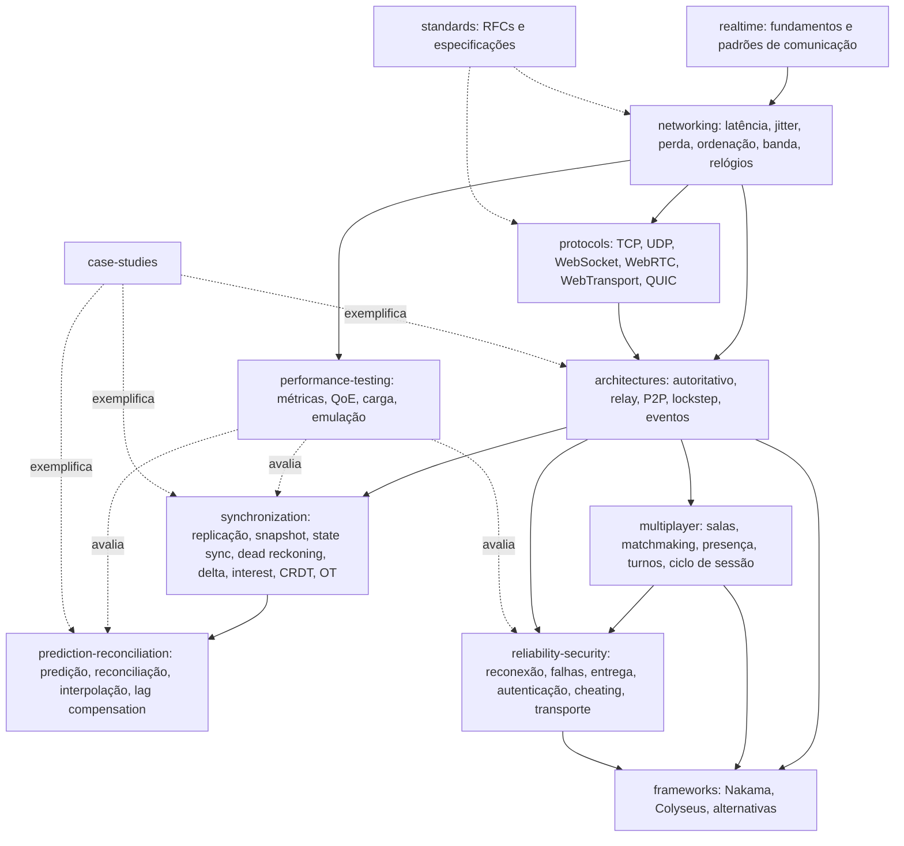

# Mapa de conceitos: tempo real e multiplayer

A primeira parte é escrita à mão e descreve as dependências entre áreas. A segunda é gerada a partir dos frontmatters com `python conhecimento/_modelo/gerar_mapa.py realtime-multiplayer` e lista todos os documentos e relações. Regenere a segunda parte ao adicionar documentos.

## Visão geral das dependências



## Como ler o mapa

**Três eixos de decisão.** [I] Os documentos se organizam em torno de três perguntas que todo sistema de tempo real responde, em ordem:

1. **Onde está a verdade?** `rtm.arch.*` responde: no servidor (`authoritative-server`), em todos os participantes com simulação idêntica (`deterministic-lockstep`), em cada cliente com o servidor só repassando (`relay-server`, `peer-to-peer`) ou em um log de eventos (`event-driven`). A escolha condiciona tudo que vem depois: resistência a cheating (`rtm.sec.cheating`), custo de hospedagem e quais técnicas de sincronização são possíveis.
2. **Como as réplicas convergem?** `rtm.sync.state-replication` é a raiz; as famílias se dividem entre simulação (`snapshot-interpolation`, `state-synchronization`, `dead-reckoning`, com `delta-compression` e `interest-management` como otimizações) e dados estruturados sem simulação (`crdt`, `operational-transformation`). Lockstep aparece como alternativa a todas, porque não replica estado, só entradas.
3. **Como esconder a latência?** `rtm.pred.*` só faz sentido sob servidor autoritativo e só é necessário em interação de ação rápida. `rtm.pred.comparison` e `rtm.mp.turn-based` documentam que jogos por turnos e colaboração dispensam a maioria dessas técnicas; o que se transfere é o princípio "aplicar local, confirmar pelo servidor", que em colaboração vira OT ou CRDT.

**Transporte é restrição, não decisão central.** [I] `rtm.proto.*` determina o que está disponível em cada ambiente: em navegador, WebSocket (TCP, ordenado, com head-of-line blocking), WebRTC data channel (UDP, configurável, exige signaling e NAT traversal) e WebTransport (QUIC, sem HOL entre streams, suporte recém-generalizado em 2026). `rtm.proto.comparison` cruza esses eixos. As propriedades de rede em `rtm.net.*` são o vocabulário comum: toda técnica de sincronização declara de qual delas depende.

**Sessão e confiabilidade são transversais a gênero.** [I] `rtm.mp.*` (salas, matchmaking, presença, ciclo de sessão) e `rtm.rel.*` (reconexão, tolerância a falhas, semântica de entrega) valem igualmente para ação, turnos e colaboração, e são o que os frameworks (`rtm.fw.*`) implementam de forma mais completa. A relação `implementado-por` liga esses conceitos a Nakama e Colyseus quando a documentação do fornecedor confirma.

**Medição fecha o ciclo.** `rtm.perf.metrics` é alvo de `avaliado-por` a partir de sincronização, predição e confiabilidade. `rtm.perf.qoe-thresholds` reúne a evidência empírica de limiares de latência, que hoje cobre jogos de ação, terceira pessoa e estratégia, e não cobre turnos nem colaboração (lacuna registrada no relatório).

**Estudos de caso ancoram as técnicas.** Cada caso em `rtm.case.*` aponta, com `relacionado-a`, para as arquiteturas e técnicas que usou: Age of Empires para lockstep; Quake III para snapshots e delta; Half-Life para predição, interpolação e lag compensation; TRIBES para ghosts, state mask e scoping; Figma para servidor autoritativo com last-writer-wins; Jupiter para OT em produção.

## Lacunas no grafo

- Todos os alvos de relação existem (verificado por `_modelo/validar.py` em 2026-10-29). Não há ids pendentes.
- `relacionado-a` é o tipo mais usado. Uma revisão futura deve promover parte dessas relações a tipos mais específicos (`depende-de`, `complementa`), o que melhora a conversão para SKOS/OWL.
- Os ids `rtm.case.source-engine`, `rtm.case.overwatch` e `rtm.case.rocket-league` previstos não foram criados por falta de fonte primária legível; ver `case-studies/README.md`.

## Gerado

### Documentos

| Id | Tipo | Arquivo | Título |
|---|---|---|---|
| `rtm.arch.authoritative-server` | conceito | [architectures/authoritative-server.md](architectures/authoritative-server.md) | Servidor autoritativo (authoritative server) |
| `rtm.arch.comparison` | comparacao | [architectures/comparison.md](architectures/comparison.md) | Comparação das arquiteturas de tempo real e multiplayer |
| `rtm.arch.deterministic-lockstep` | conceito | [architectures/deterministic-lockstep.md](architectures/deterministic-lockstep.md) | Lockstep determinístico (deterministic lockstep) |
| `rtm.arch.event-driven` | conceito | [architectures/event-driven.md](architectures/event-driven.md) | Arquitetura orientada a eventos para tempo real |
| `rtm.arch.peer-to-peer` | conceito | [architectures/peer-to-peer.md](architectures/peer-to-peer.md) | Peer-to-peer (P2P) sem servidor de simulação |
| `rtm.arch.relay-server` | conceito | [architectures/relay-server.md](architectures/relay-server.md) | Servidor relay (relayed multiplayer) |
| `rtm.brief` | relatorio | [00-brief.md](00-brief.md) | Brief do domínio tempo real e multiplayer |
| `rtm.case.age-of-empires` | estudo-de-caso | [case-studies/age-of-empires.md](case-studies/age-of-empires.md) | Age of Empires: lockstep determinístico sobre modem de 28.8 |
| `rtm.case.figma-multiplayer` | estudo-de-caso | [case-studies/figma-multiplayer.md](case-studies/figma-multiplayer.md) | Figma multiplayer: servidor autoritativo por documento com last-writer-wins por propriedade |
| `rtm.case.half-life` | estudo-de-caso | [case-studies/half-life.md](case-studies/half-life.md) | Half-Life (Valve): predição no cliente, interpolação e lag compensation |
| `rtm.case.index` | mapa | [case-studies/README.md](case-studies/README.md) | Estudos de caso de sistemas de tempo real e multiplayer |
| `rtm.case.jupiter` | estudo-de-caso | [case-studies/jupiter.md](case-studies/jupiter.md) | Jupiter (Xerox PARC): transformação de operações cliente-servidor sob alta latência |
| `rtm.case.quake3` | estudo-de-caso | [case-studies/quake3.md](case-studies/quake3.md) | Quake III Arena: snapshots com delta contra o último ack sobre UDP |
| `rtm.case.tribes` | estudo-de-caso | [case-studies/tribes.md](case-studies/tribes.md) | TRIBES: streams por requisito de entrega, ghosts e notificação de pacotes |
| `rtm.fw.alternatives` | comparacao | [frameworks/alternatives.md](frameworks/alternatives.md) | Alternativas a Nakama e Colyseus por categoria |
| `rtm.fw.colyseus` | framework | [frameworks/colyseus.md](frameworks/colyseus.md) | Colyseus |
| `rtm.fw.comparison` | comparacao | [frameworks/comparison.md](frameworks/comparison.md) | Comparação de frameworks de multiplayer e tempo real |
| `rtm.fw.nakama` | framework | [frameworks/nakama.md](frameworks/nakama.md) | Nakama (Heroic Labs) |
| `rtm.glossario` | glossario | [glossario.md](glossario.md) | Glossário de tempo real e multiplayer |
| `rtm.index` | mapa | [README.md](README.md) | Tempo real e multiplayer |
| `rtm.mapa` | mapa | [mapa-conceitos.md](mapa-conceitos.md) | Mapa de conceitos de tempo real e multiplayer |
| `rtm.mp.matchmaking` | conceito | [multiplayer/matchmaking.md](multiplayer/matchmaking.md) | Matchmaking e sistemas de rating |
| `rtm.mp.presence` | conceito | [multiplayer/presence.md](multiplayer/presence.md) | Presença (quem está online e onde) |
| `rtm.mp.rooms-and-matches` | conceito | [multiplayer/rooms-and-matches.md](multiplayer/rooms-and-matches.md) | Salas, partidas, lobbies e parties |
| `rtm.mp.session-lifecycle` | conceito | [multiplayer/session-lifecycle.md](multiplayer/session-lifecycle.md) | Ciclo de vida da sessão multiplayer |
| `rtm.mp.turn-based` | conceito | [multiplayer/turn-based.md](multiplayer/turn-based.md) | Jogos por turnos, síncronos e assíncronos |
| `rtm.net.bandwidth` | conceito | [networking/bandwidth.md](networking/bandwidth.md) | Largura de banda (banda vs latência, custo por tick, compressão, orçamento de bits por cliente) |
| `rtm.net.clock-synchronization` | conceito | [networking/clock-synchronization.md](networking/clock-synchronization.md) | Sincronização de relógios (NTP, PTP, estimativa de offset por RTT, tempo do servidor como referência) |
| `rtm.net.jitter` | conceito | [networking/jitter.md](networking/jitter.md) | Jitter (variação de atraso, IPDV, PDV, jitter buffer e atraso de interpolação) |
| `rtm.net.latency` | conceito | [networking/latency.md](networking/latency.md) | Latência (RTT, atraso unidirecional, componentes, limites físicos, medição, efeito na interatividade) |
| `rtm.net.logical-clocks` | conceito | [networking/logical-clocks.md](networking/logical-clocks.md) | Relógios lógicos (happens-before, relógios de Lamport, relógios vetoriais, relógios híbridos) |
| `rtm.net.ordering-and-reliability` | conceito | [networking/ordering-and-reliability.md](networking/ordering-and-reliability.md) | Ordenação e confiabilidade (total, parcial, por canal; confiabilidade seletiva; bloqueio de cabeça de fila) |
| `rtm.net.packet-loss` | conceito | [networking/packet-loss.md](networking/packet-loss.md) | Perda de pacotes (causas, perda em rajada, Gilbert-Elliott, efeitos em TCP e UDP, retransmissão, FEC e redundância) |
| `rtm.perf.load-testing` | tecnica | [performance-testing/load-testing.md](performance-testing/load-testing.md) | Teste de carga para WebSocket e UDP |
| `rtm.perf.metrics` | conceito | [performance-testing/metrics.md](performance-testing/metrics.md) | Métricas de rede e de aplicação para tempo real |
| `rtm.perf.network-emulation` | tecnica | [performance-testing/network-emulation.md](performance-testing/network-emulation.md) | Emulação de condições de rede |
| `rtm.perf.qoe-thresholds` | conceito | [performance-testing/qoe-thresholds.md](performance-testing/qoe-thresholds.md) | Limiares de latência e qualidade de experiência por tipo de interação |
| `rtm.pred.client-side-prediction` | tecnica | [prediction-reconciliation/client-side-prediction.md](prediction-reconciliation/client-side-prediction.md) | Client-side prediction |
| `rtm.pred.comparison` | comparacao | [prediction-reconciliation/comparison.md](prediction-reconciliation/comparison.md) | Comparação das técnicas de predição, reconciliação, interpolação e lag compensation |
| `rtm.pred.entity-interpolation` | tecnica | [prediction-reconciliation/entity-interpolation.md](prediction-reconciliation/entity-interpolation.md) | Entity interpolation |
| `rtm.pred.lag-compensation` | tecnica | [prediction-reconciliation/lag-compensation.md](prediction-reconciliation/lag-compensation.md) | Lag compensation |
| `rtm.pred.server-reconciliation` | tecnica | [prediction-reconciliation/server-reconciliation.md](prediction-reconciliation/server-reconciliation.md) | Server reconciliation |
| `rtm.proto.comparison` | comparacao | [protocols/comparison.md](protocols/comparison.md) | Comparação de protocolos de transporte para tempo real |
| `rtm.proto.http-streaming` | protocolo | [protocols/http-streaming.md](protocols/http-streaming.md) | Long polling, Server-Sent Events e streaming HTTP |
| `rtm.proto.quic` | protocolo | [protocols/quic.md](protocols/quic.md) | QUIC e HTTP/3 |
| `rtm.proto.tcp` | protocolo | [protocols/tcp.md](protocols/tcp.md) | TCP (Transmission Control Protocol) |
| `rtm.proto.udp` | protocolo | [protocols/udp.md](protocols/udp.md) | UDP (User Datagram Protocol) |
| `rtm.proto.webrtc` | protocolo | [protocols/webrtc.md](protocols/webrtc.md) | WebRTC e data channels |
| `rtm.proto.websocket` | protocolo | [protocols/websocket.md](protocols/websocket.md) | WebSocket (RFC 6455, RFC 8441, RFC 9220) |
| `rtm.proto.webtransport` | protocolo | [protocols/webtransport.md](protocols/webtransport.md) | WebTransport |
| `rtm.rel.delivery-semantics` | conceito | [reliability-security/delivery-semantics.md](reliability-security/delivery-semantics.md) | Semânticas de entrega de mensagens |
| `rtm.rel.fault-tolerance` | conceito | [reliability-security/fault-tolerance.md](reliability-security/fault-tolerance.md) | Tolerância a falhas do servidor de sessão |
| `rtm.rel.reconnection` | tecnica | [reliability-security/reconnection.md](reliability-security/reconnection.md) | Reconexão e retomada de sessão |
| `rtm.rt.communication-patterns` | conceito | [realtime/communication-patterns.md](realtime/communication-patterns.md) | Padrões de comunicação em tempo real (polling, long polling, push, pub/sub, streaming, request/response) |
| `rtm.rt.realtime-systems` | conceito | [realtime/realtime-systems.md](realtime/realtime-systems.md) | Sistemas de tempo real (hard, firm, soft) e tempo real em comunicação interativa |
| `rtm.sec.authentication` | tecnica | [reliability-security/authentication.md](reliability-security/authentication.md) | Autenticação e autorização em sessões de tempo real |
| `rtm.sec.cheating` | conceito | [reliability-security/cheating.md](reliability-security/cheating.md) | Cheating em sistemas multiplayer: taxonomia e mitigação |
| `rtm.sec.transport-security` | conceito | [reliability-security/transport-security.md](reliability-security/transport-security.md) | Segurança de transporte: TLS, wss, DTLS e QUIC |
| `rtm.std.index` | padrao | [standards/index.md](standards/index.md) | Índice de normas e especificações do domínio |
| `rtm.sync.crdt` | tecnica | [synchronization/crdt.md](synchronization/crdt.md) | CRDT (Conflict-free Replicated Data Types) |
| `rtm.sync.dead-reckoning` | tecnica | [synchronization/dead-reckoning.md](synchronization/dead-reckoning.md) | Dead reckoning |
| `rtm.sync.delta-compression` | tecnica | [synchronization/delta-compression.md](synchronization/delta-compression.md) | Delta compression |
| `rtm.sync.interest-management` | tecnica | [synchronization/interest-management.md](synchronization/interest-management.md) | Interest management |
| `rtm.sync.operational-transformation` | tecnica | [synchronization/operational-transformation.md](synchronization/operational-transformation.md) | Operational Transformation (OT) |
| `rtm.sync.snapshot-interpolation` | tecnica | [synchronization/snapshot-interpolation.md](synchronization/snapshot-interpolation.md) | Snapshot interpolation |
| `rtm.sync.state-replication` | conceito | [synchronization/state-replication.md](synchronization/state-replication.md) | Replicação de estado em simulações distribuídas |
| `rtm.sync.state-synchronization` | tecnica | [synchronization/state-synchronization.md](synchronization/state-synchronization.md) | State synchronization |

### Relações tipadas

| Tipo | Quantidade |
|---|---|
| `relacionado-a` | 282 |
| `complementa` | 129 |
| `depende-de` | 91 |
| `alternativa-a` | 46 |
| `implementado-por` | 31 |
| `avaliado-por` | 16 |
| `especificado-por` | 15 |
| `parte-de` | 7 |

| Origem | Tipo | Alvo |
|---|---|---|
| `rtm.arch.authoritative-server` | alternativa-a | `rtm.arch.deterministic-lockstep` |
| `rtm.arch.authoritative-server` | alternativa-a | `rtm.arch.event-driven` |
| `rtm.arch.authoritative-server` | alternativa-a | `rtm.arch.peer-to-peer` |
| `rtm.arch.authoritative-server` | alternativa-a | `rtm.arch.relay-server` |
| `rtm.arch.authoritative-server` | complementa | `rtm.pred.client-side-prediction` |
| `rtm.arch.authoritative-server` | complementa | `rtm.pred.entity-interpolation` |
| `rtm.arch.authoritative-server` | complementa | `rtm.pred.lag-compensation` |
| `rtm.arch.authoritative-server` | complementa | `rtm.pred.server-reconciliation` |
| `rtm.arch.authoritative-server` | complementa | `rtm.sync.interest-management` |
| `rtm.arch.authoritative-server` | complementa | `rtm.sync.snapshot-interpolation` |
| `rtm.arch.authoritative-server` | complementa | `rtm.sync.state-synchronization` |
| `rtm.arch.authoritative-server` | depende-de | `rtm.net.latency` |
| `rtm.arch.authoritative-server` | implementado-por | `rtm.fw.colyseus` |
| `rtm.arch.authoritative-server` | implementado-por | `rtm.fw.nakama` |
| `rtm.arch.authoritative-server` | relacionado-a | `rtm.arch.comparison` |
| `rtm.arch.authoritative-server` | relacionado-a | `rtm.mp.rooms-and-matches` |
| `rtm.arch.authoritative-server` | relacionado-a | `rtm.rel.reconnection` |
| `rtm.arch.authoritative-server` | relacionado-a | `rtm.sec.cheating` |
| `rtm.arch.comparison` | complementa | `rtm.pred.client-side-prediction` |
| `rtm.arch.comparison` | complementa | `rtm.pred.comparison` |
| `rtm.arch.comparison` | complementa | `rtm.pred.lag-compensation` |
| `rtm.arch.comparison` | complementa | `rtm.pred.server-reconciliation` |
| `rtm.arch.comparison` | complementa | `rtm.sync.crdt` |
| `rtm.arch.comparison` | complementa | `rtm.sync.snapshot-interpolation` |
| `rtm.arch.comparison` | complementa | `rtm.sync.state-replication` |
| `rtm.arch.comparison` | complementa | `rtm.sync.state-synchronization` |
| `rtm.arch.comparison` | relacionado-a | `rtm.arch.authoritative-server` |
| `rtm.arch.comparison` | relacionado-a | `rtm.arch.deterministic-lockstep` |
| `rtm.arch.comparison` | relacionado-a | `rtm.arch.event-driven` |
| `rtm.arch.comparison` | relacionado-a | `rtm.arch.peer-to-peer` |
| `rtm.arch.comparison` | relacionado-a | `rtm.arch.relay-server` |
| `rtm.arch.comparison` | relacionado-a | `rtm.fw.comparison` |
| `rtm.arch.comparison` | relacionado-a | `rtm.perf.qoe-thresholds` |
| `rtm.arch.comparison` | relacionado-a | `rtm.sec.cheating` |
| `rtm.arch.deterministic-lockstep` | alternativa-a | `rtm.arch.authoritative-server` |
| `rtm.arch.deterministic-lockstep` | alternativa-a | `rtm.arch.event-driven` |
| `rtm.arch.deterministic-lockstep` | alternativa-a | `rtm.arch.peer-to-peer` |
| `rtm.arch.deterministic-lockstep` | alternativa-a | `rtm.arch.relay-server` |
| `rtm.arch.deterministic-lockstep` | alternativa-a | `rtm.sync.snapshot-interpolation` |
| `rtm.arch.deterministic-lockstep` | alternativa-a | `rtm.sync.state-synchronization` |
| `rtm.arch.deterministic-lockstep` | complementa | `rtm.arch.peer-to-peer` |
| `rtm.arch.deterministic-lockstep` | complementa | `rtm.arch.relay-server` |
| `rtm.arch.deterministic-lockstep` | complementa | `rtm.pred.client-side-prediction` |
| `rtm.arch.deterministic-lockstep` | depende-de | `rtm.net.ordering-and-reliability` |
| `rtm.arch.deterministic-lockstep` | relacionado-a | `rtm.arch.comparison` |
| `rtm.arch.deterministic-lockstep` | relacionado-a | `rtm.mp.turn-based` |
| `rtm.arch.deterministic-lockstep` | relacionado-a | `rtm.net.bandwidth` |
| `rtm.arch.deterministic-lockstep` | relacionado-a | `rtm.proto.tcp` |
| `rtm.arch.deterministic-lockstep` | relacionado-a | `rtm.proto.udp` |
| `rtm.arch.event-driven` | alternativa-a | `rtm.arch.authoritative-server` |
| `rtm.arch.event-driven` | alternativa-a | `rtm.arch.deterministic-lockstep` |
| `rtm.arch.event-driven` | alternativa-a | `rtm.arch.peer-to-peer` |
| `rtm.arch.event-driven` | alternativa-a | `rtm.arch.relay-server` |
| `rtm.arch.event-driven` | complementa | `rtm.mp.presence` |
| `rtm.arch.event-driven` | complementa | `rtm.mp.turn-based` |
| `rtm.arch.event-driven` | complementa | `rtm.rt.communication-patterns` |
| `rtm.arch.event-driven` | complementa | `rtm.sync.crdt` |
| `rtm.arch.event-driven` | complementa | `rtm.sync.operational-transformation` |
| `rtm.arch.event-driven` | depende-de | `rtm.net.logical-clocks` |
| `rtm.arch.event-driven` | depende-de | `rtm.rel.delivery-semantics` |
| `rtm.arch.event-driven` | relacionado-a | `rtm.arch.comparison` |
| `rtm.arch.event-driven` | relacionado-a | `rtm.proto.websocket` |
| `rtm.arch.event-driven` | relacionado-a | `rtm.rel.reconnection` |
| `rtm.arch.peer-to-peer` | alternativa-a | `rtm.arch.authoritative-server` |
| `rtm.arch.peer-to-peer` | alternativa-a | `rtm.arch.deterministic-lockstep` |
| `rtm.arch.peer-to-peer` | alternativa-a | `rtm.arch.event-driven` |
| `rtm.arch.peer-to-peer` | alternativa-a | `rtm.arch.relay-server` |
| `rtm.arch.peer-to-peer` | complementa | `rtm.arch.deterministic-lockstep` |
| `rtm.arch.peer-to-peer` | complementa | `rtm.rel.fault-tolerance` |
| `rtm.arch.peer-to-peer` | complementa | `rtm.sync.dead-reckoning` |
| `rtm.arch.peer-to-peer` | complementa | `rtm.sync.interest-management` |
| `rtm.arch.peer-to-peer` | depende-de | `rtm.proto.webrtc` |
| `rtm.arch.peer-to-peer` | relacionado-a | `rtm.arch.comparison` |
| `rtm.arch.peer-to-peer` | relacionado-a | `rtm.net.bandwidth` |
| `rtm.arch.peer-to-peer` | relacionado-a | `rtm.sec.cheating` |
| `rtm.arch.relay-server` | alternativa-a | `rtm.arch.authoritative-server` |
| `rtm.arch.relay-server` | alternativa-a | `rtm.arch.deterministic-lockstep` |
| `rtm.arch.relay-server` | alternativa-a | `rtm.arch.event-driven` |
| `rtm.arch.relay-server` | alternativa-a | `rtm.arch.peer-to-peer` |
| `rtm.arch.relay-server` | complementa | `rtm.arch.deterministic-lockstep` |
| `rtm.arch.relay-server` | complementa | `rtm.rel.reconnection` |
| `rtm.arch.relay-server` | complementa | `rtm.sync.state-replication` |
| `rtm.arch.relay-server` | depende-de | `rtm.mp.presence` |
| `rtm.arch.relay-server` | implementado-por | `rtm.fw.colyseus` |
| `rtm.arch.relay-server` | implementado-por | `rtm.fw.nakama` |
| `rtm.arch.relay-server` | relacionado-a | `rtm.arch.comparison` |
| `rtm.arch.relay-server` | relacionado-a | `rtm.proto.webrtc` |
| `rtm.arch.relay-server` | relacionado-a | `rtm.sec.cheating` |
| `rtm.case.age-of-empires` | relacionado-a | `rtm.arch.deterministic-lockstep` |
| `rtm.case.age-of-empires` | relacionado-a | `rtm.arch.peer-to-peer` |
| `rtm.case.age-of-empires` | relacionado-a | `rtm.net.bandwidth` |
| `rtm.case.age-of-empires` | relacionado-a | `rtm.net.latency` |
| `rtm.case.age-of-empires` | relacionado-a | `rtm.net.ordering-and-reliability` |
| `rtm.case.age-of-empires` | relacionado-a | `rtm.perf.metrics` |
| `rtm.case.age-of-empires` | relacionado-a | `rtm.perf.qoe-thresholds` |
| `rtm.case.age-of-empires` | relacionado-a | `rtm.proto.udp` |
| `rtm.case.age-of-empires` | relacionado-a | `rtm.rel.delivery-semantics` |
| `rtm.case.age-of-empires` | relacionado-a | `rtm.sec.cheating` |
| `rtm.case.figma-multiplayer` | relacionado-a | `rtm.arch.authoritative-server` |
| `rtm.case.figma-multiplayer` | relacionado-a | `rtm.mp.presence` |
| `rtm.case.figma-multiplayer` | relacionado-a | `rtm.mp.rooms-and-matches` |
| `rtm.case.figma-multiplayer` | relacionado-a | `rtm.pred.client-side-prediction` |
| `rtm.case.figma-multiplayer` | relacionado-a | `rtm.proto.websocket` |
| `rtm.case.figma-multiplayer` | relacionado-a | `rtm.rel.reconnection` |
| `rtm.case.figma-multiplayer` | relacionado-a | `rtm.sync.crdt` |
| `rtm.case.figma-multiplayer` | relacionado-a | `rtm.sync.operational-transformation` |
| `rtm.case.figma-multiplayer` | relacionado-a | `rtm.sync.state-replication` |
| `rtm.case.half-life` | relacionado-a | `rtm.arch.authoritative-server` |
| `rtm.case.half-life` | relacionado-a | `rtm.net.bandwidth` |
| `rtm.case.half-life` | relacionado-a | `rtm.net.clock-synchronization` |
| `rtm.case.half-life` | relacionado-a | `rtm.net.latency` |
| `rtm.case.half-life` | relacionado-a | `rtm.pred.client-side-prediction` |
| `rtm.case.half-life` | relacionado-a | `rtm.pred.entity-interpolation` |
| `rtm.case.half-life` | relacionado-a | `rtm.pred.lag-compensation` |
| `rtm.case.half-life` | relacionado-a | `rtm.pred.server-reconciliation` |
| `rtm.case.half-life` | relacionado-a | `rtm.sec.cheating` |
| `rtm.case.half-life` | relacionado-a | `rtm.sync.dead-reckoning` |
| `rtm.case.index` | relacionado-a | `rtm.arch.comparison` |
| `rtm.case.index` | relacionado-a | `rtm.pred.comparison` |
| `rtm.case.jupiter` | relacionado-a | `rtm.arch.authoritative-server` |
| `rtm.case.jupiter` | relacionado-a | `rtm.net.bandwidth` |
| `rtm.case.jupiter` | relacionado-a | `rtm.net.latency` |
| `rtm.case.jupiter` | relacionado-a | `rtm.net.ordering-and-reliability` |
| `rtm.case.jupiter` | relacionado-a | `rtm.pred.client-side-prediction` |
| `rtm.case.jupiter` | relacionado-a | `rtm.proto.tcp` |
| `rtm.case.jupiter` | relacionado-a | `rtm.sync.crdt` |
| `rtm.case.jupiter` | relacionado-a | `rtm.sync.operational-transformation` |
| `rtm.case.quake3` | relacionado-a | `rtm.arch.authoritative-server` |
| `rtm.case.quake3` | relacionado-a | `rtm.net.bandwidth` |
| `rtm.case.quake3` | relacionado-a | `rtm.net.ordering-and-reliability` |
| `rtm.case.quake3` | relacionado-a | `rtm.net.packet-loss` |
| `rtm.case.quake3` | relacionado-a | `rtm.proto.udp` |
| `rtm.case.quake3` | relacionado-a | `rtm.rel.delivery-semantics` |
| `rtm.case.quake3` | relacionado-a | `rtm.sync.delta-compression` |
| `rtm.case.quake3` | relacionado-a | `rtm.sync.snapshot-interpolation` |
| `rtm.case.quake3` | relacionado-a | `rtm.sync.state-replication` |
| `rtm.case.tribes` | relacionado-a | `rtm.arch.authoritative-server` |
| `rtm.case.tribes` | relacionado-a | `rtm.net.bandwidth` |
| `rtm.case.tribes` | relacionado-a | `rtm.net.ordering-and-reliability` |
| `rtm.case.tribes` | relacionado-a | `rtm.net.packet-loss` |
| `rtm.case.tribes` | relacionado-a | `rtm.pred.client-side-prediction` |
| `rtm.case.tribes` | relacionado-a | `rtm.pred.entity-interpolation` |
| `rtm.case.tribes` | relacionado-a | `rtm.proto.udp` |
| `rtm.case.tribes` | relacionado-a | `rtm.rel.delivery-semantics` |
| `rtm.case.tribes` | relacionado-a | `rtm.sync.delta-compression` |
| `rtm.case.tribes` | relacionado-a | `rtm.sync.interest-management` |
| `rtm.case.tribes` | relacionado-a | `rtm.sync.state-replication` |
| `rtm.fw.alternatives` | relacionado-a | `rtm.arch.authoritative-server` |
| `rtm.fw.alternatives` | relacionado-a | `rtm.arch.deterministic-lockstep` |
| `rtm.fw.alternatives` | relacionado-a | `rtm.arch.peer-to-peer` |
| `rtm.fw.alternatives` | relacionado-a | `rtm.arch.relay-server` |
| `rtm.fw.alternatives` | relacionado-a | `rtm.fw.colyseus` |
| `rtm.fw.alternatives` | relacionado-a | `rtm.fw.comparison` |
| `rtm.fw.alternatives` | relacionado-a | `rtm.fw.nakama` |
| `rtm.fw.alternatives` | relacionado-a | `rtm.mp.presence` |
| `rtm.fw.alternatives` | relacionado-a | `rtm.proto.udp` |
| `rtm.fw.alternatives` | relacionado-a | `rtm.proto.websocket` |
| `rtm.fw.alternatives` | relacionado-a | `rtm.proto.webtransport` |
| `rtm.fw.alternatives` | relacionado-a | `rtm.rel.reconnection` |
| `rtm.fw.alternatives` | relacionado-a | `rtm.sync.crdt` |
| `rtm.fw.colyseus` | alternativa-a | `rtm.fw.nakama` |
| `rtm.fw.colyseus` | depende-de | `rtm.proto.websocket` |
| `rtm.fw.colyseus` | relacionado-a | `rtm.arch.authoritative-server` |
| `rtm.fw.colyseus` | relacionado-a | `rtm.arch.relay-server` |
| `rtm.fw.colyseus` | relacionado-a | `rtm.fw.comparison` |
| `rtm.fw.colyseus` | relacionado-a | `rtm.mp.matchmaking` |
| `rtm.fw.colyseus` | relacionado-a | `rtm.mp.presence` |
| `rtm.fw.colyseus` | relacionado-a | `rtm.mp.rooms-and-matches` |
| `rtm.fw.colyseus` | relacionado-a | `rtm.pred.client-side-prediction` |
| `rtm.fw.colyseus` | relacionado-a | `rtm.proto.webtransport` |
| `rtm.fw.colyseus` | relacionado-a | `rtm.rel.reconnection` |
| `rtm.fw.colyseus` | relacionado-a | `rtm.sec.authentication` |
| `rtm.fw.colyseus` | relacionado-a | `rtm.sync.delta-compression` |
| `rtm.fw.colyseus` | relacionado-a | `rtm.sync.interest-management` |
| `rtm.fw.colyseus` | relacionado-a | `rtm.sync.state-replication` |
| `rtm.fw.comparison` | relacionado-a | `rtm.arch.authoritative-server` |
| `rtm.fw.comparison` | relacionado-a | `rtm.arch.comparison` |
| `rtm.fw.comparison` | relacionado-a | `rtm.arch.relay-server` |
| `rtm.fw.comparison` | relacionado-a | `rtm.fw.alternatives` |
| `rtm.fw.comparison` | relacionado-a | `rtm.fw.colyseus` |
| `rtm.fw.comparison` | relacionado-a | `rtm.fw.nakama` |
| `rtm.fw.comparison` | relacionado-a | `rtm.mp.matchmaking` |
| `rtm.fw.comparison` | relacionado-a | `rtm.mp.presence` |
| `rtm.fw.comparison` | relacionado-a | `rtm.perf.load-testing` |
| `rtm.fw.comparison` | relacionado-a | `rtm.proto.udp` |
| `rtm.fw.comparison` | relacionado-a | `rtm.proto.websocket` |
| `rtm.fw.comparison` | relacionado-a | `rtm.rel.reconnection` |
| `rtm.fw.comparison` | relacionado-a | `rtm.sync.state-replication` |
| `rtm.fw.nakama` | alternativa-a | `rtm.fw.colyseus` |
| `rtm.fw.nakama` | depende-de | `rtm.proto.websocket` |
| `rtm.fw.nakama` | relacionado-a | `rtm.arch.authoritative-server` |
| `rtm.fw.nakama` | relacionado-a | `rtm.arch.relay-server` |
| `rtm.fw.nakama` | relacionado-a | `rtm.fw.comparison` |
| `rtm.fw.nakama` | relacionado-a | `rtm.mp.matchmaking` |
| `rtm.fw.nakama` | relacionado-a | `rtm.mp.presence` |
| `rtm.fw.nakama` | relacionado-a | `rtm.mp.rooms-and-matches` |
| `rtm.fw.nakama` | relacionado-a | `rtm.mp.turn-based` |
| `rtm.fw.nakama` | relacionado-a | `rtm.proto.udp` |
| `rtm.fw.nakama` | relacionado-a | `rtm.rel.reconnection` |
| `rtm.fw.nakama` | relacionado-a | `rtm.sec.authentication` |
| `rtm.mp.matchmaking` | complementa | `rtm.mp.rooms-and-matches` |
| `rtm.mp.matchmaking` | complementa | `rtm.mp.session-lifecycle` |
| `rtm.mp.matchmaking` | depende-de | `rtm.mp.presence` |
| `rtm.mp.matchmaking` | depende-de | `rtm.net.latency` |
| `rtm.mp.matchmaking` | implementado-por | `rtm.fw.colyseus` |
| `rtm.mp.matchmaking` | implementado-por | `rtm.fw.nakama` |
| `rtm.mp.matchmaking` | relacionado-a | `rtm.perf.qoe-thresholds` |
| `rtm.mp.presence` | complementa | `rtm.mp.rooms-and-matches` |
| `rtm.mp.presence` | complementa | `rtm.mp.session-lifecycle` |
| `rtm.mp.presence` | depende-de | `rtm.rel.reconnection` |
| `rtm.mp.presence` | depende-de | `rtm.rt.communication-patterns` |
| `rtm.mp.presence` | implementado-por | `rtm.fw.colyseus` |
| `rtm.mp.presence` | implementado-por | `rtm.fw.nakama` |
| `rtm.mp.presence` | relacionado-a | `rtm.proto.websocket` |
| `rtm.mp.presence` | relacionado-a | `rtm.sync.crdt` |
| `rtm.mp.rooms-and-matches` | complementa | `rtm.mp.matchmaking` |
| `rtm.mp.rooms-and-matches` | complementa | `rtm.mp.presence` |
| `rtm.mp.rooms-and-matches` | complementa | `rtm.mp.session-lifecycle` |
| `rtm.mp.rooms-and-matches` | depende-de | `rtm.arch.authoritative-server` |
| `rtm.mp.rooms-and-matches` | depende-de | `rtm.arch.relay-server` |
| `rtm.mp.rooms-and-matches` | implementado-por | `rtm.fw.colyseus` |
| `rtm.mp.rooms-and-matches` | implementado-por | `rtm.fw.nakama` |
| `rtm.mp.rooms-and-matches` | relacionado-a | `rtm.rel.reconnection` |
| `rtm.mp.rooms-and-matches` | relacionado-a | `rtm.sync.interest-management` |
| `rtm.mp.session-lifecycle` | complementa | `rtm.mp.matchmaking` |
| `rtm.mp.session-lifecycle` | complementa | `rtm.mp.presence` |
| `rtm.mp.session-lifecycle` | complementa | `rtm.mp.rooms-and-matches` |
| `rtm.mp.session-lifecycle` | complementa | `rtm.mp.turn-based` |
| `rtm.mp.session-lifecycle` | depende-de | `rtm.rel.fault-tolerance` |
| `rtm.mp.session-lifecycle` | depende-de | `rtm.rel.reconnection` |
| `rtm.mp.session-lifecycle` | implementado-por | `rtm.fw.colyseus` |
| `rtm.mp.session-lifecycle` | implementado-por | `rtm.fw.nakama` |
| `rtm.mp.session-lifecycle` | relacionado-a | `rtm.arch.peer-to-peer` |
| `rtm.mp.session-lifecycle` | relacionado-a | `rtm.arch.relay-server` |
| `rtm.mp.session-lifecycle` | relacionado-a | `rtm.sec.authentication` |
| `rtm.mp.turn-based` | alternativa-a | `rtm.pred.client-side-prediction` |
| `rtm.mp.turn-based` | complementa | `rtm.mp.rooms-and-matches` |
| `rtm.mp.turn-based` | complementa | `rtm.mp.session-lifecycle` |
| `rtm.mp.turn-based` | depende-de | `rtm.arch.authoritative-server` |
| `rtm.mp.turn-based` | implementado-por | `rtm.fw.colyseus` |
| `rtm.mp.turn-based` | implementado-por | `rtm.fw.nakama` |
| `rtm.mp.turn-based` | relacionado-a | `rtm.arch.deterministic-lockstep` |
| `rtm.mp.turn-based` | relacionado-a | `rtm.rel.delivery-semantics` |
| `rtm.mp.turn-based` | relacionado-a | `rtm.rel.reconnection` |
| `rtm.mp.turn-based` | relacionado-a | `rtm.sec.cheating` |
| `rtm.net.bandwidth` | avaliado-por | `rtm.perf.load-testing` |
| `rtm.net.bandwidth` | avaliado-por | `rtm.perf.metrics` |
| `rtm.net.bandwidth` | complementa | `rtm.net.latency` |
| `rtm.net.bandwidth` | complementa | `rtm.net.packet-loss` |
| `rtm.net.bandwidth` | depende-de | `rtm.rt.communication-patterns` |
| `rtm.net.bandwidth` | relacionado-a | `rtm.arch.deterministic-lockstep` |
| `rtm.net.bandwidth` | relacionado-a | `rtm.sync.delta-compression` |
| `rtm.net.bandwidth` | relacionado-a | `rtm.sync.interest-management` |
| `rtm.net.bandwidth` | relacionado-a | `rtm.sync.snapshot-interpolation` |
| `rtm.net.bandwidth` | relacionado-a | `rtm.sync.state-synchronization` |
| `rtm.net.clock-synchronization` | complementa | `rtm.net.latency` |
| `rtm.net.clock-synchronization` | complementa | `rtm.net.logical-clocks` |
| `rtm.net.clock-synchronization` | depende-de | `rtm.net.jitter` |
| `rtm.net.clock-synchronization` | especificado-por | `rtm.std.index` |
| `rtm.net.clock-synchronization` | relacionado-a | `rtm.arch.authoritative-server` |
| `rtm.net.clock-synchronization` | relacionado-a | `rtm.arch.deterministic-lockstep` |
| `rtm.net.clock-synchronization` | relacionado-a | `rtm.pred.entity-interpolation` |
| `rtm.net.clock-synchronization` | relacionado-a | `rtm.pred.lag-compensation` |
| `rtm.net.jitter` | avaliado-por | `rtm.perf.metrics` |
| `rtm.net.jitter` | avaliado-por | `rtm.perf.network-emulation` |
| `rtm.net.jitter` | complementa | `rtm.net.latency` |
| `rtm.net.jitter` | complementa | `rtm.net.packet-loss` |
| `rtm.net.jitter` | depende-de | `rtm.net.clock-synchronization` |
| `rtm.net.jitter` | relacionado-a | `rtm.arch.deterministic-lockstep` |
| `rtm.net.jitter` | relacionado-a | `rtm.pred.entity-interpolation` |
| `rtm.net.jitter` | relacionado-a | `rtm.sync.snapshot-interpolation` |
| `rtm.net.latency` | avaliado-por | `rtm.perf.metrics` |
| `rtm.net.latency` | avaliado-por | `rtm.perf.qoe-thresholds` |
| `rtm.net.latency` | complementa | `rtm.net.bandwidth` |
| `rtm.net.latency` | complementa | `rtm.net.jitter` |
| `rtm.net.latency` | complementa | `rtm.net.packet-loss` |
| `rtm.net.latency` | depende-de | `rtm.net.clock-synchronization` |
| `rtm.net.latency` | especificado-por | `rtm.std.index` |
| `rtm.net.latency` | relacionado-a | `rtm.pred.client-side-prediction` |
| `rtm.net.latency` | relacionado-a | `rtm.pred.entity-interpolation` |
| `rtm.net.latency` | relacionado-a | `rtm.pred.lag-compensation` |
| `rtm.net.logical-clocks` | complementa | `rtm.net.clock-synchronization` |
| `rtm.net.logical-clocks` | complementa | `rtm.net.ordering-and-reliability` |
| `rtm.net.logical-clocks` | depende-de | `rtm.rt.communication-patterns` |
| `rtm.net.logical-clocks` | relacionado-a | `rtm.arch.deterministic-lockstep` |
| `rtm.net.logical-clocks` | relacionado-a | `rtm.arch.event-driven` |
| `rtm.net.logical-clocks` | relacionado-a | `rtm.mp.turn-based` |
| `rtm.net.logical-clocks` | relacionado-a | `rtm.sync.crdt` |
| `rtm.net.logical-clocks` | relacionado-a | `rtm.sync.operational-transformation` |
| `rtm.net.ordering-and-reliability` | complementa | `rtm.net.logical-clocks` |
| `rtm.net.ordering-and-reliability` | complementa | `rtm.net.packet-loss` |
| `rtm.net.ordering-and-reliability` | depende-de | `rtm.net.latency` |
| `rtm.net.ordering-and-reliability` | especificado-por | `rtm.std.index` |
| `rtm.net.ordering-and-reliability` | implementado-por | `rtm.proto.quic` |
| `rtm.net.ordering-and-reliability` | implementado-por | `rtm.proto.tcp` |
| `rtm.net.ordering-and-reliability` | implementado-por | `rtm.proto.udp` |
| `rtm.net.ordering-and-reliability` | implementado-por | `rtm.proto.webrtc` |
| `rtm.net.ordering-and-reliability` | implementado-por | `rtm.proto.webtransport` |
| `rtm.net.ordering-and-reliability` | relacionado-a | `rtm.rel.delivery-semantics` |
| `rtm.net.ordering-and-reliability` | relacionado-a | `rtm.sync.crdt` |
| `rtm.net.packet-loss` | avaliado-por | `rtm.perf.network-emulation` |
| `rtm.net.packet-loss` | complementa | `rtm.net.jitter` |
| `rtm.net.packet-loss` | complementa | `rtm.net.latency` |
| `rtm.net.packet-loss` | complementa | `rtm.net.ordering-and-reliability` |
| `rtm.net.packet-loss` | relacionado-a | `rtm.arch.deterministic-lockstep` |
| `rtm.net.packet-loss` | relacionado-a | `rtm.proto.quic` |
| `rtm.net.packet-loss` | relacionado-a | `rtm.proto.tcp` |
| `rtm.net.packet-loss` | relacionado-a | `rtm.proto.udp` |
| `rtm.net.packet-loss` | relacionado-a | `rtm.rel.delivery-semantics` |
| `rtm.net.packet-loss` | relacionado-a | `rtm.sync.snapshot-interpolation` |
| `rtm.perf.load-testing` | avaliado-por | `rtm.perf.metrics` |
| `rtm.perf.load-testing` | complementa | `rtm.mp.rooms-and-matches` |
| `rtm.perf.load-testing` | complementa | `rtm.perf.network-emulation` |
| `rtm.perf.load-testing` | complementa | `rtm.rel.fault-tolerance` |
| `rtm.perf.load-testing` | depende-de | `rtm.perf.metrics` |
| `rtm.perf.load-testing` | depende-de | `rtm.proto.websocket` |
| `rtm.perf.load-testing` | relacionado-a | `rtm.fw.comparison` |
| `rtm.perf.load-testing` | relacionado-a | `rtm.proto.tcp` |
| `rtm.perf.load-testing` | relacionado-a | `rtm.proto.udp` |
| `rtm.perf.metrics` | complementa | `rtm.net.clock-synchronization` |
| `rtm.perf.metrics` | complementa | `rtm.perf.load-testing` |
| `rtm.perf.metrics` | complementa | `rtm.perf.network-emulation` |
| `rtm.perf.metrics` | complementa | `rtm.perf.qoe-thresholds` |
| `rtm.perf.metrics` | depende-de | `rtm.net.bandwidth` |
| `rtm.perf.metrics` | depende-de | `rtm.net.jitter` |
| `rtm.perf.metrics` | depende-de | `rtm.net.latency` |
| `rtm.perf.metrics` | depende-de | `rtm.net.packet-loss` |
| `rtm.perf.metrics` | especificado-por | `rtm.std.index` |
| `rtm.perf.metrics` | relacionado-a | `rtm.pred.client-side-prediction` |
| `rtm.perf.metrics` | relacionado-a | `rtm.rel.reconnection` |
| `rtm.perf.metrics` | relacionado-a | `rtm.sync.snapshot-interpolation` |
| `rtm.perf.network-emulation` | avaliado-por | `rtm.perf.metrics` |
| `rtm.perf.network-emulation` | complementa | `rtm.perf.load-testing` |
| `rtm.perf.network-emulation` | complementa | `rtm.perf.qoe-thresholds` |
| `rtm.perf.network-emulation` | complementa | `rtm.rel.fault-tolerance` |
| `rtm.perf.network-emulation` | complementa | `rtm.rel.reconnection` |
| `rtm.perf.network-emulation` | depende-de | `rtm.net.bandwidth` |
| `rtm.perf.network-emulation` | depende-de | `rtm.net.jitter` |
| `rtm.perf.network-emulation` | depende-de | `rtm.net.latency` |
| `rtm.perf.network-emulation` | depende-de | `rtm.net.packet-loss` |
| `rtm.perf.network-emulation` | depende-de | `rtm.perf.metrics` |
| `rtm.perf.network-emulation` | relacionado-a | `rtm.arch.deterministic-lockstep` |
| `rtm.perf.network-emulation` | relacionado-a | `rtm.sync.snapshot-interpolation` |
| `rtm.perf.qoe-thresholds` | avaliado-por | `rtm.perf.metrics` |
| `rtm.perf.qoe-thresholds` | complementa | `rtm.mp.turn-based` |
| `rtm.perf.qoe-thresholds` | complementa | `rtm.pred.client-side-prediction` |
| `rtm.perf.qoe-thresholds` | complementa | `rtm.pred.lag-compensation` |
| `rtm.perf.qoe-thresholds` | complementa | `rtm.sync.crdt` |
| `rtm.perf.qoe-thresholds` | complementa | `rtm.sync.operational-transformation` |
| `rtm.perf.qoe-thresholds` | depende-de | `rtm.net.latency` |
| `rtm.perf.qoe-thresholds` | depende-de | `rtm.perf.metrics` |
| `rtm.perf.qoe-thresholds` | relacionado-a | `rtm.perf.network-emulation` |
| `rtm.pred.client-side-prediction` | complementa | `rtm.pred.entity-interpolation` |
| `rtm.pred.client-side-prediction` | complementa | `rtm.pred.lag-compensation` |
| `rtm.pred.client-side-prediction` | complementa | `rtm.pred.server-reconciliation` |
| `rtm.pred.client-side-prediction` | depende-de | `rtm.arch.authoritative-server` |
| `rtm.pred.client-side-prediction` | depende-de | `rtm.net.latency` |
| `rtm.pred.client-side-prediction` | relacionado-a | `rtm.arch.deterministic-lockstep` |
| `rtm.pred.client-side-prediction` | relacionado-a | `rtm.pred.comparison` |
| `rtm.pred.client-side-prediction` | relacionado-a | `rtm.sec.cheating` |
| `rtm.pred.comparison` | depende-de | `rtm.arch.authoritative-server` |
| `rtm.pred.comparison` | relacionado-a | `rtm.arch.comparison` |
| `rtm.pred.comparison` | relacionado-a | `rtm.arch.deterministic-lockstep` |
| `rtm.pred.comparison` | relacionado-a | `rtm.mp.turn-based` |
| `rtm.pred.comparison` | relacionado-a | `rtm.perf.qoe-thresholds` |
| `rtm.pred.comparison` | relacionado-a | `rtm.pred.client-side-prediction` |
| `rtm.pred.comparison` | relacionado-a | `rtm.pred.entity-interpolation` |
| `rtm.pred.comparison` | relacionado-a | `rtm.pred.lag-compensation` |
| `rtm.pred.comparison` | relacionado-a | `rtm.pred.server-reconciliation` |
| `rtm.pred.comparison` | relacionado-a | `rtm.sync.crdt` |
| `rtm.pred.comparison` | relacionado-a | `rtm.sync.dead-reckoning` |
| `rtm.pred.comparison` | relacionado-a | `rtm.sync.operational-transformation` |
| `rtm.pred.comparison` | relacionado-a | `rtm.sync.snapshot-interpolation` |
| `rtm.pred.comparison` | relacionado-a | `rtm.sync.state-synchronization` |
| `rtm.pred.entity-interpolation` | alternativa-a | `rtm.sync.dead-reckoning` |
| `rtm.pred.entity-interpolation` | complementa | `rtm.pred.client-side-prediction` |
| `rtm.pred.entity-interpolation` | complementa | `rtm.pred.lag-compensation` |
| `rtm.pred.entity-interpolation` | depende-de | `rtm.arch.authoritative-server` |
| `rtm.pred.entity-interpolation` | depende-de | `rtm.net.jitter` |
| `rtm.pred.entity-interpolation` | depende-de | `rtm.sync.snapshot-interpolation` |
| `rtm.pred.entity-interpolation` | relacionado-a | `rtm.net.packet-loss` |
| `rtm.pred.entity-interpolation` | relacionado-a | `rtm.pred.comparison` |
| `rtm.pred.lag-compensation` | complementa | `rtm.pred.client-side-prediction` |
| `rtm.pred.lag-compensation` | complementa | `rtm.pred.server-reconciliation` |
| `rtm.pred.lag-compensation` | depende-de | `rtm.arch.authoritative-server` |
| `rtm.pred.lag-compensation` | depende-de | `rtm.net.latency` |
| `rtm.pred.lag-compensation` | depende-de | `rtm.pred.entity-interpolation` |
| `rtm.pred.lag-compensation` | relacionado-a | `rtm.net.clock-synchronization` |
| `rtm.pred.lag-compensation` | relacionado-a | `rtm.pred.comparison` |
| `rtm.pred.lag-compensation` | relacionado-a | `rtm.sec.cheating` |
| `rtm.pred.server-reconciliation` | complementa | `rtm.pred.entity-interpolation` |
| `rtm.pred.server-reconciliation` | complementa | `rtm.pred.lag-compensation` |
| `rtm.pred.server-reconciliation` | depende-de | `rtm.arch.authoritative-server` |
| `rtm.pred.server-reconciliation` | depende-de | `rtm.net.ordering-and-reliability` |
| `rtm.pred.server-reconciliation` | depende-de | `rtm.pred.client-side-prediction` |
| `rtm.pred.server-reconciliation` | relacionado-a | `rtm.pred.comparison` |
| `rtm.pred.server-reconciliation` | relacionado-a | `rtm.sync.state-synchronization` |
| `rtm.proto.comparison` | especificado-por | `rtm.std.index` |
| `rtm.proto.comparison` | relacionado-a | `rtm.arch.comparison` |
| `rtm.proto.comparison` | relacionado-a | `rtm.perf.qoe-thresholds` |
| `rtm.proto.comparison` | relacionado-a | `rtm.proto.http-streaming` |
| `rtm.proto.comparison` | relacionado-a | `rtm.proto.quic` |
| `rtm.proto.comparison` | relacionado-a | `rtm.proto.tcp` |
| `rtm.proto.comparison` | relacionado-a | `rtm.proto.udp` |
| `rtm.proto.comparison` | relacionado-a | `rtm.proto.webrtc` |
| `rtm.proto.comparison` | relacionado-a | `rtm.proto.websocket` |
| `rtm.proto.comparison` | relacionado-a | `rtm.proto.webtransport` |
| `rtm.proto.comparison` | relacionado-a | `rtm.rel.delivery-semantics` |
| `rtm.proto.http-streaming` | alternativa-a | `rtm.proto.websocket` |
| `rtm.proto.http-streaming` | alternativa-a | `rtm.proto.webtransport` |
| `rtm.proto.http-streaming` | complementa | `rtm.arch.event-driven` |
| `rtm.proto.http-streaming` | depende-de | `rtm.proto.tcp` |
| `rtm.proto.http-streaming` | especificado-por | `rtm.std.index` |
| `rtm.proto.http-streaming` | relacionado-a | `rtm.mp.presence` |
| `rtm.proto.http-streaming` | relacionado-a | `rtm.mp.turn-based` |
| `rtm.proto.http-streaming` | relacionado-a | `rtm.rt.communication-patterns` |
| `rtm.proto.quic` | alternativa-a | `rtm.proto.tcp` |
| `rtm.proto.quic` | complementa | `rtm.proto.websocket` |
| `rtm.proto.quic` | complementa | `rtm.proto.webtransport` |
| `rtm.proto.quic` | depende-de | `rtm.proto.udp` |
| `rtm.proto.quic` | especificado-por | `rtm.std.index` |
| `rtm.proto.quic` | relacionado-a | `rtm.net.ordering-and-reliability` |
| `rtm.proto.quic` | relacionado-a | `rtm.rel.reconnection` |
| `rtm.proto.quic` | relacionado-a | `rtm.sec.transport-security` |
| `rtm.proto.tcp` | alternativa-a | `rtm.proto.quic` |
| `rtm.proto.tcp` | alternativa-a | `rtm.proto.udp` |
| `rtm.proto.tcp` | complementa | `rtm.proto.http-streaming` |
| `rtm.proto.tcp` | complementa | `rtm.proto.websocket` |
| `rtm.proto.tcp` | depende-de | `rtm.net.latency` |
| `rtm.proto.tcp` | depende-de | `rtm.net.ordering-and-reliability` |
| `rtm.proto.tcp` | especificado-por | `rtm.std.index` |
| `rtm.proto.tcp` | relacionado-a | `rtm.proto.comparison` |
| `rtm.proto.tcp` | relacionado-a | `rtm.rel.delivery-semantics` |
| `rtm.proto.udp` | alternativa-a | `rtm.proto.tcp` |
| `rtm.proto.udp` | complementa | `rtm.proto.quic` |
| `rtm.proto.udp` | complementa | `rtm.proto.webrtc` |
| `rtm.proto.udp` | complementa | `rtm.proto.webtransport` |
| `rtm.proto.udp` | depende-de | `rtm.net.ordering-and-reliability` |
| `rtm.proto.udp` | depende-de | `rtm.net.packet-loss` |
| `rtm.proto.udp` | especificado-por | `rtm.std.index` |
| `rtm.proto.udp` | relacionado-a | `rtm.arch.peer-to-peer` |
| `rtm.proto.udp` | relacionado-a | `rtm.rel.delivery-semantics` |
| `rtm.proto.udp` | relacionado-a | `rtm.sec.transport-security` |
| `rtm.proto.webrtc` | alternativa-a | `rtm.proto.websocket` |
| `rtm.proto.webrtc` | alternativa-a | `rtm.proto.webtransport` |
| `rtm.proto.webrtc` | complementa | `rtm.arch.peer-to-peer` |
| `rtm.proto.webrtc` | complementa | `rtm.arch.relay-server` |
| `rtm.proto.webrtc` | depende-de | `rtm.proto.udp` |
| `rtm.proto.webrtc` | especificado-por | `rtm.std.index` |
| `rtm.proto.webrtc` | relacionado-a | `rtm.net.ordering-and-reliability` |
| `rtm.proto.webrtc` | relacionado-a | `rtm.rel.delivery-semantics` |
| `rtm.proto.webrtc` | relacionado-a | `rtm.sec.transport-security` |
| `rtm.proto.websocket` | alternativa-a | `rtm.proto.http-streaming` |
| `rtm.proto.websocket` | alternativa-a | `rtm.proto.webrtc` |
| `rtm.proto.websocket` | alternativa-a | `rtm.proto.webtransport` |
| `rtm.proto.websocket` | depende-de | `rtm.proto.tcp` |
| `rtm.proto.websocket` | especificado-por | `rtm.std.index` |
| `rtm.proto.websocket` | implementado-por | `rtm.fw.colyseus` |
| `rtm.proto.websocket` | implementado-por | `rtm.fw.nakama` |
| `rtm.proto.websocket` | relacionado-a | `rtm.rel.reconnection` |
| `rtm.proto.websocket` | relacionado-a | `rtm.rt.communication-patterns` |
| `rtm.proto.webtransport` | alternativa-a | `rtm.proto.webrtc` |
| `rtm.proto.webtransport` | alternativa-a | `rtm.proto.websocket` |
| `rtm.proto.webtransport` | complementa | `rtm.arch.authoritative-server` |
| `rtm.proto.webtransport` | depende-de | `rtm.proto.quic` |
| `rtm.proto.webtransport` | depende-de | `rtm.proto.udp` |
| `rtm.proto.webtransport` | especificado-por | `rtm.std.index` |
| `rtm.proto.webtransport` | relacionado-a | `rtm.rel.delivery-semantics` |
| `rtm.proto.webtransport` | relacionado-a | `rtm.rel.reconnection` |
| `rtm.rel.delivery-semantics` | avaliado-por | `rtm.perf.metrics` |
| `rtm.rel.delivery-semantics` | complementa | `rtm.rel.fault-tolerance` |
| `rtm.rel.delivery-semantics` | complementa | `rtm.rel.reconnection` |
| `rtm.rel.delivery-semantics` | depende-de | `rtm.net.ordering-and-reliability` |
| `rtm.rel.delivery-semantics` | depende-de | `rtm.net.packet-loss` |
| `rtm.rel.delivery-semantics` | relacionado-a | `rtm.arch.event-driven` |
| `rtm.rel.delivery-semantics` | relacionado-a | `rtm.proto.tcp` |
| `rtm.rel.delivery-semantics` | relacionado-a | `rtm.proto.udp` |
| `rtm.rel.fault-tolerance` | avaliado-por | `rtm.perf.metrics` |
| `rtm.rel.fault-tolerance` | complementa | `rtm.mp.session-lifecycle` |
| `rtm.rel.fault-tolerance` | complementa | `rtm.rel.delivery-semantics` |
| `rtm.rel.fault-tolerance` | complementa | `rtm.rel.reconnection` |
| `rtm.rel.fault-tolerance` | depende-de | `rtm.arch.authoritative-server` |
| `rtm.rel.fault-tolerance` | depende-de | `rtm.sync.state-replication` |
| `rtm.rel.fault-tolerance` | implementado-por | `rtm.fw.colyseus` |
| `rtm.rel.fault-tolerance` | implementado-por | `rtm.fw.nakama` |
| `rtm.rel.fault-tolerance` | relacionado-a | `rtm.arch.peer-to-peer` |
| `rtm.rel.fault-tolerance` | relacionado-a | `rtm.sync.crdt` |
| `rtm.rel.reconnection` | avaliado-por | `rtm.perf.metrics` |
| `rtm.rel.reconnection` | complementa | `rtm.mp.presence` |
| `rtm.rel.reconnection` | complementa | `rtm.rel.delivery-semantics` |
| `rtm.rel.reconnection` | complementa | `rtm.rel.fault-tolerance` |
| `rtm.rel.reconnection` | complementa | `rtm.sec.authentication` |
| `rtm.rel.reconnection` | depende-de | `rtm.mp.session-lifecycle` |
| `rtm.rel.reconnection` | depende-de | `rtm.proto.websocket` |
| `rtm.rel.reconnection` | implementado-por | `rtm.fw.colyseus` |
| `rtm.rel.reconnection` | implementado-por | `rtm.fw.nakama` |
| `rtm.rel.reconnection` | relacionado-a | `rtm.proto.quic` |
| `rtm.rt.communication-patterns` | complementa | `rtm.rt.realtime-systems` |
| `rtm.rt.communication-patterns` | depende-de | `rtm.net.bandwidth` |
| `rtm.rt.communication-patterns` | depende-de | `rtm.net.latency` |
| `rtm.rt.communication-patterns` | implementado-por | `rtm.proto.http-streaming` |
| `rtm.rt.communication-patterns` | implementado-por | `rtm.proto.webrtc` |
| `rtm.rt.communication-patterns` | implementado-por | `rtm.proto.websocket` |
| `rtm.rt.communication-patterns` | implementado-por | `rtm.proto.webtransport` |
| `rtm.rt.communication-patterns` | relacionado-a | `rtm.arch.event-driven` |
| `rtm.rt.communication-patterns` | relacionado-a | `rtm.mp.presence` |
| `rtm.rt.communication-patterns` | relacionado-a | `rtm.rel.delivery-semantics` |
| `rtm.rt.realtime-systems` | avaliado-por | `rtm.perf.metrics` |
| `rtm.rt.realtime-systems` | complementa | `rtm.rt.communication-patterns` |
| `rtm.rt.realtime-systems` | depende-de | `rtm.net.latency` |
| `rtm.rt.realtime-systems` | relacionado-a | `rtm.arch.deterministic-lockstep` |
| `rtm.rt.realtime-systems` | relacionado-a | `rtm.net.jitter` |
| `rtm.rt.realtime-systems` | relacionado-a | `rtm.perf.qoe-thresholds` |
| `rtm.sec.authentication` | complementa | `rtm.mp.rooms-and-matches` |
| `rtm.sec.authentication` | complementa | `rtm.rel.reconnection` |
| `rtm.sec.authentication` | complementa | `rtm.sec.cheating` |
| `rtm.sec.authentication` | depende-de | `rtm.proto.websocket` |
| `rtm.sec.authentication` | depende-de | `rtm.sec.transport-security` |
| `rtm.sec.authentication` | especificado-por | `rtm.std.index` |
| `rtm.sec.authentication` | implementado-por | `rtm.fw.colyseus` |
| `rtm.sec.authentication` | implementado-por | `rtm.fw.nakama` |
| `rtm.sec.cheating` | avaliado-por | `rtm.perf.metrics` |
| `rtm.sec.cheating` | complementa | `rtm.pred.lag-compensation` |
| `rtm.sec.cheating` | complementa | `rtm.sec.authentication` |
| `rtm.sec.cheating` | complementa | `rtm.sec.transport-security` |
| `rtm.sec.cheating` | complementa | `rtm.sync.interest-management` |
| `rtm.sec.cheating` | depende-de | `rtm.arch.authoritative-server` |
| `rtm.sec.cheating` | relacionado-a | `rtm.arch.deterministic-lockstep` |
| `rtm.sec.cheating` | relacionado-a | `rtm.arch.peer-to-peer` |
| `rtm.sec.cheating` | relacionado-a | `rtm.mp.turn-based` |
| `rtm.sec.transport-security` | complementa | `rtm.proto.webtransport` |
| `rtm.sec.transport-security` | complementa | `rtm.sec.authentication` |
| `rtm.sec.transport-security` | complementa | `rtm.sec.cheating` |
| `rtm.sec.transport-security` | depende-de | `rtm.proto.quic` |
| `rtm.sec.transport-security` | depende-de | `rtm.proto.webrtc` |
| `rtm.sec.transport-security` | depende-de | `rtm.proto.websocket` |
| `rtm.sec.transport-security` | especificado-por | `rtm.std.index` |
| `rtm.sec.transport-security` | relacionado-a | `rtm.net.latency` |
| `rtm.std.index` | relacionado-a | `rtm.net.clock-synchronization` |
| `rtm.std.index` | relacionado-a | `rtm.net.jitter` |
| `rtm.std.index` | relacionado-a | `rtm.net.latency` |
| `rtm.std.index` | relacionado-a | `rtm.net.packet-loss` |
| `rtm.std.index` | relacionado-a | `rtm.perf.metrics` |
| `rtm.std.index` | relacionado-a | `rtm.proto.http-streaming` |
| `rtm.std.index` | relacionado-a | `rtm.proto.quic` |
| `rtm.std.index` | relacionado-a | `rtm.proto.tcp` |
| `rtm.std.index` | relacionado-a | `rtm.proto.udp` |
| `rtm.std.index` | relacionado-a | `rtm.proto.webrtc` |
| `rtm.std.index` | relacionado-a | `rtm.proto.websocket` |
| `rtm.std.index` | relacionado-a | `rtm.proto.webtransport` |
| `rtm.std.index` | relacionado-a | `rtm.sec.transport-security` |
| `rtm.sync.crdt` | alternativa-a | `rtm.sync.operational-transformation` |
| `rtm.sync.crdt` | complementa | `rtm.mp.presence` |
| `rtm.sync.crdt` | depende-de | `rtm.net.logical-clocks` |
| `rtm.sync.crdt` | depende-de | `rtm.rel.delivery-semantics` |
| `rtm.sync.crdt` | parte-de | `rtm.sync.state-replication` |
| `rtm.sync.crdt` | relacionado-a | `rtm.arch.peer-to-peer` |
| `rtm.sync.crdt` | relacionado-a | `rtm.rel.reconnection` |
| `rtm.sync.crdt` | relacionado-a | `rtm.sync.delta-compression` |
| `rtm.sync.dead-reckoning` | alternativa-a | `rtm.sync.snapshot-interpolation` |
| `rtm.sync.dead-reckoning` | complementa | `rtm.sync.interest-management` |
| `rtm.sync.dead-reckoning` | depende-de | `rtm.net.bandwidth` |
| `rtm.sync.dead-reckoning` | especificado-por | `rtm.std.index` |
| `rtm.sync.dead-reckoning` | parte-de | `rtm.sync.state-replication` |
| `rtm.sync.dead-reckoning` | relacionado-a | `rtm.pred.entity-interpolation` |
| `rtm.sync.dead-reckoning` | relacionado-a | `rtm.sync.state-synchronization` |
| `rtm.sync.delta-compression` | complementa | `rtm.sync.snapshot-interpolation` |
| `rtm.sync.delta-compression` | complementa | `rtm.sync.state-synchronization` |
| `rtm.sync.delta-compression` | depende-de | `rtm.net.bandwidth` |
| `rtm.sync.delta-compression` | depende-de | `rtm.net.ordering-and-reliability` |
| `rtm.sync.delta-compression` | depende-de | `rtm.proto.udp` |
| `rtm.sync.delta-compression` | parte-de | `rtm.sync.state-replication` |
| `rtm.sync.delta-compression` | relacionado-a | `rtm.rel.delivery-semantics` |
| `rtm.sync.interest-management` | complementa | `rtm.sync.dead-reckoning` |
| `rtm.sync.interest-management` | complementa | `rtm.sync.snapshot-interpolation` |
| `rtm.sync.interest-management` | complementa | `rtm.sync.state-synchronization` |
| `rtm.sync.interest-management` | depende-de | `rtm.net.bandwidth` |
| `rtm.sync.interest-management` | parte-de | `rtm.sync.state-replication` |
| `rtm.sync.interest-management` | relacionado-a | `rtm.mp.rooms-and-matches` |
| `rtm.sync.interest-management` | relacionado-a | `rtm.rt.communication-patterns` |
| `rtm.sync.interest-management` | relacionado-a | `rtm.sec.cheating` |
| `rtm.sync.operational-transformation` | alternativa-a | `rtm.sync.crdt` |
| `rtm.sync.operational-transformation` | depende-de | `rtm.net.logical-clocks` |
| `rtm.sync.operational-transformation` | depende-de | `rtm.rel.delivery-semantics` |
| `rtm.sync.operational-transformation` | parte-de | `rtm.sync.state-replication` |
| `rtm.sync.operational-transformation` | relacionado-a | `rtm.arch.authoritative-server` |
| `rtm.sync.operational-transformation` | relacionado-a | `rtm.pred.client-side-prediction` |
| `rtm.sync.operational-transformation` | relacionado-a | `rtm.rt.realtime-systems` |
| `rtm.sync.snapshot-interpolation` | alternativa-a | `rtm.arch.deterministic-lockstep` |
| `rtm.sync.snapshot-interpolation` | alternativa-a | `rtm.sync.state-synchronization` |
| `rtm.sync.snapshot-interpolation` | complementa | `rtm.sync.delta-compression` |
| `rtm.sync.snapshot-interpolation` | complementa | `rtm.sync.interest-management` |
| `rtm.sync.snapshot-interpolation` | depende-de | `rtm.net.jitter` |
| `rtm.sync.snapshot-interpolation` | depende-de | `rtm.net.packet-loss` |
| `rtm.sync.snapshot-interpolation` | depende-de | `rtm.proto.udp` |
| `rtm.sync.snapshot-interpolation` | parte-de | `rtm.sync.state-replication` |
| `rtm.sync.snapshot-interpolation` | relacionado-a | `rtm.pred.entity-interpolation` |
| `rtm.sync.state-replication` | avaliado-por | `rtm.perf.metrics` |
| `rtm.sync.state-replication` | complementa | `rtm.pred.client-side-prediction` |
| `rtm.sync.state-replication` | complementa | `rtm.pred.entity-interpolation` |
| `rtm.sync.state-replication` | depende-de | `rtm.net.bandwidth` |
| `rtm.sync.state-replication` | depende-de | `rtm.net.jitter` |
| `rtm.sync.state-replication` | depende-de | `rtm.net.latency` |
| `rtm.sync.state-replication` | depende-de | `rtm.net.packet-loss` |
| `rtm.sync.state-replication` | relacionado-a | `rtm.arch.authoritative-server` |
| `rtm.sync.state-replication` | relacionado-a | `rtm.arch.deterministic-lockstep` |
| `rtm.sync.state-replication` | relacionado-a | `rtm.sync.crdt` |
| `rtm.sync.state-replication` | relacionado-a | `rtm.sync.operational-transformation` |
| `rtm.sync.state-synchronization` | alternativa-a | `rtm.arch.deterministic-lockstep` |
| `rtm.sync.state-synchronization` | alternativa-a | `rtm.sync.snapshot-interpolation` |
| `rtm.sync.state-synchronization` | complementa | `rtm.sync.delta-compression` |
| `rtm.sync.state-synchronization` | complementa | `rtm.sync.interest-management` |
| `rtm.sync.state-synchronization` | depende-de | `rtm.net.bandwidth` |
| `rtm.sync.state-synchronization` | depende-de | `rtm.net.jitter` |
| `rtm.sync.state-synchronization` | parte-de | `rtm.sync.state-replication` |
| `rtm.sync.state-synchronization` | relacionado-a | `rtm.pred.client-side-prediction` |
| `rtm.sync.state-synchronization` | relacionado-a | `rtm.sync.dead-reckoning` |

### Diagrama (relações estruturais)

```mermaid
graph LR
  rtm_arch_authoritative_server[rtm.arch.authoritative-server] <-->|alt| rtm_arch_relay_server[rtm.arch.relay-server]
  rtm_arch_authoritative_server[rtm.arch.authoritative-server] <-->|alt| rtm_arch_peer_to_peer[rtm.arch.peer-to-peer]
  rtm_arch_authoritative_server[rtm.arch.authoritative-server] <-->|alt| rtm_arch_deterministic_lockstep[rtm.arch.deterministic-lockstep]
  rtm_arch_authoritative_server[rtm.arch.authoritative-server] <-->|alt| rtm_arch_event_driven[rtm.arch.event-driven]
  rtm_arch_authoritative_server[rtm.arch.authoritative-server] -.->|depende| rtm_net_latency[rtm.net.latency]
  rtm_arch_authoritative_server[rtm.arch.authoritative-server] -->|impl| rtm_fw_nakama[rtm.fw.nakama]
  rtm_arch_authoritative_server[rtm.arch.authoritative-server] -->|impl| rtm_fw_colyseus[rtm.fw.colyseus]
  rtm_arch_deterministic_lockstep[rtm.arch.deterministic-lockstep] <-->|alt| rtm_arch_authoritative_server[rtm.arch.authoritative-server]
  rtm_arch_deterministic_lockstep[rtm.arch.deterministic-lockstep] <-->|alt| rtm_arch_relay_server[rtm.arch.relay-server]
  rtm_arch_deterministic_lockstep[rtm.arch.deterministic-lockstep] <-->|alt| rtm_arch_peer_to_peer[rtm.arch.peer-to-peer]
  rtm_arch_deterministic_lockstep[rtm.arch.deterministic-lockstep] <-->|alt| rtm_arch_event_driven[rtm.arch.event-driven]
  rtm_arch_deterministic_lockstep[rtm.arch.deterministic-lockstep] <-->|alt| rtm_sync_state_synchronization[rtm.sync.state-synchronization]
  rtm_arch_deterministic_lockstep[rtm.arch.deterministic-lockstep] <-->|alt| rtm_sync_snapshot_interpolation[rtm.sync.snapshot-interpolation]
  rtm_arch_deterministic_lockstep[rtm.arch.deterministic-lockstep] -.->|depende| rtm_net_ordering_and_reliability[rtm.net.ordering-and-reliability]
  rtm_arch_event_driven[rtm.arch.event-driven] <-->|alt| rtm_arch_authoritative_server[rtm.arch.authoritative-server]
  rtm_arch_event_driven[rtm.arch.event-driven] <-->|alt| rtm_arch_relay_server[rtm.arch.relay-server]
  rtm_arch_event_driven[rtm.arch.event-driven] <-->|alt| rtm_arch_peer_to_peer[rtm.arch.peer-to-peer]
  rtm_arch_event_driven[rtm.arch.event-driven] <-->|alt| rtm_arch_deterministic_lockstep[rtm.arch.deterministic-lockstep]
  rtm_arch_event_driven[rtm.arch.event-driven] -.->|depende| rtm_net_logical_clocks[rtm.net.logical-clocks]
  rtm_arch_event_driven[rtm.arch.event-driven] -.->|depende| rtm_rel_delivery_semantics[rtm.rel.delivery-semantics]
  rtm_arch_peer_to_peer[rtm.arch.peer-to-peer] <-->|alt| rtm_arch_authoritative_server[rtm.arch.authoritative-server]
  rtm_arch_peer_to_peer[rtm.arch.peer-to-peer] <-->|alt| rtm_arch_relay_server[rtm.arch.relay-server]
  rtm_arch_peer_to_peer[rtm.arch.peer-to-peer] <-->|alt| rtm_arch_deterministic_lockstep[rtm.arch.deterministic-lockstep]
  rtm_arch_peer_to_peer[rtm.arch.peer-to-peer] <-->|alt| rtm_arch_event_driven[rtm.arch.event-driven]
  rtm_arch_peer_to_peer[rtm.arch.peer-to-peer] -.->|depende| rtm_proto_webrtc[rtm.proto.webrtc]
  rtm_arch_relay_server[rtm.arch.relay-server] <-->|alt| rtm_arch_authoritative_server[rtm.arch.authoritative-server]
  rtm_arch_relay_server[rtm.arch.relay-server] <-->|alt| rtm_arch_peer_to_peer[rtm.arch.peer-to-peer]
  rtm_arch_relay_server[rtm.arch.relay-server] <-->|alt| rtm_arch_deterministic_lockstep[rtm.arch.deterministic-lockstep]
  rtm_arch_relay_server[rtm.arch.relay-server] <-->|alt| rtm_arch_event_driven[rtm.arch.event-driven]
  rtm_arch_relay_server[rtm.arch.relay-server] -.->|depende| rtm_mp_presence[rtm.mp.presence]
  rtm_arch_relay_server[rtm.arch.relay-server] -->|impl| rtm_fw_nakama[rtm.fw.nakama]
  rtm_arch_relay_server[rtm.arch.relay-server] -->|impl| rtm_fw_colyseus[rtm.fw.colyseus]
  rtm_fw_colyseus[rtm.fw.colyseus] -.->|depende| rtm_proto_websocket[rtm.proto.websocket]
  rtm_fw_colyseus[rtm.fw.colyseus] <-->|alt| rtm_fw_nakama[rtm.fw.nakama]
  rtm_fw_nakama[rtm.fw.nakama] -.->|depende| rtm_proto_websocket[rtm.proto.websocket]
  rtm_fw_nakama[rtm.fw.nakama] <-->|alt| rtm_fw_colyseus[rtm.fw.colyseus]
  rtm_mp_matchmaking[rtm.mp.matchmaking] -.->|depende| rtm_mp_presence[rtm.mp.presence]
  rtm_mp_matchmaking[rtm.mp.matchmaking] -.->|depende| rtm_net_latency[rtm.net.latency]
  rtm_mp_matchmaking[rtm.mp.matchmaking] -->|impl| rtm_fw_nakama[rtm.fw.nakama]
  rtm_mp_matchmaking[rtm.mp.matchmaking] -->|impl| rtm_fw_colyseus[rtm.fw.colyseus]
  rtm_mp_presence[rtm.mp.presence] -.->|depende| rtm_rel_reconnection[rtm.rel.reconnection]
  rtm_mp_presence[rtm.mp.presence] -.->|depende| rtm_rt_communication_patterns[rtm.rt.communication-patterns]
  rtm_mp_presence[rtm.mp.presence] -->|impl| rtm_fw_nakama[rtm.fw.nakama]
  rtm_mp_presence[rtm.mp.presence] -->|impl| rtm_fw_colyseus[rtm.fw.colyseus]
  rtm_mp_rooms_and_matches[rtm.mp.rooms-and-matches] -.->|depende| rtm_arch_authoritative_server[rtm.arch.authoritative-server]
  rtm_mp_rooms_and_matches[rtm.mp.rooms-and-matches] -.->|depende| rtm_arch_relay_server[rtm.arch.relay-server]
  rtm_mp_rooms_and_matches[rtm.mp.rooms-and-matches] -->|impl| rtm_fw_nakama[rtm.fw.nakama]
  rtm_mp_rooms_and_matches[rtm.mp.rooms-and-matches] -->|impl| rtm_fw_colyseus[rtm.fw.colyseus]
  rtm_mp_session_lifecycle[rtm.mp.session-lifecycle] -.->|depende| rtm_rel_reconnection[rtm.rel.reconnection]
  rtm_mp_session_lifecycle[rtm.mp.session-lifecycle] -.->|depende| rtm_rel_fault_tolerance[rtm.rel.fault-tolerance]
  rtm_mp_session_lifecycle[rtm.mp.session-lifecycle] -->|impl| rtm_fw_nakama[rtm.fw.nakama]
  rtm_mp_session_lifecycle[rtm.mp.session-lifecycle] -->|impl| rtm_fw_colyseus[rtm.fw.colyseus]
  rtm_mp_turn_based[rtm.mp.turn-based] -.->|depende| rtm_arch_authoritative_server[rtm.arch.authoritative-server]
  rtm_mp_turn_based[rtm.mp.turn-based] <-->|alt| rtm_pred_client_side_prediction[rtm.pred.client-side-prediction]
  rtm_mp_turn_based[rtm.mp.turn-based] -->|impl| rtm_fw_nakama[rtm.fw.nakama]
  rtm_mp_turn_based[rtm.mp.turn-based] -->|impl| rtm_fw_colyseus[rtm.fw.colyseus]
  rtm_net_bandwidth[rtm.net.bandwidth] -.->|depende| rtm_rt_communication_patterns[rtm.rt.communication-patterns]
  rtm_net_clock_synchronization[rtm.net.clock-synchronization] -.->|depende| rtm_net_jitter[rtm.net.jitter]
  rtm_net_clock_synchronization[rtm.net.clock-synchronization] -->|spec| rtm_std_index[rtm.std.index]
  rtm_net_jitter[rtm.net.jitter] -.->|depende| rtm_net_clock_synchronization[rtm.net.clock-synchronization]
  rtm_net_latency[rtm.net.latency] -.->|depende| rtm_net_clock_synchronization[rtm.net.clock-synchronization]
  rtm_net_latency[rtm.net.latency] -->|spec| rtm_std_index[rtm.std.index]
  rtm_net_logical_clocks[rtm.net.logical-clocks] -.->|depende| rtm_rt_communication_patterns[rtm.rt.communication-patterns]
  rtm_net_ordering_and_reliability[rtm.net.ordering-and-reliability] -.->|depende| rtm_net_latency[rtm.net.latency]
  rtm_net_ordering_and_reliability[rtm.net.ordering-and-reliability] -->|spec| rtm_std_index[rtm.std.index]
  rtm_net_ordering_and_reliability[rtm.net.ordering-and-reliability] -->|impl| rtm_proto_tcp[rtm.proto.tcp]
  rtm_net_ordering_and_reliability[rtm.net.ordering-and-reliability] -->|impl| rtm_proto_udp[rtm.proto.udp]
  rtm_net_ordering_and_reliability[rtm.net.ordering-and-reliability] -->|impl| rtm_proto_quic[rtm.proto.quic]
  rtm_net_ordering_and_reliability[rtm.net.ordering-and-reliability] -->|impl| rtm_proto_webrtc[rtm.proto.webrtc]
  rtm_net_ordering_and_reliability[rtm.net.ordering-and-reliability] -->|impl| rtm_proto_webtransport[rtm.proto.webtransport]
  rtm_perf_load_testing[rtm.perf.load-testing] -.->|depende| rtm_perf_metrics[rtm.perf.metrics]
  rtm_perf_load_testing[rtm.perf.load-testing] -.->|depende| rtm_proto_websocket[rtm.proto.websocket]
  rtm_perf_metrics[rtm.perf.metrics] -.->|depende| rtm_net_latency[rtm.net.latency]
  rtm_perf_metrics[rtm.perf.metrics] -.->|depende| rtm_net_jitter[rtm.net.jitter]
  rtm_perf_metrics[rtm.perf.metrics] -.->|depende| rtm_net_packet_loss[rtm.net.packet-loss]
  rtm_perf_metrics[rtm.perf.metrics] -.->|depende| rtm_net_bandwidth[rtm.net.bandwidth]
  rtm_perf_metrics[rtm.perf.metrics] -->|spec| rtm_std_index[rtm.std.index]
  rtm_perf_network_emulation[rtm.perf.network-emulation] -.->|depende| rtm_perf_metrics[rtm.perf.metrics]
  rtm_perf_network_emulation[rtm.perf.network-emulation] -.->|depende| rtm_net_latency[rtm.net.latency]
  rtm_perf_network_emulation[rtm.perf.network-emulation] -.->|depende| rtm_net_jitter[rtm.net.jitter]
  rtm_perf_network_emulation[rtm.perf.network-emulation] -.->|depende| rtm_net_packet_loss[rtm.net.packet-loss]
  rtm_perf_network_emulation[rtm.perf.network-emulation] -.->|depende| rtm_net_bandwidth[rtm.net.bandwidth]
  rtm_perf_qoe_thresholds[rtm.perf.qoe-thresholds] -.->|depende| rtm_net_latency[rtm.net.latency]
  rtm_perf_qoe_thresholds[rtm.perf.qoe-thresholds] -.->|depende| rtm_perf_metrics[rtm.perf.metrics]
  rtm_pred_client_side_prediction[rtm.pred.client-side-prediction] -.->|depende| rtm_arch_authoritative_server[rtm.arch.authoritative-server]
  rtm_pred_client_side_prediction[rtm.pred.client-side-prediction] -.->|depende| rtm_net_latency[rtm.net.latency]
  rtm_pred_comparison[rtm.pred.comparison] -.->|depende| rtm_arch_authoritative_server[rtm.arch.authoritative-server]
  rtm_pred_entity_interpolation[rtm.pred.entity-interpolation] -.->|depende| rtm_arch_authoritative_server[rtm.arch.authoritative-server]
  rtm_pred_entity_interpolation[rtm.pred.entity-interpolation] -.->|depende| rtm_sync_snapshot_interpolation[rtm.sync.snapshot-interpolation]
  rtm_pred_entity_interpolation[rtm.pred.entity-interpolation] -.->|depende| rtm_net_jitter[rtm.net.jitter]
  rtm_pred_entity_interpolation[rtm.pred.entity-interpolation] <-->|alt| rtm_sync_dead_reckoning[rtm.sync.dead-reckoning]
  rtm_pred_lag_compensation[rtm.pred.lag-compensation] -.->|depende| rtm_arch_authoritative_server[rtm.arch.authoritative-server]
  rtm_pred_lag_compensation[rtm.pred.lag-compensation] -.->|depende| rtm_pred_entity_interpolation[rtm.pred.entity-interpolation]
  rtm_pred_lag_compensation[rtm.pred.lag-compensation] -.->|depende| rtm_net_latency[rtm.net.latency]
  rtm_pred_server_reconciliation[rtm.pred.server-reconciliation] -.->|depende| rtm_arch_authoritative_server[rtm.arch.authoritative-server]
  rtm_pred_server_reconciliation[rtm.pred.server-reconciliation] -.->|depende| rtm_pred_client_side_prediction[rtm.pred.client-side-prediction]
  rtm_pred_server_reconciliation[rtm.pred.server-reconciliation] -.->|depende| rtm_net_ordering_and_reliability[rtm.net.ordering-and-reliability]
  rtm_proto_comparison[rtm.proto.comparison] -->|spec| rtm_std_index[rtm.std.index]
  rtm_proto_http_streaming[rtm.proto.http-streaming] -->|spec| rtm_std_index[rtm.std.index]
  rtm_proto_http_streaming[rtm.proto.http-streaming] -.->|depende| rtm_proto_tcp[rtm.proto.tcp]
  rtm_proto_http_streaming[rtm.proto.http-streaming] <-->|alt| rtm_proto_websocket[rtm.proto.websocket]
  rtm_proto_http_streaming[rtm.proto.http-streaming] <-->|alt| rtm_proto_webtransport[rtm.proto.webtransport]
  rtm_proto_quic[rtm.proto.quic] -->|spec| rtm_std_index[rtm.std.index]
  rtm_proto_quic[rtm.proto.quic] -.->|depende| rtm_proto_udp[rtm.proto.udp]
  rtm_proto_quic[rtm.proto.quic] <-->|alt| rtm_proto_tcp[rtm.proto.tcp]
  rtm_proto_tcp[rtm.proto.tcp] -->|spec| rtm_std_index[rtm.std.index]
  rtm_proto_tcp[rtm.proto.tcp] -.->|depende| rtm_net_ordering_and_reliability[rtm.net.ordering-and-reliability]
  rtm_proto_tcp[rtm.proto.tcp] -.->|depende| rtm_net_latency[rtm.net.latency]
  rtm_proto_tcp[rtm.proto.tcp] <-->|alt| rtm_proto_udp[rtm.proto.udp]
  rtm_proto_tcp[rtm.proto.tcp] <-->|alt| rtm_proto_quic[rtm.proto.quic]
  rtm_proto_udp[rtm.proto.udp] -->|spec| rtm_std_index[rtm.std.index]
  rtm_proto_udp[rtm.proto.udp] -.->|depende| rtm_net_packet_loss[rtm.net.packet-loss]
  rtm_proto_udp[rtm.proto.udp] -.->|depende| rtm_net_ordering_and_reliability[rtm.net.ordering-and-reliability]
  rtm_proto_udp[rtm.proto.udp] <-->|alt| rtm_proto_tcp[rtm.proto.tcp]
  rtm_proto_webrtc[rtm.proto.webrtc] -->|spec| rtm_std_index[rtm.std.index]
  rtm_proto_webrtc[rtm.proto.webrtc] -.->|depende| rtm_proto_udp[rtm.proto.udp]
  rtm_proto_webrtc[rtm.proto.webrtc] <-->|alt| rtm_proto_websocket[rtm.proto.websocket]
  rtm_proto_webrtc[rtm.proto.webrtc] <-->|alt| rtm_proto_webtransport[rtm.proto.webtransport]
  rtm_proto_websocket[rtm.proto.websocket] -->|spec| rtm_std_index[rtm.std.index]
  rtm_proto_websocket[rtm.proto.websocket] -.->|depende| rtm_proto_tcp[rtm.proto.tcp]
  rtm_proto_websocket[rtm.proto.websocket] <-->|alt| rtm_proto_webtransport[rtm.proto.webtransport]
  rtm_proto_websocket[rtm.proto.websocket] <-->|alt| rtm_proto_http_streaming[rtm.proto.http-streaming]
  rtm_proto_websocket[rtm.proto.websocket] <-->|alt| rtm_proto_webrtc[rtm.proto.webrtc]
  rtm_proto_websocket[rtm.proto.websocket] -->|impl| rtm_fw_colyseus[rtm.fw.colyseus]
  rtm_proto_websocket[rtm.proto.websocket] -->|impl| rtm_fw_nakama[rtm.fw.nakama]
  rtm_proto_webtransport[rtm.proto.webtransport] -->|spec| rtm_std_index[rtm.std.index]
  rtm_proto_webtransport[rtm.proto.webtransport] -.->|depende| rtm_proto_quic[rtm.proto.quic]
  rtm_proto_webtransport[rtm.proto.webtransport] -.->|depende| rtm_proto_udp[rtm.proto.udp]
  rtm_proto_webtransport[rtm.proto.webtransport] <-->|alt| rtm_proto_websocket[rtm.proto.websocket]
  rtm_proto_webtransport[rtm.proto.webtransport] <-->|alt| rtm_proto_webrtc[rtm.proto.webrtc]
  rtm_rt_communication_patterns[rtm.rt.communication-patterns] -.->|depende| rtm_net_latency[rtm.net.latency]
  rtm_rt_communication_patterns[rtm.rt.communication-patterns] -.->|depende| rtm_net_bandwidth[rtm.net.bandwidth]
  rtm_rt_communication_patterns[rtm.rt.communication-patterns] -->|impl| rtm_proto_websocket[rtm.proto.websocket]
  rtm_rt_communication_patterns[rtm.rt.communication-patterns] -->|impl| rtm_proto_http_streaming[rtm.proto.http-streaming]
  rtm_rt_communication_patterns[rtm.rt.communication-patterns] -->|impl| rtm_proto_webtransport[rtm.proto.webtransport]
  rtm_rt_communication_patterns[rtm.rt.communication-patterns] -->|impl| rtm_proto_webrtc[rtm.proto.webrtc]
  rtm_rt_realtime_systems[rtm.rt.realtime-systems] -.->|depende| rtm_net_latency[rtm.net.latency]
  rtm_sec_authentication[rtm.sec.authentication] -.->|depende| rtm_proto_websocket[rtm.proto.websocket]
  rtm_sec_authentication[rtm.sec.authentication] -.->|depende| rtm_sec_transport_security[rtm.sec.transport-security]
  rtm_sec_authentication[rtm.sec.authentication] -->|spec| rtm_std_index[rtm.std.index]
  rtm_sec_authentication[rtm.sec.authentication] -->|impl| rtm_fw_nakama[rtm.fw.nakama]
  rtm_sec_authentication[rtm.sec.authentication] -->|impl| rtm_fw_colyseus[rtm.fw.colyseus]
  rtm_sec_cheating[rtm.sec.cheating] -.->|depende| rtm_arch_authoritative_server[rtm.arch.authoritative-server]
  rtm_rel_delivery_semantics[rtm.rel.delivery-semantics] -.->|depende| rtm_net_ordering_and_reliability[rtm.net.ordering-and-reliability]
  rtm_rel_delivery_semantics[rtm.rel.delivery-semantics] -.->|depende| rtm_net_packet_loss[rtm.net.packet-loss]
  rtm_rel_fault_tolerance[rtm.rel.fault-tolerance] -.->|depende| rtm_arch_authoritative_server[rtm.arch.authoritative-server]
  rtm_rel_fault_tolerance[rtm.rel.fault-tolerance] -.->|depende| rtm_sync_state_replication[rtm.sync.state-replication]
  rtm_rel_fault_tolerance[rtm.rel.fault-tolerance] -->|impl| rtm_fw_nakama[rtm.fw.nakama]
  rtm_rel_fault_tolerance[rtm.rel.fault-tolerance] -->|impl| rtm_fw_colyseus[rtm.fw.colyseus]
  rtm_rel_reconnection[rtm.rel.reconnection] -.->|depende| rtm_proto_websocket[rtm.proto.websocket]
  rtm_rel_reconnection[rtm.rel.reconnection] -.->|depende| rtm_mp_session_lifecycle[rtm.mp.session-lifecycle]
  rtm_rel_reconnection[rtm.rel.reconnection] -->|impl| rtm_fw_nakama[rtm.fw.nakama]
  rtm_rel_reconnection[rtm.rel.reconnection] -->|impl| rtm_fw_colyseus[rtm.fw.colyseus]
  rtm_sec_transport_security[rtm.sec.transport-security] -.->|depende| rtm_proto_websocket[rtm.proto.websocket]
  rtm_sec_transport_security[rtm.sec.transport-security] -.->|depende| rtm_proto_webrtc[rtm.proto.webrtc]
  rtm_sec_transport_security[rtm.sec.transport-security] -.->|depende| rtm_proto_quic[rtm.proto.quic]
  rtm_sec_transport_security[rtm.sec.transport-security] -->|spec| rtm_std_index[rtm.std.index]
  rtm_sync_crdt[rtm.sync.crdt] -->|parte de| rtm_sync_state_replication[rtm.sync.state-replication]
  rtm_sync_crdt[rtm.sync.crdt] <-->|alt| rtm_sync_operational_transformation[rtm.sync.operational-transformation]
  rtm_sync_crdt[rtm.sync.crdt] -.->|depende| rtm_net_logical_clocks[rtm.net.logical-clocks]
  rtm_sync_crdt[rtm.sync.crdt] -.->|depende| rtm_rel_delivery_semantics[rtm.rel.delivery-semantics]
  rtm_sync_dead_reckoning[rtm.sync.dead-reckoning] -->|parte de| rtm_sync_state_replication[rtm.sync.state-replication]
  rtm_sync_dead_reckoning[rtm.sync.dead-reckoning] -->|spec| rtm_std_index[rtm.std.index]
  rtm_sync_dead_reckoning[rtm.sync.dead-reckoning] <-->|alt| rtm_sync_snapshot_interpolation[rtm.sync.snapshot-interpolation]
  rtm_sync_dead_reckoning[rtm.sync.dead-reckoning] -.->|depende| rtm_net_bandwidth[rtm.net.bandwidth]
  rtm_sync_delta_compression[rtm.sync.delta-compression] -->|parte de| rtm_sync_state_replication[rtm.sync.state-replication]
  rtm_sync_delta_compression[rtm.sync.delta-compression] -.->|depende| rtm_net_ordering_and_reliability[rtm.net.ordering-and-reliability]
  rtm_sync_delta_compression[rtm.sync.delta-compression] -.->|depende| rtm_proto_udp[rtm.proto.udp]
  rtm_sync_delta_compression[rtm.sync.delta-compression] -.->|depende| rtm_net_bandwidth[rtm.net.bandwidth]
  rtm_sync_interest_management[rtm.sync.interest-management] -->|parte de| rtm_sync_state_replication[rtm.sync.state-replication]
  rtm_sync_interest_management[rtm.sync.interest-management] -.->|depende| rtm_net_bandwidth[rtm.net.bandwidth]
  rtm_sync_operational_transformation[rtm.sync.operational-transformation] -->|parte de| rtm_sync_state_replication[rtm.sync.state-replication]
  rtm_sync_operational_transformation[rtm.sync.operational-transformation] <-->|alt| rtm_sync_crdt[rtm.sync.crdt]
  rtm_sync_operational_transformation[rtm.sync.operational-transformation] -.->|depende| rtm_net_logical_clocks[rtm.net.logical-clocks]
  rtm_sync_operational_transformation[rtm.sync.operational-transformation] -.->|depende| rtm_rel_delivery_semantics[rtm.rel.delivery-semantics]
  rtm_sync_snapshot_interpolation[rtm.sync.snapshot-interpolation] -->|parte de| rtm_sync_state_replication[rtm.sync.state-replication]
  rtm_sync_snapshot_interpolation[rtm.sync.snapshot-interpolation] <-->|alt| rtm_sync_state_synchronization[rtm.sync.state-synchronization]
  rtm_sync_snapshot_interpolation[rtm.sync.snapshot-interpolation] <-->|alt| rtm_arch_deterministic_lockstep[rtm.arch.deterministic-lockstep]
  rtm_sync_snapshot_interpolation[rtm.sync.snapshot-interpolation] -.->|depende| rtm_proto_udp[rtm.proto.udp]
  rtm_sync_snapshot_interpolation[rtm.sync.snapshot-interpolation] -.->|depende| rtm_net_jitter[rtm.net.jitter]
  rtm_sync_snapshot_interpolation[rtm.sync.snapshot-interpolation] -.->|depende| rtm_net_packet_loss[rtm.net.packet-loss]
  rtm_sync_state_replication[rtm.sync.state-replication] -.->|depende| rtm_net_latency[rtm.net.latency]
  rtm_sync_state_replication[rtm.sync.state-replication] -.->|depende| rtm_net_jitter[rtm.net.jitter]
  rtm_sync_state_replication[rtm.sync.state-replication] -.->|depende| rtm_net_packet_loss[rtm.net.packet-loss]
  rtm_sync_state_replication[rtm.sync.state-replication] -.->|depende| rtm_net_bandwidth[rtm.net.bandwidth]
  rtm_sync_state_synchronization[rtm.sync.state-synchronization] -->|parte de| rtm_sync_state_replication[rtm.sync.state-replication]
  rtm_sync_state_synchronization[rtm.sync.state-synchronization] <-->|alt| rtm_sync_snapshot_interpolation[rtm.sync.snapshot-interpolation]
  rtm_sync_state_synchronization[rtm.sync.state-synchronization] <-->|alt| rtm_arch_deterministic_lockstep[rtm.arch.deterministic-lockstep]
  rtm_sync_state_synchronization[rtm.sync.state-synchronization] -.->|depende| rtm_net_bandwidth[rtm.net.bandwidth]
  rtm_sync_state_synchronization[rtm.sync.state-synchronization] -.->|depende| rtm_net_jitter[rtm.net.jitter]
```
