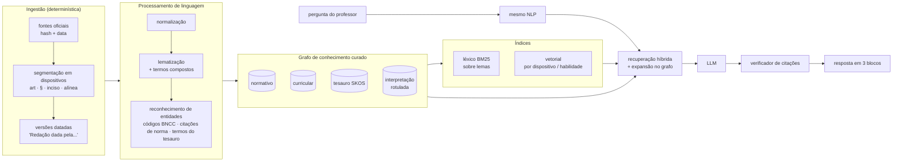
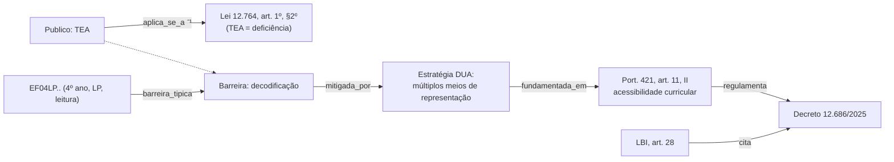

# Arquitetura de conhecimento do componente A: grafo, lematização e recuperação

> Visão geral para discussão. Não há código nem decisão de tecnologia aqui: cada escolha marcada "candidato a ADR" fica para `produtos/vuoo-microjogos/padroes/`. Base teórica em [conhecimento/grafo-conhecimento-educacional/](../../conhecimento/grafo-conhecimento-educacional/README.md), em especial `kg.ret.graph-rag`, `kg.ret.text-to-query`, `kg.mod.layer-separation` e `kg.std.skos`.

## 1. Não somos um clone do bncc.dev: o que muda

**O que é igual de propósito**
- A BNCC é extraída por nós da fonte oficial do MEC.
- Alguns **princípios de método** coincidem: fonte imutável com hash, extração sem LLM, proveniência por registro, poucas tools no MCP e erro que explica.

Isso é boa engenharia, não produto.

**O que é diferente, e é o produto**

| | bncc.dev | Componente A |
|---|---|---|
| Corpus | **um documento** (BNCC + Computação) | **muitos documentos que se modificam entre si**: leis, decretos, portarias, resoluções federais e estaduais, mais a BNCC |
| Unidade de dado | habilidade | habilidade **e** dispositivo legal (artigo, parágrafo, inciso, alínea) |
| Tempo | vigência por registro | **versões datadas** de cada dispositivo; resposta "vigente em uma data" (§3.3) |
| Relações | hierarquia interna da BNCC | **grafo entre documentos**: regulamenta, altera, revoga, conflita, fundamenta; e a ponte **BNCC ↔ inclusão** (§3) |
| Vocabulário | texto da norma, com radical por regras | **tesauro do professor** ("cuidador" → "profissional de apoio escolar"; "laudo" → "documento comprobatório"), **lematização** e reconhecimento de entidades (§4) |
| Recuperação | lookup + BM25 | lookup + busca híbrida (léxica + vetorial) + **expansão pelo grafo** (§5) |
| Garantia | o dado é verificado | o dado é verificado **e cada resposta também**: verificador de citações antes de exibir, medindo citação que não sustenta a afirmação (*misgrounding*) |
| Para quem | desenvolvedor, edtech | **professor**, com conversa pronta (DA-1, DA-2); MCP para quem tem o próprio LLM |
| Avaliação | benchmark de memória dos LLMs na BNCC | golden set de **legislação** + BNCC, rodado no **LLM do cliente**, com e sem base |

Em uma frase: **o bncc.dev é um dicionário verificado de um documento. O A é um sistema que sabe como os documentos da educação especial se relacionam, no tempo, e que conversa na língua do professor.**

## 2. Visão em camadas



A regra que atravessa as camadas é que **o mesmo processamento de linguagem roda na indexação e na pergunta**. Se um lado lematiza e o outro não, a busca falha em silêncio.

## 3. O grafo de conhecimento

É um **grafo curado**: construído pelo pipeline e pela curadoria, não extraído do texto por LLM. Essa distinção vem de `kg.ret.graph-rag`: Graph RAG por extração serve para perguntas globais sobre corpus grande, mas herda os erros do extrator. Para fato normativo, só vale grafo curado.

### 3.1 Quatro camadas, separadas (kg.mod.layer-separation)

| Camada | O que contém | Quem escreve | Pode ser citada como "a norma diz"? |
|---|---|---|---|
| **Normativa** | normas, dispositivos, versões, relações entre atos | pipeline determinístico | sim |
| **Curricular** | BNCC: competências, áreas, componentes, unidades, objetos, habilidades | pipeline próprio, da fonte oficial do MEC | sim |
| **Tesauro** | conceitos e seus nomes: oficial, popular, sigla, termo antigo | curadoria | não (serve para achar, não para afirmar) |
| **Interpretação** | barreiras típicas, estratégias DUA, ligações BNCC ↔ inclusão, FAQ | curadoria pedagógica | **não**: sempre rotulada "orientação" |

### 3.2 Nós e arestas principais

**Nós**

| Nó | Exemplo | Identificador |
|---|---|---|
| `Norma` (obra) | Portaria MEC 421/2026 | URN LEX (`urn:lex:br:ministerio.educacao:portaria:2026-05-15;421`, a conferir) |
| `Dispositivo` | art. 11, II | URN + `~art11;inc2` |
| `VersaoDispositivo` (expressão datada) | art. 29 na redação da Port. 550/2026 | URN + `@2026-06-18` |
| `Habilidade` | EF04LP05 | código BNCC |
| `Conceito` (SKOS) | profissional de apoio escolar; PEI; tecnologia assistiva | slug próprio |
| `Publico` | TEA, deficiência intelectual, surdez, AH/SD, dislexia/TDAH | slug, ligado ao `Conceito` |
| `Barreira` *(interpretação)* | barreira de comunicação; barreira na leitura | slug |
| `EstrategiaDUA` *(interpretação)* | múltiplos meios de representação: texto com apoio de imagem e áudio | ligada às diretrizes CAST |
| `Jurisdicao` | federal; SP estadual | código IBGE / `br` |

**Arestas**

| Aresta | De → para | Camada |
|---|---|---|
| `contem` | Norma → Dispositivo → Dispositivo | normativa |
| `tem_versao` | Dispositivo → VersaoDispositivo (com `vigente_de`, `vigente_ate`) | normativa |
| `regulamenta` | Port. 421 → Decreto 12.686 | normativa |
| `altera` / `revoga` / `acrescenta` | Port. 550 → art. 29 da Port. 421 | normativa |
| `cita` | dispositivo → dispositivo | normativa |
| `conflita_com` | Res. SEDUC 129, art. 9 ↔ Port. 421 (laudo) — **com nota, sem decidir** | normativa (curada) |
| `trata_de` | Dispositivo → Conceito | tesauro |
| `aplica_se_a` | Dispositivo → Publico | tesauro |
| `pertence_a` | Habilidade → Componente → Area | curricular |
| `barreira_tipica` | Habilidade × Publico → Barreira | interpretação |
| `mitigada_por` | Barreira → EstrategiaDUA | interpretação |
| `fundamentada_em` | EstrategiaDUA → Dispositivo (ex.: acessibilidade curricular, Port. 421, art. 11, II) | interpretação |

### 3.3 Exemplo: a pergunta do Fluxo 1 percorrendo o grafo

"Aluno com TEA, 4º ano, não lê ainda: que habilidades de LP e que adaptações?"



A resposta sai em três blocos:
1. **O que a norma diz:** Lei 12.764, LBI art. 28, Port. 421 art. 11, II, e as habilidades com código.
2. **Orientação:** a barreira e a estratégia, rotuladas como interpretação.
3. **Fontes:** com vigência.

Cada pedaço vem de um nó com identificador, e por isso o verificador consegue conferir a resposta.

### 3.4 Tempo (o que mais nos diferencia)

- Cada `Dispositivo` tem uma ou mais `VersaoDispositivo`, cada uma com intervalo de vigência e o ato que a criou. O modelo segue a ideia FRBR obra/expressão e a notação `@data` da URN LEX (RFC 9676).
- Uma consulta tem sempre uma **data de referência**. O padrão é hoje, mas a pergunta "como era em junho?" muda a data.
- **Revogado não é apagado.** O nó fica, com `vigente_ate` e a aresta `revoga`. Por isso a resposta para "o Decreto 10.502 ainda vale?" é "não, revogado pelo 11.370/2023, e antes disso suspenso pelo STF".

## 4. Processamento de linguagem: lematização e companhia

### 4.1 Lematização × radicalização

| | Radical (o que o bncc-pacotes faz) | Lema (proposta) |
|---|---|---|
| O que é | corta sufixos por regra: `frações → frac` | reduz à forma de dicionário usando morfologia: `frações → fração`, `adaptou → adaptar` |
| Erro típico | junta o que não devia: o próprio projeto aceita por escrito colisões como `educação`/`educacional` e `conta`/`conto` | depende de modelo; erra em palavra rara ou termo técnico |
| Explicável | muito: regra fixa e determinística | menos; o modelo precisa ser **pinado** (versão fixa) para ser reprodutível |
| Por que importa para nós | no texto jurídico, `educação especial` × `educacional especializado` é uma distinção **com consequência**: modalidade × atendimento (AEE) | preserva a distinção; a ligação entre termos parecidos passa a ser feita pelo **tesauro**, de forma explícita |

**Proposta:** lematização como base, com modelo pinado (candidatos: spaCy `pt_core_news`, Stanza; avaliar no nosso corpus, candidato a ADR). Ajustes:
- um **dicionário de exceções** do domínio, para que `AEE`, `PEI`, `PAEE`, `SRM`, `Libras`, `TEA` e `AH/SD` não sejam lematizados;
- o **radical como sinal secundário** no BM25, para recall.

A escolha se mede no golden set de busca (mapeamento §4.5), não no gosto.

### 4.2 Etapas do pipeline de linguagem

1. **Normalização:** Unicode, caixa e espaço. Os acentos ficam numa forma e somem noutra, e as duas são indexadas.
2. **Segmentação jurídica:** quebrar o texto em artigo, parágrafo, inciso e alínea, e reconhecer as marcas do Planalto ("(Redação dada pela Lei nº...)", "(Incluído pelo Decreto...)", "(Revogado)", "(Vide...)"). Essas marcas **viram arestas e versões**, não texto.
3. **Termos compostos:** `profissional de apoio escolar`, `sala de recursos multifuncionais`, `tecnologia assistiva`, `comunicação aumentativa e alternativa`, `estudo de caso` são um termo só. A fonte é o tesauro, não estatística.
4. **Lematização** das palavras soltas (4.1).
5. **Reconhecimento de entidades**, por regra, determinístico:
   - **código BNCC**, pela gramática do decodificador (`EF04LP05`, `EM13LGG101`, `EI03ET01`);
   - **citação de norma** em linguagem natural ("art. 28, § 1º da LBI", "Portaria 421", "decreto de 2025 da educação especial"), resolvida para URN. A parte ambígua pede confirmação ou vira busca;
   - **termo do tesauro**, incluindo sinônimo popular e sigla;
   - **público** (TEA, DI, surdez...) e **ano/etapa** ("4º ano", "fundamental 1").
6. **Detecção de dado pessoal** (RF-17): nome próprio junto a condição, CPF, data de nascimento. A pergunta é avisada antes de ir ao LLM.

### 4.3 O tesauro (SKOS) é onde mora a língua do professor

| Conceito (prefLabel) | Como o professor fala (altLabel) | Termo antigo ou inadequado (hiddenLabel) |
|---|---|---|
| profissional de apoio escolar | cuidador, monitor, acompanhante, AT | — |
| documento comprobatório / laudo | laudo, CID, relatório médico | — |
| estudante público da educação especial | aluno de inclusão, aluno laudado | aluno especial, portador de deficiência, PNE |
| altas habilidades ou superdotação | AH/SD, superdotado | — |
| plano educacional individualizado | PEI, plano individual | PDI (em alguns estados) `[A CONFIRMAR]` |

Os termos inadequados ficam como **hiddenLabel**: a busca os entende, mas a resposta usa o termo correto. É uma forma discreta de formação, com linguagem respeitosa sem corrigir o professor. O tesauro é curado, versionado e testado, e cada termo novo vem de pergunta real que falhou.

## 5. Recuperação: do texto da pergunta ao contexto do LLM

```
pergunta
  │ NLP (§4): lemas, entidades, termos, público, ano, data de referência
  ├─► 1. lookup direto      código BNCC ou dispositivo reconhecido → nó exato (sem busca)
  ├─► 2. léxico (BM25)      sobre lemas + rótulos do tesauro, com filtros de jurisdição e vigência
  ├─► 3. vetorial           sobre dispositivos e habilidades (cada um com cabeçalho de contexto:
  │                         "Port. 421/2026 › Cap. II › art. 11 › inciso II")
  │     fusão (ex.: RRF) dos resultados 2 e 3
  ├─► 4. expansão no grafo  1 a 2 saltos: regulamenta, altera, conflita, fundamentada_em,
  │                         sempre filtrando pela data de referência
  ├─► 5. reordenação        prioridade: lookup > normativa > curricular > interpretação
  └─► 6. pacote de contexto cada trecho com id, rótulo de camada, vigência e fonte
        → LLM → verificador de citações (RF-10) → resposta em 3 blocos
```

Pontos de desenho:
- **A unidade de indexação é o dispositivo ou a habilidade**, não pedaços de N tokens. A citação, portanto, é sempre a de um nó real.
- **A camada vetorial nunca afirma sozinha.** Ela acha candidatos; quem sustenta a resposta é o nó do grafo com fonte. A regra vem do bncc-pacotes e de `kg.ret.graph-rag`.
- **Text-to-query** (o LLM gera uma consulta ao grafo) fica para perguntas estruturais ("quais normas regulamentam o Decreto 12.686?"), exposto como tool `norma_relacoes`, e não como consulta livre. Ver `kg.ret.text-to-query`.
- **O mesmo pipeline atende a conversa e o MCP**: núcleo único, cascas finas.

## 6. Armazenamento (opções, candidato a ADR)

| Opção | A favor | Contra |
|---|---|---|
| Postgres com tabelas de nós e arestas + busca textual + pgvector | um banco só; transacional; fácil de operar | consulta de grafo profundo é mais trabalhosa (SQL recursivo) |
| Triplestore RDF (SKOS, SPARQL) + índice de busca à parte | casa com SKOS e URN; padrão aberto | dois sistemas; equipe precisa de SPARQL |
| Grafo de propriedades (Neo4j etc.) + índice à parte | consulta de caminhos expressiva | dois sistemas; licença e operação |

**Recomendação (revista em 05/11/2026, ver [02-prd.md](02-prd.md#decisões-técnicas-recomendadas-boas-práticas)):** com a ontologia (DA-6), o grafo fica num triplestore leve (**Oxigraph**, SPARQL com consultas fixas) e a busca fica no **Postgres** (BM25 + pgvector). O grafo é pequeno (milhares de nós) e quase imutável entre releases, o que torna os dois sistemas baratos de operar. Vira ADR no `04-plano.md`.

Ordem de grandeza, a medir:
- cerca de 1.700 aprendizagens BNCC (contagem do bncc.dev, só como referência; a nossa é conferida na nossa extração);
- de poucas centenas a 2 mil dispositivos nas normas P1 [I];
- algumas centenas de conceitos no tesauro [I].

## 7. O que este desenho exige do mapeamento

Liga-se aos blocos de [mapeamento-da-solucao.md](mapeamento-da-solucao.md):
- 4.2: modelo de `Dispositivo` e `VersaoDispositivo` com URN;
- 4.3: segmentador jurídico e regras das marcas do Planalto;
- 4.4: arestas de interpretação (`barreira_tipica`, `mitigada_por`, `fundamentada_em`);
- 4.5: tesauro v0, escolha do lematizador e golden set de busca para comparar radical, lema e híbrido.
