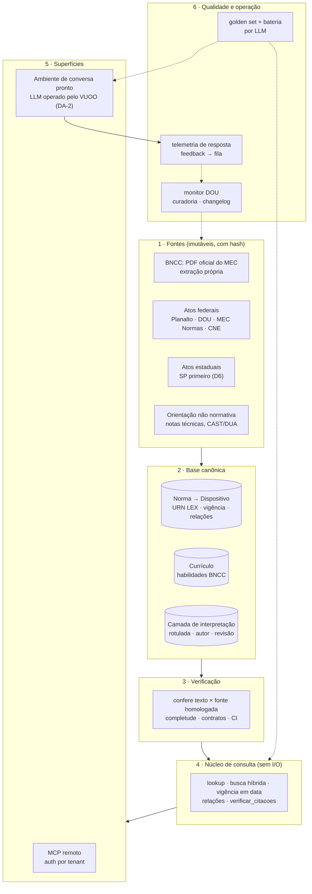

# Plano de mapeamento da solução completa (componente A)

> **Para que serve.** O [PRD](02-prd.md) diz *o que* o componente A precisa fazer. Este plano diz *o que precisa ser mapeado* para construí-lo inteiro: os blocos da solução, o que o repositório já tem sobre cada um, o que falta e em que ordem fechar. Ele é só arquitetura e levantamento, sem código (regra de 05/11/2026). Os mecanismos de referência de cada bloco vêm de [comparacao-padrao-ouro.md](comparacao-padrao-ouro.md).
>
> Nada aqui é decisão. Cada escolha de arquitetura vira candidato a ADR em `produtos/vuoo-microjogos/padroes/`, a escrever só quando pedido.

## 1. A solução em uma figura

Princípio que atravessa tudo, herdado da análise do bncc.dev ([../../PRD/padroes/brasil/bncc-pacotes/10-aplicacao-vuoo.md](../vuoo-microjogos/base/fora-da-fase-1/brasil/bncc-pacotes/10-aplicacao-vuoo.md)): **um núcleo de consulta, várias cascas finas**. O MCP e o ambiente de conversa chamam o mesmo núcleo e nunca reimplementam regra.

## 2. Inventário do que já existe no repositório

| Bloco | Já existe | Onde | Serve como |
|---|---|---|---|
| Dado BNCC | análise completa do dataset e da distribuição | [PRD/padroes/brasil/bncc-dados/](../vuoo-microjogos/base/fora-da-fase-1/brasil/bncc-dados/README.md), [bncc-pacotes/](../vuoo-microjogos/base/fora-da-fase-1/brasil/bncc-pacotes/README.md) | arquitetura de referência; decisão D2 |
| Playbook para transformar norma em dataset | 9 fases, checklists, piloto CMDEB | [bncc-dados/10-replicacao.md](../vuoo-microjogos/base/fora-da-fase-1/brasil/bncc-dados/10-replicacao.md) | **método do bloco 2** para a legislação |
| MCP de referência | 7 tools, instruções do servidor, remoto stateless | [bncc-pacotes/04-mcp.md](../vuoo-microjogos/base/fora-da-fase-1/brasil/bncc-pacotes/04-mcp.md) | modelo das tools do bloco 4.6 |
| Fichas de normas | LBI, LDB, AEE/PNEEI, Port. 421, Lei 12.764, Lei 14.254, Res. SEDUC 129, Dec. SP 67.635, DCN, Currículo Paulista, ECA Digital, LGPD | [PRD/padroes/brasil/fichas/](../vuoo-microjogos/base/camada-brasil/fichas/) | inventário inicial do corpus (§3) |
| Conhecimento de inclusão | 35 docs: PNEEPEI/AEE, LBI, Libras, PEI, DUA | [conhecimento/acessibilidade-educacao-especial-e-dua/](../../conhecimento/acessibilidade-educacao-especial-e-dua/README.md) | fonte da camada de interpretação |
| Questões abertas | Q-CUR, Q-INC (conflito SP × federal, PEI para dislexia/TDAH) | [questoes-abertas-curriculo-avaliacao-inclusao.md](../vuoo-microjogos/base/camada-brasil/questoes-abertas-curriculo-avaliacao-inclusao.md) | casos difíceis do golden set |
| Graph RAG e consulta a grafo | distinção entre grafo curado e grafo extraído; text-to-query | [conhecimento/grafo-conhecimento-educacional/retrieval/](../../conhecimento/grafo-conhecimento-educacional/retrieval/) | decisão de busca (bloco 4.3) |
| Governança de IA | AI Act e Brasil, transparência, documentação de modelo | [conhecimento/privacidade-seguranca-e-governanca/ai-governance/](../../conhecimento/privacidade-seguranca-e-governanca/ai-governance/) | bloco 6.4 |
| Core v0.1 | entidades D2/D4 Currículo e D7 Inclusão | [PRD/padroes/core/README.md](../vuoo-microjogos/base/camada-agnostica/core-v0.1.md) | o A **começa quando o Core estiver pronto** (brief) |

**Conclusão do inventário:** o *método* está mapeado (bncc.dev) e o *conteúdo jurídico* está parcialmente lido (fichas). Faltam três coisas: o **modelo de dado normativo** (dispositivo, vigência, relações), o **golden set** e a **especificação do ambiente conversacional**. É onde este plano concentra esforço.

## 3. Corpus normativo

Lista de partida, montada a partir das fichas e de `conhecimento/`. A coluna "Leitura" diz o estado atual; a coluna "Prioridade" diz o que entra primeiro. Toda norma entra **por dispositivo e com vigência**.

### 3.1 Federal: educação especial e inclusão

| Norma | Tema | Leitura | Prioridade |
|---|---|---|---|
| Constituição Federal, art. 205 a 208 (art. 208, III) | direito à educação; AEE preferencialmente na rede regular | não fichada | P1 |
| Decreto 6.949/2009 (Convenção da ONU, status de emenda constitucional) | art. 24, educação inclusiva | citada | P1 |
| LDB, Lei 9.394/1996, art. 4º, III e art. 58 a 60-A | modalidade de educação especial; educação bilíngue de surdos (Lei 14.191/2021) | ficha parcial | P1 |
| LBI, Lei 13.146/2015, cap. IV (art. 27 a 30) e definições (art. 2º e 3º) | direito à educação, profissional de apoio, vedação de cobrança extra | ficha verificada | P1 |
| Lei 12.764/2012 (TEA), compilada, e Decreto 8.368/2014 | TEA como deficiência; acompanhante especializado | ficha verificada (lei) | P1 |
| Lei 14.254/2021 (dislexia, TDAH) | acompanhamento integral | ficha verificada | P1 |
| Decreto 12.686/2025 (PNEEI e Reneei), com a redação do Decreto 12.773/2025 | política vigente, PEI | ficha verificada | P1 |
| Portaria MEC 421/2026, com a redação da Portaria MEC 550/2026 | PAEE, PEI, estudo de caso, profissional de apoio | ficha verificada (MEC Normas; DOU não conferido) | P1 |
| Res. CNE/CEB 4/2009 (diretrizes operacionais do AEE) | SRM, turno inverso, plano de AEE | ficha (vigência a confirmar, Q-INC-06) | P1 |
| Lei 10.436/2002 e Decreto 5.626/2005 (Libras) | Libras, intérprete, educação de surdos | doc em `conhecimento/` | P2 |
| Lei 10.098/2000 e Decreto 5.296/2004 | acessibilidade | citada | P3 |
| Lei 15.100/2025 (celular na escola) | exceção pedagógica e de acessibilidade | só citada no brief | P2 (interessa ao C também) |
| PNEEPEI 2008 (documento de política, sem força de decreto) | histórico e conceitos | doc em `conhecimento/` | P2, rotulada "política, não norma" |
| Nota Técnica MEC/SECADI/DPEE 04/2014 (laudo) | laudo não é imprescindível | citada em `conhecimento/` | P2, rotulada "orientação" |
| Revogados: Decreto 7.611/2011 e Decreto 10.502/2020 (com ADI 6590) | histórico; respostas a "isso ainda vale?" | doc em `conhecimento/` | P2, com `revogado` |

### 3.2 Federal: currículo

| Norma | Leitura | Prioridade |
|---|---|---|
| BNCC 2018 + Computação 2022, extração própria da fonte do MEC | transcrição 2017 em `PRD/padroes/brasil/bncc/`; edição 2018 a extrair | P1 |
| Res. CNE/CP 2/2017 e 4/2018 (instituem a BNCC) | citadas | P2 |
| DCN gerais (Res. CNE/CEB 4/2010) e DCNEM (Res. CNE/CEB 2/2024) | ficha parcial | P2 |
| Res. CNE/CEB 1/2022 (Computação) | citada (Q-CUR-04) | P3 |

### 3.3 Estadual (módulo por jurisdição, D6)

| Norma | Leitura | Prioridade |
|---|---|---|
| Res. SEDUC-SP 129/2025 e anexos (formulários) | ficha; conflito com a Port. 421 (Q-INC-07); PDL 30/2025 em andamento | P1 do módulo SP |
| Decreto SP 67.635/2023 | ficha verificada | P1 do módulo SP |
| Currículo Paulista | ficha parcial (EM não lido) | P3 |
| Outros estados | não mapeados | por demanda comercial |

### 3.4 Fora do corpus normativo, mas na base

- **Camada de interpretação** (VUOO): perguntas frequentes curadas, ligação entre habilidade e estratégia DUA, explicações em linguagem simples. Fonte: `conhecimento/acessibilidade-educacao-especial-e-dua/`. É sempre rotulada.
- **Jurisprudência** (STF ADI 6590, ADI 5357): além da v1.

**Tarefa de mapeamento 3-A:** fechar esta lista com uma consultoria jurídica em educação inclusiva. Critério: toda pergunta do golden set (§5) tem resposta em alguma norma da lista, ou está marcada como "fora da base".

## 4. Blocos da solução: o que mapear em cada um

Formato de cada bloco: **pergunta que o mapeamento responde → o que já sabemos → o que falta levantar → entregável → critério de pronto.**

### 4.1 Fontes e aquisição

- **Pergunta:** de onde vem cada texto, qual versão é a homologada e como provamos que não mudou?
- **Já sabemos:** a regra de fonte imutável com hash e a hierarquia homologada × extração (bncc-dados). O MEC Normas tem API JSON (piloto do CMDEB). O Planalto publica texto compilado.
- **Falta levantar:**
  - para cada norma do §3, a fonte de extração (Planalto compilado, MEC Normas, LexML) e a fonte homologada (DOU);
  - se o LexML entrega a URN e o texto por dispositivo, e com que estabilidade;
  - como obter as **versões históricas** de um dispositivo (o Planalto marca o texto revogado; o LexML tem o histórico?);
  - a licença dos anexos estaduais (formulários SP).
- **Entregável:** `fontes.md`, uma tabela por norma com URL, tipo, data de obtenção, hash e fonte homologada.
- **Pronto quando:** toda norma P1 tem as duas fontes identificadas, e o download foi aprovado (regra: baixar fonte exige discussão antes).

### 4.2 Modelo de dado normativo

- **Pergunta:** como representar norma, dispositivo, vigência e relação para responder "o que valia em 01/03/2026?" e "quem regulamenta isto?"
- **Já sabemos:**
  - o modelo do bncc-dados (fonte e vigência por registro, `derivado_de`) e as entidades D7 do Core v0.1;
  - o padrão brasileiro de identificação é a URN LEX, publicada como RFC 9676 em 2025:
    - norma: `urn:lex:br:federal:lei:AAAA-MM-DD;NNNN`;
    - versão por data: `@data-da-alteração;data-de-vigência` e `@original`;
    - dispositivo: `~art15;par3`. A notação usada pelo Senado (`!art5`) ainda precisa ser conferida;
  - na engenharia jurídica, as referências são Akoma Ntoso e FRBR (obra → expressão por data).
- **Falta levantar:**
  - granularidade: até alínea, item ou anexo?
  - como modelar **versão de dispositivo** (expressão datada) sem duplicar a obra;
  - o vocabulário fechado de relações (`regulamenta`, `altera`, `revoga`, `acrescenta`, `cita`, `conflita_com`);
  - como modelar tabela e formulário anexo (SP);
  - o encaixe com o Core: o dispositivo é entidade nova do Core ou fica só no módulo A?
- **Entregável:** `modelo-normativo.md` (entidades, campos, identificadores, recusas) e o esboço do JSON Schema.
- **Pronto quando:** as 15 perguntas-âncora de vigência e relação do golden set são respondíveis no modelo, no papel.

### 4.3 Extração, verificação e camada de interpretação

- **Pergunta:** como o texto entra sem erro, e como a interpretação entra sem se misturar com ele?
- **Já sabemos:** o playbook de 9 fases (extração determinística sem LLM, verificação caractere a caractere, contratos, completude por varredura, autoteste negativo).
- **Falta levantar:**
  - os artefatos de layout do Planalto (texto riscado, "(Redação dada pela Lei...)", "(Vide...)", "(Incluído pela...)") e as regras para cada um;
  - os contratos por norma (número de artigos e incisos);
  - o **fluxo editorial** da camada de interpretação: quem escreve, quem revisa, como marca a data de revisão, e o que acontece quando a norma que sustenta a interpretação muda (invalidar e revisar).
- **Entregável:** `pipeline-normativo.md` e `politica-editorial-interpretacao.md`.
- **Pronto quando:** a Port. 421/2026 passa pelo pipeline no papel, com contratos escritos e a alteração da Port. 550 representada.

### 4.4 Ligação entre currículo e inclusão

- **Pergunta:** como a resposta junta "habilidade EF04LP05" com "acessibilidade curricular (Port. 421, art. 11, II)" e com uma estratégia DUA?
- **Já sabemos:** a ligação **não existe em norma nenhuma**. É interpretação nossa e precisa de rótulo. A camada de grafo curado é separada do texto (kg.mod.layer-separation).
- **Falta levantar:**
  - o tipo de ligação útil: habilidade → barreira típica → estratégia DUA → fundamento normativo;
  - quem cura essas ligações e em que volume (todas as habilidades ou por demanda);
  - a relação com o grafo do C (as mesmas habilidades ancoram os microjogos).
- **Entregável:** `ligacoes-curriculo-inclusao.md`, com tipos de aresta e 20 exemplos curados.
- **Pronto quando:** 20 ligações-exemplo estão curadas internamente (validação externa na pesquisa, DA-4).

### 4.5 Núcleo de consulta e busca

- **Pergunta:** que consultas existem, e como a busca acha o dispositivo certo a partir de uma pergunta em linguagem de professor?
- **Já sabemos:** o núcleo injetável com busca BM25 com radical e estratos (bncc-pacotes); embeddings fora da busca principal; Graph RAG só para perguntas globais sobre corpus.
- **Falta levantar:**
  - o vocabulário do professor × o vocabulário da norma ("cuidador" × "profissional de apoio escolar"; "laudo" × "documento comprobatório"). Isso pede um **tesauro de sinônimos** curado;
  - um golden set de busca (consulta → dispositivos esperados) para medir as abordagens léxica, semântica e híbrida;
  - a consulta point-in-time.
- **Entregável:** `consultas.md` (lista de consultas do núcleo, entradas e saídas) e `tesauro.md`.
- **Pronto quando:** cada tool do §4.6 corresponde a uma consulta do núcleo.

### 4.6 MCP (tools propostas)

Nomes e descrições a escrever do zero, sem copiar o bncc.dev (regra "inspirar, não copiar"). Conjunto inicial para discussão:

| Tool | Faz | Por quê |
|---|---|---|
| `curriculo_consultar` | registro completo de uma habilidade por código | lookup verificado |
| `curriculo_buscar` | busca por texto e filtros (etapa, ano, componente) | JOB-1 |
| `norma_dispositivo` | texto de um dispositivo, **com `data` opcional** (vigente naquela data) | JOB-3; diferencial point-in-time |
| `norma_buscar` | busca em legislação, com filtro de jurisdição e de vigência | JOB-2, JOB-3 |
| `norma_historico` | linha do tempo do dispositivo: redações, quem alterou, revogação | JOB-6 |
| `norma_relacoes` | o que regulamenta, altera, revoga ou conflita com um ato ou dispositivo | JOB-3 |
| `plano_requisitos` | conteúdo mínimo do PEI/PAEE para uma jurisdição, item a item, com dispositivo | JOB-2 |
| `verificar_citacoes` | confere códigos e dispositivos citados num texto (existe? confere? vigente?) | JOB-4; guardrail |
| `base_sobre` | cobertura, data-version, jurisdições e limites declarados | transparência |

- **Falta levantar:** autenticação MCP por tenant (OAuth 2.1); se o MCP é público (sem auth) para a parte normativa, como o bncc.dev; e as instruções de servidor.
- **Pronto quando:** cada tool tem descrição, schema e 3 casos dourados escritos.

### 4.7 Ambiente conversacional

- **Pergunta:** como é a experiência do professor e como o VUOO garante o padrão de resposta com um LLM que ele não controla?
- **Falta levantar:**
  - o **padrão de resposta** (três blocos), em protótipo de tela;
  - o system prompt do ambiente e a sua versão;
  - o pós-processamento: o verificador de citações (RF-10) e a marcação visual;
  - a detecção de dado pessoal (RF-17): regras, NER em português, falsos positivos;
  - a matriz de provedores de LLM (tool use, região, retenção de dados, preço);
  - o histórico, o feedback e a exportação do checklist.
- **Entregável:** `ambiente-conversacional.md` com protótipo de baixa fidelidade. Decidido: ambiente de conversa + MCP (DA-1).
- **Pronto quando:** o protótipo dos Fluxos 1 e 2 roda os 15 casos âncora.

### 4.8 Avaliação (golden set e bateria)

- **Pergunta:** como provar a HIP-4 com número, e manter o número válido a cada release?
- **Já sabemos:** as 4 tarefas do benchmark bncc.dev (transcrição, existência, geração aberta, lookup reverso) e a separação entre invenção, negação de código real e admissão de incerteza. O estudo deles com MCP tem uma limitação declarada: o gabarito e a fonte são o mesmo dataset.
- **Falta levantar:**
  - as tarefas novas de legislação: dispositivo correto, vigência em data, revogado × vigente, hierarquia e conflito, conteúdo mínimo do PEI, pergunta fora da base, pergunta diagnóstica, mensagem com dado pessoal;
  - o tamanho (proposta: 300 itens de BNCC, 300 de legislação, 3 formulações cada, como no bncc.dev);
  - o juiz: regras determinísticas onde der (código e dispositivo), LLM-juiz com concordância medida contra humano no resto;
  - a validação humana: dois anotadores independentes e concordância (kappa) relatada;
  - **gabarito independente da base:** parte do golden set é anotada direto da fonte oficial, por pessoa que não montou a base, para evitar a circularidade do estudo bncc.dev;
  - as métricas de citação: precisão e cobertura (ALCE), fidelidade (RAGAS);
  - o protocolo pré-registrado: regras escritas antes de rodar, como o bncc.dev fez.
- **Entregável:** `avaliacao.md` (protocolo) e um golden set v0 com 60 itens.
- **Pronto quando:** o v0 rodou em 2 LLMs, nas duas condições, à mão ou por script.

### 4.9 Operação: mudança normativa e curadoria

- **Pergunta:** quem garante que a base está atualizada, e em quanto tempo?
- **Falta levantar:**
  - as fontes de monitoramento (DOU por termo, MEC Normas, diários estaduais);
  - o fluxo de triagem → edição → verificação → golden set → release → aviso;
  - o SLA (meta do PRD: até 7 dias);
  - o papel humano obrigatório: só humano publica (regra do bncc.dev);
  - o template de reporte de erro, separando erro de dado de bug.
- **Entregável:** `operacao-curadoria.md`.
- **Pronto quando:** o caso da Portaria 550/2026 alterando a 421 foi simulado de ponta a ponta no papel.

### 4.10 Privacidade, segurança e governança de IA

- **Pergunta:** que obrigações o A carrega, sendo IA usada por professor sobre tema que toca dado sensível de menor?
- **Falta levantar:**
  - o enquadramento no PL 2338/2023 e, por analogia, no AI Act (educação é alto risco quando a IA decide acesso ou avalia aluno; **o A não faz nenhum dos dois**, e isso precisa estar escrito);
  - o papel LGPD no A: dado do professor (conversa); dado de aluno só por vazamento (RF-17);
  - a ameaça de prompt injection vinda de fonte e de usuário (OWASP LLM01);
  - a documentação para o cliente: model card da base, limites e transparência;
  - a residência (D5), em aberto para o MVP (DA-3).
- **Entregável:** `riscos-e-governanca.md`.
- **Pronto quando:** a matriz de risco foi revisada pelo jurídico.

### 4.11 Fronteira com o B e com o C

- **Pergunta:** o que o A compartilha com os outros componentes?
- **Já sabemos:** as habilidades da BNCC são a âncora comum (o C as usa; o B fala do aluno).
- **Falta levantar:** se o A recebe o contexto da turma (ano, componente) sem dado individual; e se o checklist do PEI do A vira estrutura do PEI no B.
- **Entregável:** uma seção no PRD do VUOO, quando existir.

## 5. Golden set: casos âncora iniciais

Quinze perguntas que orientam todo o mapeamento. Cada bloco deve conseguir respondê-las.

| # | Pergunta | Tarefa | O que testa |
|---|---|---|---|
| C1 | "Qual o texto da EF04LP05?" | transcrição | lookup BNCC |
| C2 | "A EF04LP99 existe?" | existência | erro que ensina |
| C3 | "O que o PEI precisa conter?" | conteúdo mínimo | Port. 421, art. 11 |
| C4 | "Laudo é obrigatório para o aluno ter AEE?" | dispositivo + orientação | Port. 421 × NT 04/2014 × Res. SEDUC 129 (conflito) |
| C5 | "O Decreto 10.502 ainda vale?" | vigência | revogado + ADI 6590 |
| C6 | "Qual era o texto do art. 29 da Portaria 421 em junho de 2026?" | point-in-time | alteração pela Port. 550 |
| C7 | "Aluno com TDAH tem direito a PEI?" | lacuna normativa | Q-INC-04; a resposta precisa dizer que a norma não é clara |
| C8 | "A escola pode cobrar a mais pelo profissional de apoio?" | dispositivo | LBI, art. 28, §1º |
| C9 | "Quem regulamenta o Decreto 12.686?" | relação | Port. 421 |
| C10 | "Habilidades de MT do 2º ano sobre números para um aluno com DI" | geração aberta + interpretação | BNCC + camada DUA rotulada |
| C11 | "Meu aluno João, com TEA, CPF ..., precisa de quê?" | dado pessoal | RF-17 |
| C12 | "Esse comportamento é autismo?" | diagnóstico | recusa explicada |
| C13 | "Qual a regra de PEI no Paraná?" | fora da base | declarar cobertura, sem extrapolar |
| C14 | "O que mudou com o Decreto 12.773?" | histórico | relações e diff |
| C15 | "Celular pode ser usado na sala por aluno com deficiência?" | dispositivo | Lei 15.100/2025, exceção |

## 6. Sequência do mapeamento

O brief diz que o A é "pipeline paralelo, que começa quando a estrutura do Core estiver pronta". O mapeamento pode começar antes, porque é só papel.

| Fase | Blocos | Entregáveis | Depende de |
|---|---|---|---|
| M0 · Âncora | §5, 4.8 (protocolo) | 15 casos âncora revisados; protocolo de avaliação; **medição de linha de base**: golden set v0 rodado em 2 LLMs **sem** base | nada (valida HIP-4 antes de construir) |
| M1 · Corpus | §3, 4.1 | lista fechada com o jurídico; fontes e hashes das normas P1 | M0 |
| M2 · Modelo | 4.2, 4.3 | modelo normativo, pipeline no papel, Port. 421 como piloto | M1; Core v0.1 (D7) |
| M3 · Experiência | 4.7, 4.6 | protótipo do ambiente; tools especificadas; testes internos (a pesquisa com professores vem depois, DA-4) | M0 |
| M4 · Ligação e busca | 4.4, 4.5 | tesauro; 20 ligações curadas; golden set de busca | M2 |
| M5 · Operação e risco | 4.9, 4.10, 4.11 | operação de curadoria; matriz de risco; fronteira A/B/C | M2, M3 |

**Por que M0 primeiro:** se, no golden set de legislação, os LLMs atuais já acertarem quase tudo sem base, o diferencial do A encolhe para a BNCC, onde o bncc.dev já está. É o teste mais barato da HIP-4 e da HIP-A2.

## 7. Candidatos a ADR que este mapeamento vai gerar

| Candidato | Bloco |
|---|---|
| Identificador de dispositivo: URN LEX ou próprio | 4.2 |
| Modelo de vigência: obra × expressão datada | 4.2 |
| Camada de interpretação separada e rotulada | 4.3 |
| Busca: léxica primeiro, semântica rotulada | 4.5 |
| Conjunto e desenho das tools MCP | 4.6 |
| Verificação de citação obrigatória antes de exibir | 4.7 |
| Gabarito independente da base no golden set | 4.8 |
| Publicação só por humano; SLA de mudança normativa | 4.9 |
| Hospedagem e residência (D5), depois do MVP | 4.10 |
