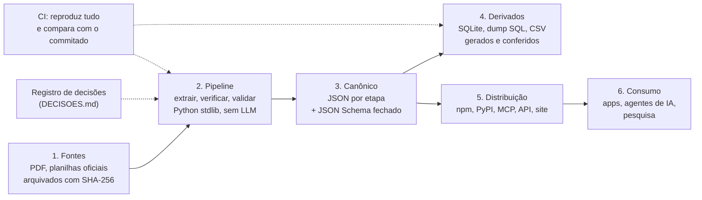

# Arquitetura

> **Fonte:** bncc-dados (commit `9c26897`): `README.md`, `pipeline/README.md`, `derivados/README.md`, `.github/workflows/validacao.yml`; bncc-pacotes: `docs/arquitetura.md`. Analisado em 2026-11-04.

## Camadas

O dado atravessa seis camadas, sempre num único sentido. Nenhuma camada é editada à mão; cada uma é função da anterior.



| Camada | Papel | Regra principal |
|---|---|---|
| Fontes | Matéria-prima: os documentos oficiais como baixados | Arquivo original intocado, com data de obtenção e SHA-256. Normalização técnica (ex.: reescrever um PDF malformado) é passo do pipeline, nunca da fonte |
| Pipeline | Scripts que leem as fontes e escrevem o canônico | Determinístico: mesma entrada, mesmos bytes. Correções conhecidas da fonte ficam num mapa explícito dentro do extrator |
| Canônico | O dataset, em JSON, um arquivo por etapa ou documento | Validado por JSON Schema fechado (`additionalProperties: false`). É a única fonte de verdade para os consumidores |
| Derivados | O mesmo dado em formatos de conveniência (SQL, planilha) | Gerados do canônico; o CI confere byte a byte (CSV) ou por dump lógico (SQLite) |
| Distribuição | Interfaces para máquina e para gente | Embutem uma data-version fixa, com checksums; nunca reimplementam o dado |
| Consumo | Quem usa | Recebe garantias explícitas (versionamento, vigência, proveniência) |

## Organização do repositório

A estrutura de pastas espelha as camadas. Vale como modelo:

```
fontes/          documentos oficiais + README com tabela (arquivo, o que é, data, SHA-256) e notas de proveniência
pipeline/        um script por etapa da cadeia; saídas intermediárias em saida/ (fora do git)
schema/          JSON Schema por arquivo de dados + definicoes.json com tipos compartilhados
dados/<doc>/     canônico, uma pasta por documento normativo (ex.: bncc-2018/, computacao-2022/)
                 + verificacao.json: resultado da verificação por registro
derivados/       SQLite, dump SQL, CSV; README avisando "gerado, não editar"
docs/            modelo de dados, dicionário, metodologia, versionamento, instalação, política de conteúdo
DECISOES.md      decisões de interpretação, numeradas
CHANGELOG.md     histórico por categoria
AGENTS.md, llms.txt   instruções para agentes de IA
CITATION.cff     metadado de citação; também é a fonte única da versão da release
```

Dois detalhes de desenho:

- **Uma pasta por documento normativo** em `dados/`. Um complemento (a Computação, de 2022) entra como documento novo ligado ao original por `derivado_de`, sem mexer no que já existia. Currículos estaduais podem entrar do mesmo jeito.
- **O resultado da verificação também é dado** (`verificacao.json`), versionado ao lado do dataset. Qualquer pessoa vê o status de cada registro sem rodar nada.

## Pipeline em etapas

A sequência é fixa e cada passo sai com código de erro se algo falhar:

| # | Etapa | Entrada → saída | Observação |
|---|---|---|---|
| 1 | Extração | planilhas e PDF → JSON canônico | Um extrator por tipo de fonte (planilha, PDF, anexo). Leitor de xlsx próprio, só com a biblioteca padrão |
| 2 | Verificação | JSON + PDF homologado → página de cada registro + `verificacao.json` | Confere o texto e grava o localizador da página |
| 3 | Validação de formato | JSON + schemas → ok/erro | Inclui o autoteste negativo (ver [03](03-cadeia-de-confianca.md)) |
| 4 | Validação de contratos | JSON + PDF → relatório | Cerca de 30 checagens de domínio, contagens e completude |
| 5 | Derivação | JSON → SQLite, SQL, CSV | Ordenação estável, metadados (versão, hashes das fontes) |
| 6 | Comparação no CI | reproduzido × commitado | `git diff --exit-code` sobre `dados/` e `derivados/` |

O CI roda essa cadeia inteira **em todo push e PR**, num runner limpo, instalando só as ferramentas declaradas (poppler, ghostscript, jsonschema). A reprodutibilidade deixa de ser promessa e vira teste.

## Ecossistema: separar o que envelhece em ritmos diferentes

O projeto não é um repositório só. A divisão segue um princípio explícito: **separa-se o que muda em ritmos diferentes; junta-se o que precisa lançar junto.**

| Repositório | Conteúdo | Ritmo |
|---|---|---|
| bncc-dados | Fontes, pipeline, canônico, derivados, documentação | Anos (muda quando a norma muda) |
| bncc-pacotes (monorepo) | Pacote npm, pacote PyPI, servidor MCP local e remoto | Lança junto com cada data-version |
| bncc-site | Site estático, uma página por aprendizagem | Próprio |
| bncc-api | API REST hospedada | Operacional, deploy próprio |
| bncc-benchmark | Mede alucinação de LLMs sobre a BNCC, com e sem a fonte estruturada | Rodadas periódicas |

Os pacotes ficam num monorepo porque precisam dizer exatamente a mesma coisa: a sincronização do dado é atômica (um comando atualiza npm e PyPI com o mesmo commit e checksums), e uma única fixture de testes prova que as duas bibliotecas respondem igual. O site e a API saíram desse monorepo quando passaram a ter ciclo próprio.

## Dependências mínimas como decisão de arquitetura

- O pipeline usa só a biblioteca padrão do Python. A única exceção, `jsonschema`, fica restrita à validação de formato.
- Ferramentas externas são livres e aprovadas pela OSI (poppler, ghostscript).
- Consumir o dado não exige nada além de um leitor de JSON, CSV ou SQLite.
- Os pacotes não têm dependências em tempo de execução e funcionam sem internet.

O efeito é longevidade: o dataset continua reproduzível daqui a anos, em qualquer máquina, sem conta em serviço algum.
