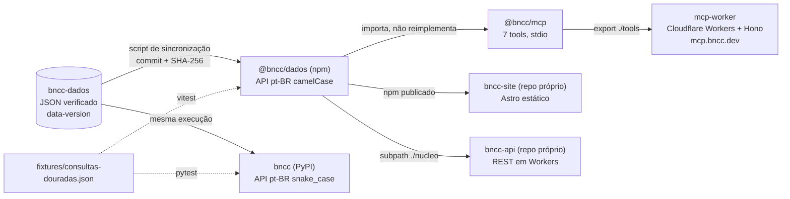

# Arquitetura

> **Fonte:** [bncc-dev/bncc-pacotes](https://github.com/bncc-dev/bncc-pacotes), commit `e9b4985`: `docs/arquitetura.md`, `DECISOES.md` (D1, D2, D4, D5), `README.md`, `CONTRIBUTING.md`, `packages/bncc/package.json`, `packages/bncc/src/nucleo.ts`, `packages/bncc/src/consultas.ts`, `packages/mcp/src/servidor.ts`, `mcp-worker/src/dados.ts`. Analisado em 2026-11-04.
>
> Inspirar, não copiar: ver o aviso em [README.md](README.md).

## O desenho em uma frase

Uma fonte de dados única, copiada de forma pinada para dois pacotes irmãos (npm e PyPI) que provam equivalência por um arquivo de testes compartilhado, e um servidor MCP que é casca fina sobre o pacote npm, servido em dois transportes (stdio local e HTTP remoto).



## Os quatro projetos do monorepo

| Diretório | Publica | Stack | Dependências de runtime |
|---|---|---|---|
| `packages/bncc` | npm `@bncc/dados` | TypeScript, build tsup (ESM + CJS + `.d.ts`), tarball ~204 KB | nenhuma |
| `packages/mcp` | npm `@bncc/mcp` (binário `bncc-mcp`, via `npx`) | SDK oficial do MCP + zod v3 | SDK, zod, `@bncc/dados` (`workspace:*`) |
| `python/` | PyPI `bncc` | Hatchling, wheel ~208 KB, Python ≥ 3.10 | nenhuma (pandas é extra opcional) |
| `mcp-worker/` | serviço `mcp.bncc.dev` | Cloudflare Workers + Hono + `@hono/mcp` | consome os dois pacotes acima por workspace |

Tamanho do código: cerca de 2.000 linhas em todos os `src/` somados (o núcleo TS tem 335; o MCP, 137 nas tools; o worker, 124 no handler).

## Por que monorepo (D1)

Três mecanismos só funcionam com tudo no mesmo repositório:

1. **Sincronização atômica.** Um comando copia o dataset para os dois pacotes e grava o mesmo commit e os mesmos hashes nos dois. Drift de versão do dado entre npm e PyPI fica estruturalmente impossível.
2. **Fixture única.** O arquivo de consultas douradas é um só, lido pelos dois runners. Em repos separados viraria cópia dessincronizada.
3. **Cadeia validada por inteiro.** MCP e worker buildam contra o pacote local (`workspace:*`), então `build + test` recursivo valida lib, MCP local e MCP remoto no mesmo commit, antes de qualquer publicação.

Custo aceito: tooling misto (pnpm + uv) e histórico compartilhado.

## A linha de corte: separar o que envelhece em ritmos diferentes (D2)

Regra explícita: **o que não compartilha o dataset não fica no monorepo.**

| Fica | Sai para repo próprio | Motivo |
|---|---|---|
| npm, PyPI, MCP stdio | | Lançam juntos, no ritmo do dado |
| `mcp-worker` | | Parece infraestrutura, mas importa código do workspace e é testado pela mesma suíte |
| | `bncc-dados` | Dado envelhece em anos; tem governança própria |
| | `bncc-site` (jul/2026) | Consome o pacote publicado; ciclo de deploy próprio |
| | `contato-worker` (jul/2026) | Não importava nada daqui; foi junto da página que o chama |
| | `bncc-api` | Deploy e ciclo operacional próprios |

O princípio de fundo, citado como "separar reputações": cada superfície pública (dado, pacote, API, MCP, site) tem reputação e ciclo próprios; a falha ou a migração de uma não arrasta as outras. O `wrangler.toml` do worker registra isso: o MCP remoto é Cloudflare nativo e não é afetado por deploy ou migração do site (que roda em AWS ECS).

## Núcleo injetável (D4): a peça central

Toda a lógica de consulta (lookup, filtros, busca, decodificação, progressão, estatísticas) vive em uma função que **recebe os dados como parâmetro** e não toca no sistema de arquivos:

```
criarConsultas(dados) → { porCodigo, habilidadesEF, habilidadesEM, objetivosEI,
                          buscar, indiceBusca, progressaoEI, estrutura, estatisticas }
```

O tipo `Consultas` é o tipo de retorno dessa função. As "cascas" só montam os dados e delegam:

| Casca | Como obtém os dados | Arquivo |
|---|---|---|
| Entrada padrão do npm | lê os JSONs do disco uma vez (lazy, com cache em módulo) | `packages/bncc/src/consultas.ts` |
| MCP stdio | usa a entrada padrão do npm | `packages/mcp/src/servidor.ts` |
| MCP remoto | importa os JSONs como módulos (Workers não tem fs) e chama `criarConsultas` no escopo do módulo, uma vez por cold start | `mcp-worker/src/dados.ts` |
| API REST (outro repo) | idem, via subpath `@bncc/dados/nucleo` | (bncc-api) |

Consequências:

- O mesmo código roda em Node, em Workers e no navegador.
- Fica impossível o MCP responder diferente da lib com o mesmo dado, porque não há segunda implementação. É a "regra de ouro" do `CONTRIBUTING.md`: PR que reimplementa consulta é recusado **mesmo passando nos testes**.
- Um teste unitário garante que o núcleo não importa `node:fs` nem `node:path`.

## Subpaths exportados

| Subpath | Conteúdo | Para quem |
|---|---|---|
| `@bncc/dados` | API completa com dados carregados do disco | apps Node |
| `@bncc/dados/nucleo` | `criarConsultas` + decodificador, sem dados | runtimes sem fs |
| `@bncc/dados/busca` | funções puras de ranking (sem dados, sem Node) | navegador |
| `@bncc/dados/dados/*.json` | os JSONs crus | quem injeta no núcleo |
| `@bncc/mcp/tools` | `registrarTools(servidor, consultas, versao)` + `instrucoesServidor` | MCP remoto e terceiros |

## Dados embutidos, zero rede (D5)

Os JSONs viajam dentro do pacote; nenhuma consulta faz I/O de rede. Ganho: previsibilidade, uso offline, sem serviço no caminho. Custo aceito: tarball maior e republicação a cada nova versão do dado. Quem quer dado sempre fresco usa a API hospedada.

## Módulos opcionais por documento

O complemento de Computação (Parecer CNE/CEB 2/2022) entra como campo **opcional** do objeto de dados injetado (`computacao?`). Sem ele, o núcleo serve só a BNCC 2018; com ele, as 141 aprendizagens extras entram em lookup, busca e estatísticas. Nas listagens, Computação só aparece com filtro explícito (`componente: 'CO'`), para não mudar o resultado padrão de quem já consumia a BNCC 2018. O worker remoto ligou o módulo antes da casca fs, por decisão registrada no código.

## Fluxo de versão

```
release do dataset (dados-AAAA.MM)
   → script de sincronização (recusa checkout sujo)
   → dados/ e VERSAO.json atualizados nos dois pacotes
   → build + testes (TS e Python)
   → bump: minor para dado novo, patch para correção
   → publicação (humano, 2FA) → deploy do MCP remoto → commit "registra a publicação"
```

A versão do pacote segue semver próprio; a versão do dado embutido é consultável em runtime por `versao()` e no header HTTP `X-BNCC-Data-Version` do MCP remoto.
