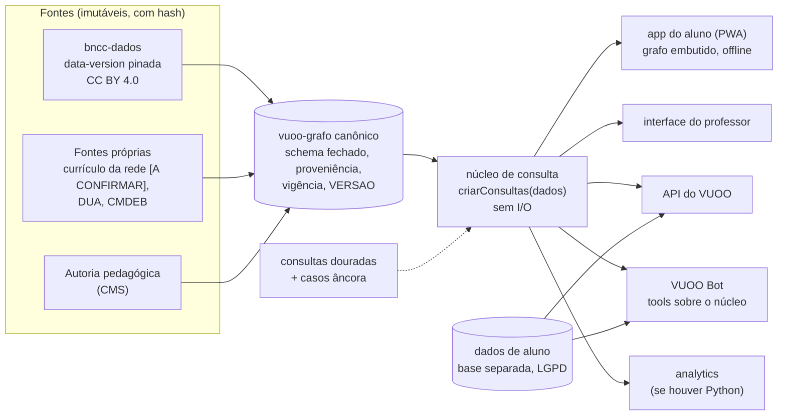

# Aplicação ao VUOO

> **Fonte:** análise nossa sobre os arquivos 01 a 07 desta pasta, que citam [bncc-dev/bncc-pacotes](https://github.com/bncc-dev/bncc-pacotes) (commit `e9b4985`). Contexto do VUOO: ../../produtos/vuoo/LEIAME.md, ../../produtos/vuoo/padroes/LEIAME.md e ../../projeto/vuoo.md (este último só como contexto: o produto é independente do projeto de pesquisa desde 2026-11-05). Escrito em 2026-11-04.
>
> **Inspirar, não copiar.** Nada aqui autoriza copiar código, documentação, descrições de tools, nomes ou marca do bncc-pacotes. Tudo o que for adotado é reescrito para o VUOO e entra como ADR próprio. Este arquivo é proposta para discussão: nada aqui é decisão até virar ADR aceito em `produtos/vuoo-microjogos/padroes/`.

## A pergunta de partida: fazer igual o quê?

O bncc-pacotes resolve "como entregar um dataset curricular verificado a apps, cientistas de dados e agentes de IA sem que as interfaces divirjam". O VUOO tem o mesmo problema em escala maior, porque o dado dele não é só a BNCC: é o grafo de conhecimento (habilidades, pré-requisitos, micro-atividades, adaptações por perfil), consumido pelo app do aluno, pela interface do professor, pelo CMS e pelo VUOO Bot.

Recomendação: separar as duas coisas.

1. **O dado da BNCC: consumir, não reextrair.** O dataset do bncc-dados é aberto (CC BY 4.0), verificado por registro e versionado com DOI. Refazer a extração gasta esforço sem ganho e cria uma segunda verdade sobre o mesmo documento normativo. O VUOO embute uma data-version pinada (pacote ou release), com atribuição, como **uma das fontes** do grafo. `[A CONFIRMAR]` com o time: dependência de um projeto mantido por empresa privada é aceitável? Mitigação: o dado é CC BY e arquivado no Zenodo, então um fork do dado é sempre possível.
2. **O dado próprio do VUOO: construir "igual" no método, não no conteúdo.** Para o que só o VUOO tem (grafo, micro-atividades, adaptações DUA, eventualmente o currículo da rede `[A CONFIRMAR]`, CMDEB em [../cmdeb/](../../../camada-brasil/cmdeb/README.md)), replicar a arquitetura: fonte imutável → canônico validado → núcleo injetável → cascas finas.

## Adotar, adaptar, recusar

| Mecanismo do bncc-pacotes | Veredito | No VUOO |
|---|---|---|
| Dado pinado com commit + SHA-256 + data-version (`VERSAO.json`) | **adotar** | todo artefato do VUOO (app, API, bot) declara a versão do grafo que embute; exposta em runtime e em header HTTP |
| Script de sincronização que recusa estado sujo | **adotar** | a cópia do canônico para os consumidores é sempre automática e reprodutível |
| Núcleo injetável, única superfície de consulta | **adotar (central)** | um pacote de consultas do grafo que recebe os dados por parâmetro; app PWA, API, CMS e VUOO Bot só injetam e delegam. Regra de ouro no CONTRIBUTING do VUOO |
| Cascas por runtime (disco, Workers, navegador) | **adotar** | permite o mesmo núcleo no app offline (navegador), no backend e no bot |
| Dados embutidos, zero rede | **adaptar** | serve para a parte **pública e curricular** do grafo (uso offline no app, previsto na proposta). Não serve para dado de aluno, que nunca é embutido |
| Zero dependências de runtime | **adaptar** | meta para o núcleo de consulta; o restante da plataforma segue política de dependências normal |
| API em português, convenção de cada linguagem | **adotar** | vocabulário pedagógico em pt-BR; coerente com `conhecimento/` |
| Erros que ensinam, nunca `null` | **adotar** | requisito de todas as tools do VUOO Bot e da API; o texto do erro é afirmação factual e se verifica como dado (incidente 5 em [07-licoes-e-incidentes.md](07-licoes-e-incidentes.md)) |
| Proveniência por registro (arquivo + localizador + página) | **adotar** | cada nó do grafo diz de onde veio; interpretação do projeto marcada separada do texto oficial (como a `nota` dos alinhamentos da EI) |
| Vigência por registro com data-version | **adotar** | prepara mudanças normativas (ex.: novos complementos) sem apagar histórico |
| Módulo opcional por documento (Computação) | **adotar** | complementos e currículos locais entram como módulos injetáveis, sem mudar o resultado padrão de quem não os pediu |
| Fixture dourada compartilhada entre linguagens | **adotar se houver duas linguagens** | se o VUOO tiver TS (app/API) e Python (analytics), o mesmo arquivo de consultas roda nos dois. Mesmo com uma linguagem, a fixture vira o teste de aceitação do grafo (casos âncora `C*`) |
| Busca léxica determinística e explicável (radical + BM25 + estratos) | **adaptar** | bom ponto de partida para o professor achar habilidades e atividades. Precisa de corpus próprio (enunciados + atividades) e de golden set medido, que o bncc-pacotes não tem |
| Ranking exportado para o navegador com a mesma ordem | **adotar** | busca no app offline igual à do servidor |
| Embeddings fora da busca principal | **adotar como princípio** | a proposta prevê pipeline semântico e Graph RAG; manter a camada semântica separada, rotulada como inferida, nunca substituindo o lookup verificado. Tensão a discutir no ADR |
| MCP com poucas tools, descrição como produto, instruções do servidor com regras anti-alucinação | **adotar** | o VUOO Bot consome o grafo por tools desenhadas para o agente; método de escrita da descrição em [04-mcp.md](04-mcp.md) |
| Listagens com `limite` + `total`, formato compacto | **adotar** | não inundar o contexto do bot |
| MCP remoto stateless, sem cadastro, sem chave | **adaptar com restrição** | só para a parte pública (currículo, catálogo de atividades). Tudo que toca aluno exige identidade por perfil, base separada e LGPD (ver `conhecimento/privacidade-seguranca-e-governanca/`) |
| Rate limit com 429 que aponta alternativa | **adotar** | |
| Monorepo pelo critério "o que compartilha o dado fica" | **adotar o critério** | o critério importa mais que o formato: separar o que envelhece em ritmos diferentes (grafo, núcleo, app, site) |
| `DECISOES.md` no formato Decisão / Por quê / Custo aceito | **já temos equivalente** | ADR-nn; vale incorporar "Custo aceito" e "O que fica de fora" ao modelo |
| AGENTS.md curto e imperativo | **adotar** | o VUOO é desenvolvido com agentes; regras que nunca se quebram + mapa do domínio em 30 segundos |
| Templates de issue que roteiam (erro de dado vai para o dono do dado) | **adotar** | separa erro de conteúdo pedagógico de bug de software |
| Gate da 1.0 ligado à revisão pedagógica | **adotar** | o VUOO não declara 1.0 do grafo sem revisão pedagógica e de acessibilidade registradas |
| Publicação só por humano com 2FA; agentes não publicam | **adotar** | |
| Commit "registra a publicação" com verificações e números | **adotar** | |
| Métricas de uso sem IP, histórico fora do repo | **adotar** | coerente com a política de privacidade do projeto |
| Código MIT + dados CC BY + marca não licenciada | **decidir** | licença do código e do grafo do VUOO depende do financiamento e da rede `[A CONFIRMAR]` |
| Copiar código, descrições de tools, textos | **recusar** | aviso no topo |
| Usar o nome ou a marca bncc.dev | **recusar** | marca não licenciada |
| Camadas de terceiros CC BY-NC | **recusar** (como eles) | incompatível se o VUOO tiver qualquer uso comercial |

## Arquitetura proposta para o VUOO (esboço)

Princípio de leitura do diagrama: o grafo curricular e o dado de aluno **nunca** passam pelo mesmo caminho de distribuição. O primeiro é embutível, versionado e público ou semipúblico; o segundo vive só no backend, com identidade e auditoria.

## Candidatos a ADR

Não escritos agora (plano de 29/10/2026: ADRs só depois da base de conhecimento). Ficam registrados como candidatos, com o arquivo desta pasta que os embasa:

| Candidato | Embasamento |
|---|---|
| Consumir o dataset BNCC publicado em vez de reextrair | este arquivo; [../bncc-dados/](../bncc-dados/README.md) |
| Núcleo de consulta injetável como única superfície | [01-arquitetura.md](01-arquitetura.md) |
| Versão do grafo pinada e exposta em todo artefato | [06-operacao-e-governanca.md](06-operacao-e-governanca.md) |
| Consultas douradas como contrato e teste de aceitação | [05-qualidade-e-paridade.md](05-qualidade-e-paridade.md) |
| Busca léxica determinística primeiro; semântica como camada rotulada | [03-busca.md](03-busca.md) |
| Desenho das tools do VUOO Bot (poucas, descritas como produto, erros que ensinam) | [04-mcp.md](04-mcp.md) |
| Separação entre distribuição do grafo e dado de aluno | este arquivo |
| AGENTS.md e regras para agentes no repositório do VUOO | [06-operacao-e-governanca.md](06-operacao-e-governanca.md) |

Ids de conhecimento relacionados: `kg.curr.bncc`, `iop.comp.case`, `kg.std.skos` (em `conhecimento/grafo-conhecimento-educacional/`).

## Perguntas em aberto para o time

1. Aceitamos o bncc-dados como fonte da BNCC (com pin e atribuição), ou a rede/financiador exige extração própria?
2. Quais currículos além da BNCC entram como módulos (Currículo Paulista? materiais da rede?) e com que licença?
3. O VUOO terá Python (analytics) consumindo o grafo? Se sim, a paridade por fixture entra desde o início.
4. O grafo do VUOO (ou parte dele) será aberto? Isso decide licença de dados, MCP público e site.
5. A busca semântica prevista na proposta (Graph RAG) convive com a léxica como camada separada, ou a substitui? A recomendação daqui é conviver.
